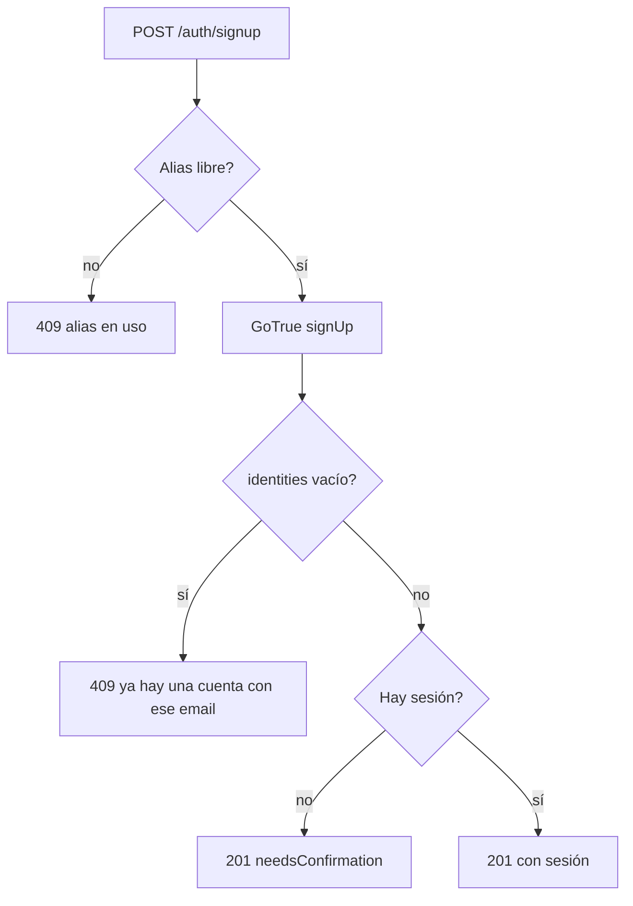

# Avisar que el email ya tiene cuenta al registrarse: documentación

## Qué hace

Si alguien se registra con un email que ya tiene una cuenta confirmada, la web le dice "Ya hay una cuenta con ese email." en el campo del email, en vez de pedirle que confirme el correo.

Antes no pasaba porque, con la confirmación del correo encendida (desde el 2026-11-04), GoTrue no da error en ese caso. Devuelve un usuario falso, sin sesión y con `identities` vacío, para que no se pueda averiguar qué emails están registrados. La API veía "sin sesión" y respondía `needsConfirmation: true`. Lo reportó Daniel el 2026-11-04 con la cuenta de "vanz".

## Reglas

| Caso | Qué responde `POST /auth/signup` | Qué ve el usuario |
|---|---|---|
| Email nuevo | `201`, `needsConfirmation: true` | "Revisa tu correo" |
| Email con cuenta confirmada | `409 CONFLICT`, detalle en `email` | "Ya hay una cuenta con ese email." en el campo del email |
| Email con cuenta sin confirmar | `201`, `needsConfirmation: true` (GoTrue le reenvía el correo) | "Revisa tu correo" |
| `identities` no viene en la respuesta | Como antes | Como antes |

- Con esto se puede averiguar si un email está registrado. Daniel lo aceptó, y el registro tiene límite por IP (`RATE_RULES.auth`).
- La web no cambió: `RegisterFlow` ya mostraba el `409` en el campo del email y volvía al paso 1.

## Qué cambia para cada rol

| Rol | Qué cambia | Página del manual |
|---|---|---|
| Jugador | Al registrarse con un email que ya tiene cuenta, la web lo avisa | [`jugador/crear-cuenta.md`](../../manual/jugador/crear-cuenta.md) |

## Términos y privacidad

Sin cambios: no se guarda ni se publica nada nuevo.

## Dónde está cada cosa

| Qué | Archivo |
|---|---|
| La comprobación de `identities` | `web/backend/src/routes/auth.ts` (ruta `signup`) |
| Pruebas (cuenta confirmada y sin confirmar) | `web/backend/test/unit/auth-routes.test.ts` |
| El aviso en la web (sin cambios) | `web/frontend/src/features/auth/pages/RegisterFlow.tsx` |
