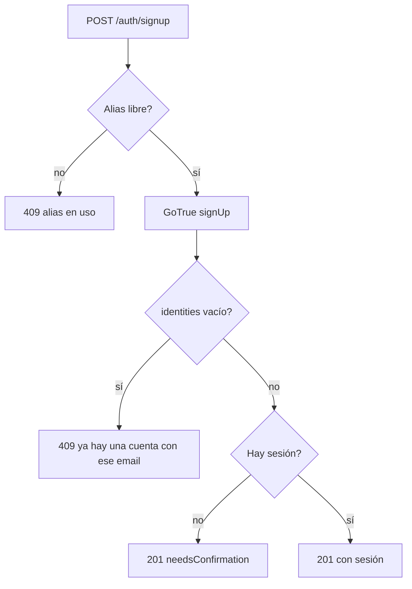

# Plan: avisar que el email ya tiene cuenta al registrarse

> Planeación original. Estado: **aprobado** (pedido por Daniel el 2026-11-04).

## Qué pasa

Un usuario ("vanz") intentó registrarse con un email que ya tenía cuenta. Daniel lo probó: la web le pidió confirmar el correo, como si la cuenta fuera nueva. Debería decir que ya hay una cuenta con ese email.

Desde el 2026-11-04 la confirmación del correo está encendida en el GoTrue del VPS ([`2026-11-03-admin-cuentas-usuarios`](../2026-11-03-admin-cuentas-usuarios/)). Con la confirmación encendida, GoTrue no da error si el email ya tiene una cuenta confirmada: devuelve un usuario falso, sin sesión y con `identities` vacío, para que no se pueda averiguar qué emails están registrados. `POST /auth/signup` ve "sin sesión" y responde `needsConfirmation: true`.

## Decisiones tomadas

| Tema | Decisión |
|---|---|
| Cómo se detecta | Si `signUp` devuelve un usuario con `identities` como lista vacía, el email ya tiene una cuenta confirmada: `409 CONFLICT` "Ya hay una cuenta con ese email." con el detalle en `email`. Si `identities` no viene, se sigue como hasta ahora. |
| Cuenta sin confirmar | No cambia: GoTrue reenvía el correo y devuelve el usuario real (con `identities`), así que la web sigue pidiendo que confirme el correo. Es lo correcto. |
| Averiguar emails registrados | Lo acepta Daniel: es lo que pidió. El registro ya tiene límite por IP (`RATE_RULES.auth`). |
| Web | Sin cambios: `RegisterFlow` ya muestra el `409` en el campo del email. |

## 1. El flujo

## 2. API

`web/backend/src/routes/auth.ts`, ruta `signup`: después de `signUp`, la comprobación de `identities`. Una prueba en `test/unit/auth-routes.test.ts`.

## 3. Manual, términos y privacidad

- Manual: `jugador/crear-cuenta.md`, una línea sobre el aviso.
- Términos y privacidad: sin cambios (no se guarda ni publica nada nuevo).

## 4. Orden de implementación

1. El cambio en la API y su prueba.
2. Las pruebas del backend.
3. Documentación, guía, manual y fila en el README.
4. Desplegar la API (cuando Daniel lo pida).
