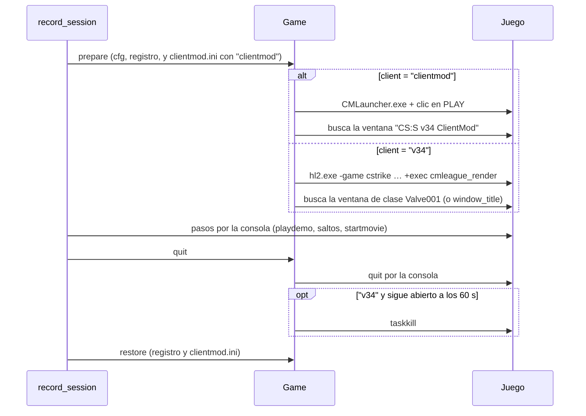

# Grabar los clips con el CS:S v34 normal: documentación

## Qué hace

La grabación de los clips (`render/render_clip.py`, que usa `render/procesar.py`) puede abrir dos clientes distintos. Se elige en `render/config.json`, que es propio de cada máquina, con la clave `client`:

- `"clientmod"` (por defecto, como hasta ahora): ClientMod. Abre `CMLauncher.exe`, pone los parámetros en `clientmod.ini` y hace clic en PLAY.
- `"v34"`: el CS:S v34 normal (en el portátil, eXpandedCS). Abre `hl2.exe` directo, con los parámetros en la línea de comandos. No hay launcher, clic ni `clientmod.ini`.

Todo lo que pasa una vez abierto el juego es igual en los dos: el cfg `cmleague_render.cfg`, los pasos por la consola, los saltos, `startmovie`, FFmpeg y las subidas.

## Por qué

Daniel sospecha que el launcher de ClientMod hace fallar a veces la grabación. Es la parte más frágil:

- el clic en PLAY se hace en una posición fija y se reintenta (en la PC hicieron falta dos o tres clics por sesión);
- el proceso de ClientMod está protegido: no se puede matar, y si se cuelga, la corrida siguiente falla;
- `clientmod.ini` se modifica y se restaura en cada pasada.

## Claves de `config.json`

| Clave | Con `"clientmod"` | Con `"v34"` |
|---|---|---|
| `client` | `"clientmod"` (o ausente) | `"v34"` |
| `client_dir` | Carpeta con `CMLauncher.exe` y `clientmod.ini` | Carpeta con `hl2.exe` |
| `launch_params` | Extra que van a `Params=` de `clientmod.ini` | Extra de la línea de comandos. En el portátil, los del acceso directo: `-steam -appid 240 -32bpp -noipx -nojoy` |
| `registry_key` | Obligatoria: si no se puede respaldar, la corrida falla | Si no existe, avisa en el log y sigue |
| `window_title` | No se usa | Opcional: el título de la ventana, si no se encuentra por la clase `Valve001` |

Los parámetros fijos son `-novid -windowed -noborder -w <width> -h <height>` y `+exec cmleague_render` al final. Con `"v34"` se agrega `-game cstrike` al principio.

## Detalles

- **Administrador:** el script se sigue elevando en los dos modos (la tarea corre con privilegios más altos). Con el juego elevado, Windows deja escribir en `C:\Program Files (x86)` sin desviarlo a `VirtualStore`, así que los cuadros, el log y las demos quedan donde el script los busca.
- **Mapas:** con `"v34"` van en `cstrike/maps/` (con sus `materials`, `models` y `sound` dentro de `cstrike/`). `cstrike_downloads/` es de ClientMod.
- **Un `client` inválido** hace fallar la corrida con el mensaje `config.json: "client" tiene que ser uno de ('clientmod', 'v34')`.
- **El juego ya abierto** al empezar se cierra con `quit` (y con `taskkill` en `"v34"`). Si no se cierra, la corrida falla con "el juego (`<exe>`) ya está abierto".

## Qué cambia para cada rol

Nada para los usuarios: es la máquina que graba los clips.

## Términos y privacidad

Sin cambios: no cambia lo que se graba ni dónde se guarda.

## Dónde está cada cosa

| Qué | Archivo / ubicación |
|---|---|
| Elección del cliente, apertura y cierre del juego | `render/render_clip.py` (clase `Game`) |
| Clave `client` de ejemplo | `render/config.example.json` |
| Cómo configurar el portátil con el v34 normal | `render/CONFIGURAR_PORTATIL.md`, paso 3b |
| El CS:S v34 normal en el portátil | `C:\Program Files (x86)\CSS v34 eXpandedCS` |
