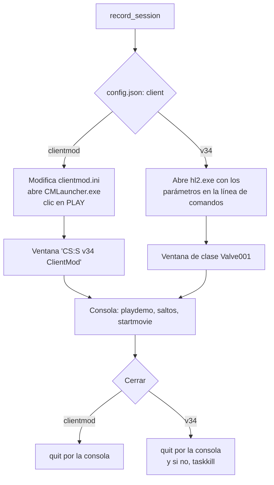

# Plan: grabar los clips con el CS:S v34 normal, sin el launcher de ClientMod

> Planeación original. Estado: **aprobado** por Daniel el 2026-11-04 ("dale, hazlo con config.json").

Daniel sospecha que el launcher de ClientMod (`CMLauncher.exe`) es lo que hace fallar a veces la grabación automática de los clips. Instaló en el portátil un CS:S v34 normal (eXpandedCS, en `C:\Program Files (x86)\CSS v34 eXpandedCS`), que se abre directo con `hl2.exe`. La propuesta es poder elegir, por máquina, con qué cliente se graba.

## Decisiones tomadas

| Tema | Decisión | Por qué |
|---|---|---|
| Dónde se elige el cliente | Una clave nueva `client` en `render/config.json`: `"clientmod"` (por defecto) o `"v34"` | `config.json` ya es por máquina (no se versiona) y ahí están `client_dir`, `launch_params` y `registry_key`, que cambian junto con el cliente. Una variable de entorno sola dejaría esas tres claves sin cambiar |
| Valor por defecto | `"clientmod"` | La PC de Daniel sigue igual, sin tocar su `config.json` |
| Abrir el juego con `"v34"` | `hl2.exe` de `client_dir` con `-game cstrike -novid -windowed -noborder -w … -h …`, los `launch_params` y `+exec cmleague_render` en la línea de comandos | Sin launcher no hay clic en PLAY a ciegas ni `clientmod.ini` que modificar y restaurar |
| Encontrar la ventana con `"v34"` | Por la clase de ventana del motor Source (`Valve001`), con la opción `window_title` en `config.json` por si hace falta | No sabemos el título exacto de la ventana de eXpandedCS; la clase es la misma en todos los juegos de Source |
| Cerrar el juego con `"v34"` | `quit` por la consola, como ahora; si no cierra en 60 s, `taskkill` del proceso de la ventana | `hl2.exe` no es un proceso protegido como el de ClientMod, así que sí se puede matar |
| Administrador | Se mantiene la elevación con UAC en los dos modos | La tarea programada ya corre con privilegios más altos, y un proceso elevado puede mandarle teclas a uno que no lo está. Además, con el juego elevado, Windows no desvía a `VirtualStore` lo que se escribe en `C:\Program Files (x86)` |
| Registro | Igual que ahora con `registry_key`; si la clave no existe, se avisa en el log y se sigue | Con `"v34"` la resolución va en la línea de comandos (`-w`/`-h`): la clave es solo para dejarla como estaba |

## 1. El flujo completo

Todo lo que pasa dentro del juego (consola, pasos, saltos, `startmovie`, FFmpeg) es igual en los dos modos.

## 2. Cambios en `render/render_clip.py`

- `Game` lee `cfg.get("client", "clientmod")` y valida que sea uno de los dos valores.
- `prepare`/`restore`: el `clientmod.ini` solo se toca con `"clientmod"`. El respaldo del registro no falla si la clave no existe.
- `running`: `CMLauncher.exe` o `hl2.exe` según el modo.
- `launch`: el camino actual para `"clientmod"`; para `"v34"`, `subprocess.Popen` de `hl2.exe` con los parámetros y espera de la ventana.
- `quit`: con `"v34"`, `taskkill` como último recurso.
- `record_session`: busca la ventana del juego abierto con el método del modo, y el mensaje de error deja de nombrar a ClientMod.

## 3. Configuración y guía

- `render/config.example.json`: la clave `client` y `window_title` opcional.
- `render/CONFIGURAR_PORTATIL.md`: cómo usar el CS:S v34 normal (abrirlo una vez a mano, encontrar la clave del registro, copiar los mapas a `cstrike/`, `launch_params` del acceso directo).

## 4. Requisitos antes de empezar

Ninguno para el código. Para probarlo hace falta el portátil (Daniel): en la PC no hay un v34 normal instalado (la carpeta de ClientMod no tiene `hl2.exe`).

## 5. Orden de implementación

1. Código en `render_clip.py` y `config.example.json`.
2. Comprobar que compila y que el modo `"clientmod"` arma lo mismo que antes.
3. Guía del portátil.
4. `DOCUMENTACION.md`, `GUIA_IMPLEMENTACION.md`, fila en `bitacora/README.md` y punto en `PENDIENTES.md`.
5. Prueba en el portátil con `"client": "v34"` (Daniel).
