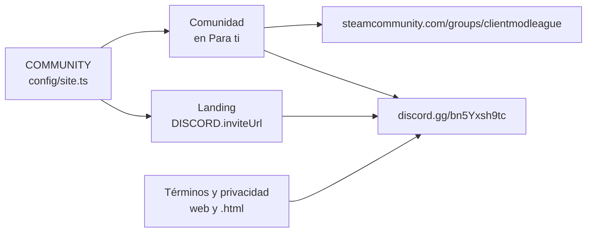

# Tarjeta "Comunidad" en Para ti: documentación

## Qué hace

"Para ti" (`/home`) tiene al final del costado una tarjeta **Comunidad** con dos filas: **Discord** y **Grupo de Steam**. Cada una abre su link en otra pestaña. En el celular queda al final de la página.

La tarjeta no pide datos: se ve siempre, para todos, sin skeleton ni estado vacío.

Además, toda la web lleva ahora al mismo Discord: la landing, los términos y la privacidad dejaron `dsc.gg/v34frag` por `discord.gg/bn5Yxsh9tc`.

## La tarjeta

| Fila | Texto | Link |
|---|---|---|
| Discord | Avisos, buscar equipo y soporte | `https://discord.gg/bn5Yxsh9tc` |
| Grupo de Steam | ClientMod League en Steam | `https://steamcommunity.com/groups/clientmodleague` |

- Cada fila lleva el ícono de la marca (`BrandTile`) y un ícono de link externo.
- `target="_blank"` con `rel="noopener noreferrer"`. Para lectores de pantalla, el link dice "(abre en otra pestaña)".

## Qué cambia para cada rol

| Rol | Qué cambia | Página del manual |
|---|---|---|
| Jugador, capitán, organizador, moderador, admin y streamer | Ven la tarjeta Comunidad en "Para ti" | [Para ti](../../manual/jugador/para-ti.md) |
| Visitante (sin sesión) | El botón de Discord de la landing lleva al link nuevo | — |

## Términos y privacidad

El canal de soporte por Discord de `/terminos` (Contacto) y de `/privacidad` pasa a `discord.gg/bn5Yxsh9tc`, en la web y en `terms/terminos.html` y `terms/privacidad.html`, con la fecha de actualización al 5 de noviembre de 2026. No cambia nada más: son links y no se comparte ningún dato con Discord ni con Steam.

## Dónde está cada cosa

| Qué | Archivo |
|---|---|
| Tarjeta | `CommunityCard` en `web/frontend/src/features/home/components/SideCards.tsx` |
| Prueba | `web/frontend/src/features/home/components/CommunityCard.test.tsx` |
| Dónde se monta | `web/frontend/src/features/home/pages/HomePage.tsx` |
| Links | `COMMUNITY` en `web/frontend/src/config/site.ts` |
| Legales | `web/frontend/src/features/legal/pages/TermsPage.tsx`, `PrivacyPage.tsx`, `lib/meta.ts`; `terms/*.html` |
| Manual | `docs/manual/jugador/para-ti.md` |
