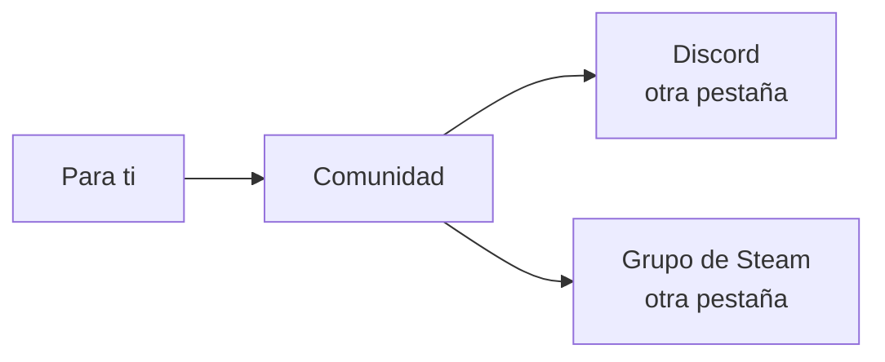

# Plan: tarjeta "Comunidad" en Para ti

> Planeación original. Estado: **aprobado** por Daniel el 2026-11-05 sobre el [artifact](https://claude.ai/artifact/RopftvCWw2VY22afQhiThZ) ("Sí, lo apruebo"), con el cambio del link de Discord en toda la web y los textos propuestos.

Daniel pidió una tarjeta chica de "Comunidad" en "Para ti" (`/home`) con el link del Discord (`https://discord.gg/bn5Yxsh9tc`) y del grupo de Steam (`https://steamcommunity.com/groups/clientmodleague`).

## Decisiones tomadas

| Tema | Decisión | Por qué |
|---|---|---|
| Dónde va | Al final del costado, debajo de Top jugadores | Es información fija: no compite con pendientes, jugar ni en vivo |
| En el celular | Al final de la página, como el resto del costado | El costado se apila debajo de la columna principal |
| Estilo | El de las otras tarjetas (`Box`), con `BrandTile` de Discord y Steam | No suma componentes ni dependencias |
| Visible | Siempre y para todos los roles | No depende de datos |
| Links | `COMMUNITY` en `src/config/site.ts` | Un solo lugar para cambiarlos |
| Textos | "Avisos, buscar equipo y soporte" y "ClientMod League en Steam" | Aprobados como estaban |
| Discord del resto de la web | `dsc.gg/v34frag` pasa a `discord.gg/bn5Yxsh9tc` en la landing, los términos y la privacidad (web y `.html`) | Que toda la web lleve al mismo lugar |

## 1. El flujo

## 2. En la web

- `CommunityCard` en `features/home/components/SideCards.tsx`, montada al final del `aside` de `HomePage`.
- `COMMUNITY` en `config/site.ts`; `DISCORD.inviteUrl` de la landing toma `COMMUNITY.discordUrl`.
- `TermsPage` y `PrivacyPage`: el link del Discord; `LEGAL_UPDATED` al 2026-11-05.
- Una prueba de la tarjeta.

## 3. Manual, términos y changelog

- `docs/manual/jugador/para-ti.md`: un párrafo en "Al costado".
- `terms/terminos.html` y `terms/privacidad.html`: el mismo link y la fecha.
- `CHANGELOG_DISCORD.txt` 2.9.15.

## 4. Orden

1. Tarjeta, links y prueba.
2. Typecheck, lint y la suite completa.
3. Bitácora y manual.
4. Commit en `main` y despliegue de la web, junto con el globo de ELO del perfil ([`2026-11-05-tooltip-elo-perfil`](../2026-11-05-tooltip-elo-perfil/)).
