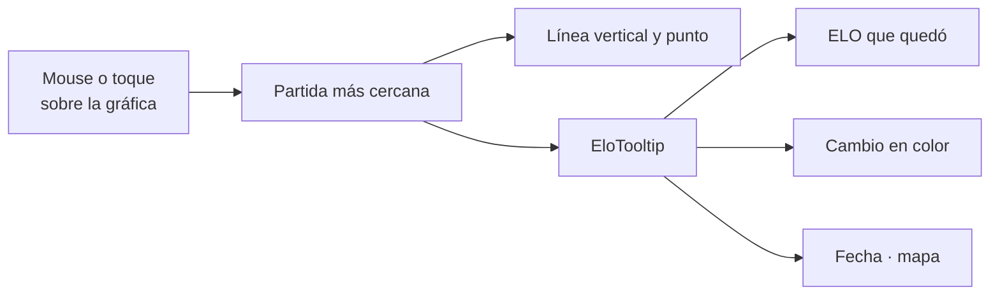

# El tooltip de ELO en el perfil: documentación

## Qué hace

Las dos gráficas de ELO de la web muestran el mismo globo al pasar el mouse o tocar una partida:

- la de **Tu nivel** en "Para ti" (`/home`);
- la de **Evolución de ELO** en el Resumen del perfil (`/players/{nick}`), que se ve desde **Mi perfil** › **Ver perfil público** y en el perfil de cualquier jugador.

El globo dice el ELO con el que quedó el jugador, el cambio de esa partida (verde si sumó, rojo si restó), la fecha y el mapa. Antes, el perfil solo escribía "ELO · mapa · fecha" en gris al lado del título, sin el cambio, y en el celular había que arrastrar el dedo para que apareciera.

## El globo

| Parte | Dato de `EloPoint` | Detalle |
|---|---|---|
| ELO | `elo_after` | En negrita |
| Cambio | `elo_delta` | Con signo; verde (`text-win`) desde 0, rojo (`text-destructive`) si es negativo. Sin dato, `+0` |
| Fecha y mapa | `at` y `map` | `d MMM` en español ("3 nov"), separados por " · "; lo que falte no se muestra |

- Va encima de la gráfica, alineado con la partida. En el primer y el último 20 % se corre hacia adentro para no salirse de la tarjeta.
- No captura el puntero (`pointer-events-none`), así que no corta el movimiento sobre la gráfica.
- Se va al sacar el mouse de la gráfica.

## Cambios en el perfil

- La gráfica del perfil responde también al toque (`pointerdown`), no solo al arrastre.
- El texto gris al lado de "Evolución de ELO" se quitó: el globo dice lo mismo y además el cambio.
- La línea punteada del piso del nivel y el selector de 10, 20 o 30 partidas siguen igual.

## Qué cambia para cada rol

| Rol | Qué cambia | Página del manual |
|---|---|---|
| Jugador | En Evolución de ELO del perfil ve el globo con el ELO, el cambio, la fecha y el mapa de cada partida, también en el celular | [Tu ELO, nivel y estadísticas](../../manual/jugador/elo-y-estadisticas.md) |
| Capitán, organizador, moderador, admin y streamer | Lo mismo que un jugador, al mirar cualquier perfil | — |

## Términos y privacidad

Sin cambios: el globo muestra datos que el perfil ya publicaba (el historial de ELO de la pestaña Partidas).

## Dónde está cada cosa

| Qué | Archivo |
|---|---|
| El globo | `web/frontend/src/components/brand/EloTooltip.tsx` |
| Pruebas | `web/frontend/src/components/brand/EloTooltip.test.tsx` |
| Gráfica de "Para ti" | `web/frontend/src/features/home/components/EloChart.tsx` |
| Gráfica del perfil | `web/frontend/src/features/player/components/EloChart.tsx` |
| Tarjeta Evolución de ELO | `EloCard` en `web/frontend/src/features/player/pages/PlayerProfile.tsx` |
| Manual | `docs/manual/jugador/elo-y-estadisticas.md` |
