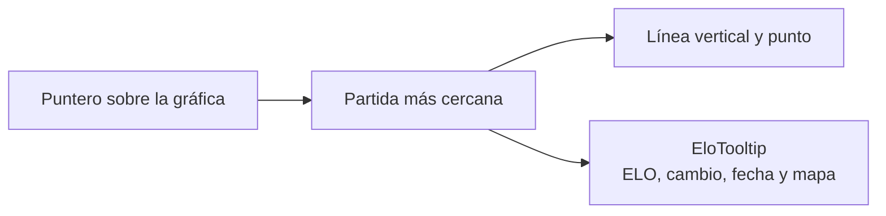

# Plan: el tooltip de ELO de "Para ti" en el perfil

> Planeación original. Estado: **aprobado** por Daniel el 2026-11-05 ("el tooltip que está en Para ti en la gráfica de ELO también debería existir en Mi Perfil › Evolución de ELO").

Hoy la gráfica de "Para ti" (`/home`) muestra, al pasar el mouse o tocar, un globo con el ELO que quedó, el cambio de esa partida en color, la fecha y el mapa. La de **Evolución de ELO** del perfil solo marca el punto y escribe "ELO · mapa · fecha" en gris a la derecha del título, sin el cambio.

## Decisiones tomadas

| Tema | Decisión | Por qué |
|---|---|---|
| Componente | `EloTooltip` compartido en `src/components/brand/`, usado por las dos gráficas | Que se vean igual y que un cambio futuro sirva para las dos |
| Texto gris junto al título | Se quita | El globo dice lo mismo y además el cambio; mostrarlo dos veces es ruido |
| Tocar en el celular | La gráfica del perfil también responde a `pointerdown`, como la de "Para ti" | Hoy en el celular solo responde al arrastrar |
| Posición del globo | Encima de la gráfica, siguiendo al punto, corrido hacia adentro en los bordes | Igual que en "Para ti" |
| API, base y servidores | Sin cambios | `EloPoint` ya trae `elo_delta`, `at` y `map` |

## 1. El flujo

## 2. En la web

- `src/components/brand/EloTooltip.tsx` (nuevo): el globo que hoy está escrito dentro de `features/home/components/EloChart.tsx`.
- `features/home/components/EloChart.tsx`: usa `EloTooltip`. Se ve igual que hoy.
- `features/player/components/EloChart.tsx`: usa `EloTooltip`, suma `onPointerDown` y deja de recibir `onHover`.
- `features/player/pages/PlayerProfile.tsx`: `EloCard` deja de guardar y mostrar el texto gris.
- Una prueba de `EloTooltip` (ELO, cambio con signo, fecha y mapa).

## 3. Manual, términos y changelog

- `docs/manual/jugador/elo-y-estadisticas.md`: una línea sobre la gráfica del Resumen.
- Términos y privacidad: sin cambios (se muestran datos que ya se veían).
- `CHANGELOG_DISCORD.txt` en esta carpeta.

## 4. Requisitos

Ninguno.

## 5. Orden

1. `EloTooltip` y su prueba.
2. Las dos gráficas y `PlayerProfile`.
3. Typecheck, lint y pruebas.
4. Manual, documentación, guía y fila en el índice.
5. Desplegar la web desde `main` cuando Daniel lo pida.
