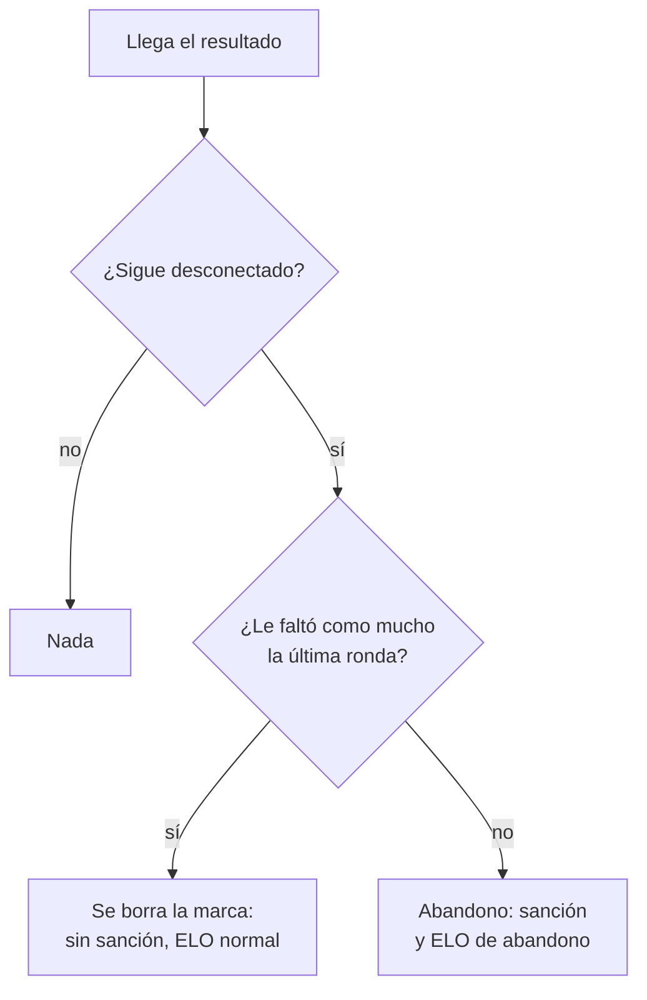

# Irse en la última ronda no es abandono: documentación

## Qué hace

En el matchmaking, quien seguía desconectado cuando terminaba la partida quedaba como **abandono**, aunque se hubiera ido en la última ronda o en el marcador final, antes de que se guardara el resultado. Eso traía una sanción (la escalera de esperas) y el ELO de abandono (derrota completa y un extra, aunque su equipo ganara; su equipo y el rival también se ajustaban). En producción, los dos únicos abandonos registrados hasta el 2026-11-04 fueron así.

Desde el replanteo `77`, si a esa persona le faltó como mucho la última ronda, solo se le borra la marca de desconectado: no hay sanción y el ELO de todos se calcula normal, con el ajuste por participación de siempre. El abandono a mitad de partida no cambia.

## La regla

- **Le faltó como mucho la última ronda:** sus rondas en el juego (`match_player_stats.rounds`, que manda el reporter) son al menos el total de rondas menos una. El total es el mismo que usa el ELO de abandono: el mayor entre el marcador y las rondas del que más jugó.
- Entra quien se fue durante la última ronda (le falta esa) y quien se fue en el marcador final (las jugó todas).
- Sale de datos guardados: un recálculo del ELO da lo mismo.

## Base

| Objeto | Qué es |
|---|---|
| `mm_left_last_round(p_game, p_player)` | `true` si al jugador le faltó como mucho la última ronda de ese juego. Solo `service_role` y las funciones internas |
| `csstv_link_game` | El bucle "irse al final no sale gratis" deja afuera a quien cumple `mm_left_last_round`; a esos solo se les borra `left_at` |

`mm_elo_abandoned` y `mm_elo_delta` no cambian: como esas personas ya no quedan marcadas, los tratan como a cualquiera.

## Lo que no cubre

- **Resultado que llega tarde:** si alguien se va al empezar la última ronda y el resultado tarda más de los minutos para volver (`reconnect_minutes`, 3), `mm_tick` lo marca como abandono antes de que llegue. Una ronda dura menos, así que es raro.
- **Casos anteriores:** mew y musul (2026-11-04) quedan como están, por decisión de Daniel.

## Qué cambia para cada rol

| Rol | Qué cambia | Página del manual |
|---|---|---|
| Jugador | Irse en la última ronda, o cuando ya terminó la partida, no cuenta como abandono: sin sanción y con el ELO normal | [`jugador/buscar-partida.md`](../../manual/jugador/buscar-partida.md), [`jugador/elo-y-estadisticas.md`](../../manual/jugador/elo-y-estadisticas.md) |
| Capitán, organizador, moderador, admin, streamer y dueño de un servidor externo | Nada | — |

## Términos y privacidad

`/terminos`, sección 7 (Moderación y baneos): el punto del abandono en el matchmaking suma que irse en la última ronda, o cuando ya terminó la partida, no cuenta como abandono. Cambiados la página (`TermsPage.tsx`) y `terms/terminos.html`. `/privacidad`: sin cambios.

## Dónde está cada cosa

| Qué | Archivo |
|---|---|
| Base | `supabase/replanteo/77_mm_abandono_ultima_ronda.sql` |
| Inversa | `docs/bitacora/2026-10-14-replanteo-modelo-datos/reversas/77_mm_abandono_ultima_ronda.sql` |
| Pruebas | `pruebas/prueba_77.sql` y `pruebas/probar_77.sh` |
| Manual y términos | `docs/manual/jugador/buscar-partida.md`, `elo-y-estadisticas.md`, `web/frontend/src/features/legal/pages/TermsPage.tsx`, `terms/terminos.html` |
