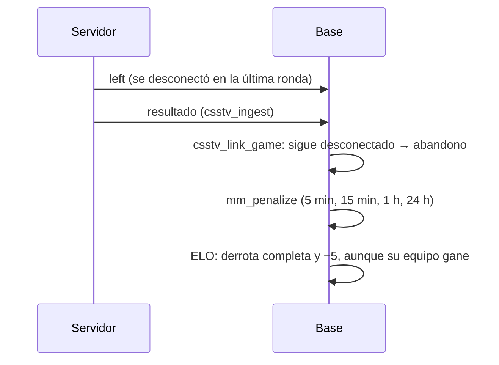
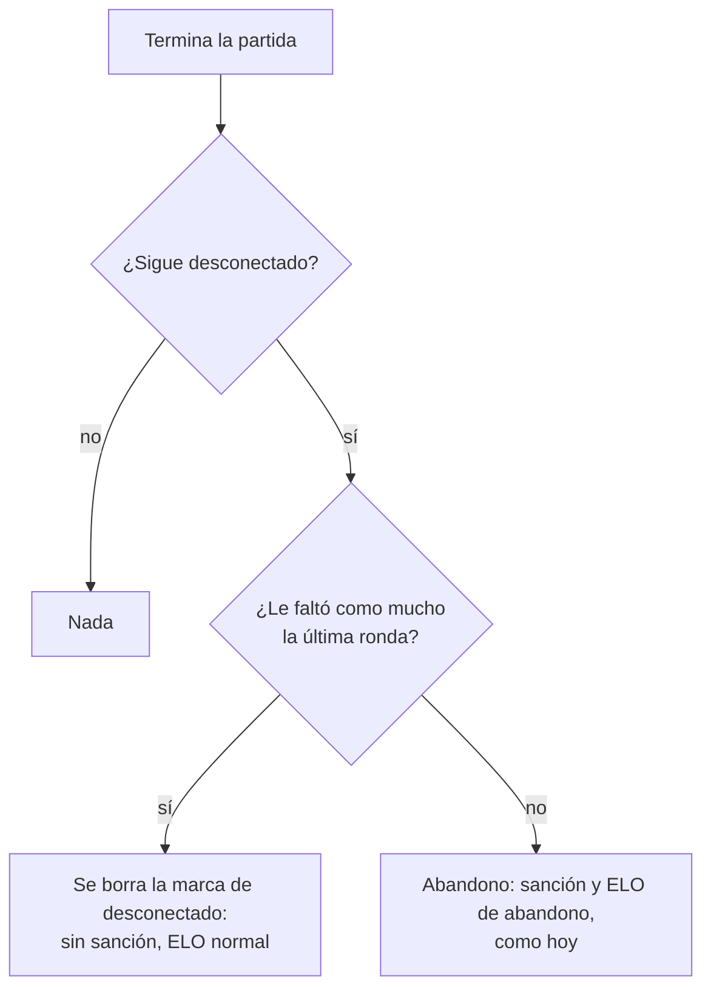

# Plan: irse en la última ronda no es abandono

> Planeación original. Estado: **aprobado** por Daniel el 2026-11-06 ("si alguien abandona en la última ronda no debería banearlo, y tampoco debería penalizarlo en el ELO"; eligió "le faltó solo la última" y no corregir los casos viejos).

## Decisiones tomadas

| Tema | Decisión | Por qué |
|---|---|---|
| Qué cuenta como "última ronda" | Le faltó como mucho una ronda: jugó todas menos la última, o todas (se fue en el marcador final, antes de que se guarde el resultado) | Daniel. Sale de las rondas de cada jugador que manda el reporter (`match_player_stats.rounds`): es exacto y un recálculo del ELO da lo mismo |
| Qué pasa con esa persona | No queda marcada como abandono: sin sanción y con su ELO normal (con el ajuste por participación, como cualquiera) | Daniel |
| Su equipo y el rival | ELO normal: sin el ajuste por un abandono | Se sigue de lo anterior: no hubo abandono |
| Abandono a mitad de partida | Igual que hoy (3 minutos para volver, sanción, ELO de abandono y 2 abandonos = derrota) | No se pidió cambiarlo |
| Casos viejos (mew y musul, 2026-11-04) | Quedan como están | Daniel |
| Número | Replanteo `77` (la `75` y la `76` ya existen) | |
| Ramas | `feat/frontend-fase-1` y `feat/mm-claim-en-sala` | `CLAUDE.md`: los cambios del matchmaking en la base van en las dos |

## 1. Qué pasa hoy

En producción, los 2 únicos abandonos registrados (mew, 18 de 19 rondas, y musul, 22 de 23) son este caso.

## 2. El cambio

## 3. Base (replanteo `77_mm_abandono_ultima_ronda.sql`)

- `mm_left_last_round(p_game, p_player)`: `true` si las rondas del jugador en ese juego son al menos el total de rondas menos una. El total es el mismo que usa `mm_elo_delta`: el mayor entre el marcador y las rondas del que más jugó.
- `csstv_link_game`: el bucle "irse al final no sale gratis" deja afuera a quien cumple `mm_left_last_round`; a esos solo se les borra `left_at`.
- Inversa en `docs/bitacora/2026-10-14-replanteo-modelo-datos/reversas/77_mm_abandono_ultima_ronda.sql`.
- No se toca el ELO: como no quedan marcados, `mm_elo_abandoned` y `mm_elo_delta` ya los tratan como a cualquiera.

## 4. Lo que queda afuera

- **Si el resultado llega tarde:** si alguien se va al empezar la última ronda y el resultado llega más de 3 minutos después (`reconnect_minutes`), `mm_tick` lo marca como abandono antes. Es raro (una ronda dura menos) y se anota en la guía; no se cambia ahora.
- El plugin no cambia.

## 5. Documentación

- Manual: `jugador/buscar-partida.md` y `jugador/elo-y-estadisticas.md`.
- Términos (sección 7, abandono en el matchmaking): `terms/terminos.html` y `TermsPage.tsx` dicen que irse en la última ronda no cuenta como abandono. Privacidad: sin cambios.
- `CHANGELOG_DISCORD.txt`, fila en el índice, `supabase/replanteo/README.md` y `PENDIENTES.md`.

## 6. Requisitos antes de empezar

- Supabase local con la copia de producción (tiene la `75` y la `76`).

## 7. Orden de implementación

1. Replanteo `77`, su inversa y las pruebas (`probar_77.sh`, con la inversa dentro de una transacción que se deshace).
2. Manual, términos, changelog e índices.
3. Commit en `feat/frontend-fase-1` y llevarlo a `feat/mm-claim-en-sala`, solo si Daniel lo pide.
4. Despliegue en la base del VPS, solo si Daniel lo pide.
