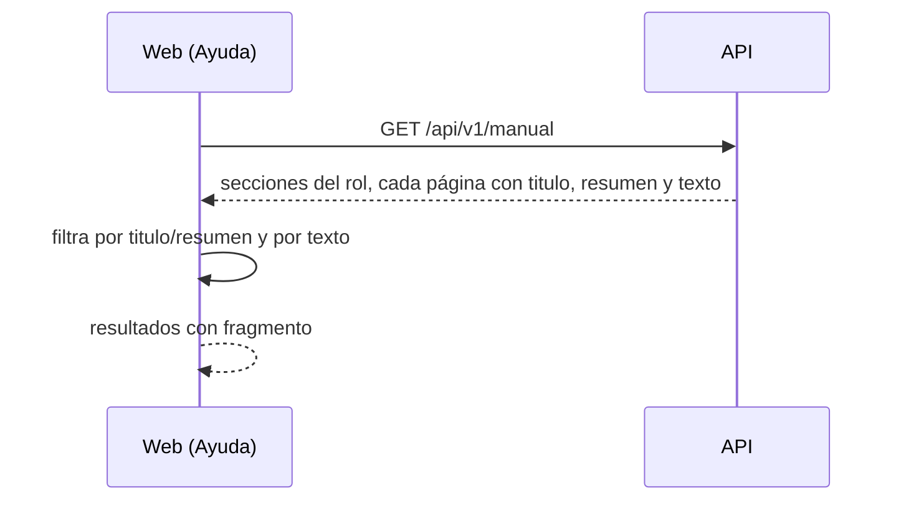

# Plan: buscar en el texto de la ayuda y una página con los comandos del jugador

> Planeación original. Estado: **aprobado** por Daniel en el pedido (2026-11-06).

Daniel no encontraba `!pause` ni `!calladmin` en **Ayuda**: están dentro de "Jugar en el servidor", que no dice "comandos" en el título, y el buscador solo mira el título y el resumen de cada página (`HelpIndex.tsx`).

## Decisiones tomadas

| Tema | Decisión | Por qué |
|---|---|---|
| Página del jugador | Nueva `jugador/comandos-en-el-servidor.md`, "Comandos del jugador en el servidor", con todos los comandos del jugador en tablas por momento (calentamiento, ronda, pausas, rendirse, ayuda). `jugar-en-el-servidor.md` se queda con cómo se juega una partida (arranque, formato, pausas, rendición, pedir un arma, espectadores) y enlaza a la nueva | Igual que los otros roles: una página de comandos por rol |
| Buscador | Busca también en el texto de cada página. El índice de la API (`GET /api/v1/manual`) suma `texto` en cada página: el cuerpo en texto plano, sin la sintaxis de Markdown (encabezados, negritas, links, tablas, citas, capturas) y sin los marcadores `{{…}}` | El texto ya se carga en memoria; las 43 páginas pesan poco. Mandarlo en el índice evita pedir cada página |
| Resultados | Primero las páginas que coinciden en el título o el resumen, después las que coinciden solo en el texto. En estas se muestra un fragmento del texto alrededor de lo que se buscó | Que se entienda por qué apareció la página |
| Filtro por rol | Sin cambios: el índice ya trae solo las secciones del rol, y el texto va dentro de esas páginas | La regla de `manual.ts` sigue igual |
| Despliegue | API y web desde `main`, en ese orden (la web nueva tolera un índice sin `texto`) | Los despliegues salen de `main` |

## 1. El flujo completo

## 2. API (`web/backend`)

- `lib/manual.ts`: `textoPlano(markdown)` e `indiceDe` con `texto` en cada página.
- `routes/manual.ts`: `texto` en el esquema `ManualIndice`.
- Pruebas en `test/unit/manual.test.ts`.

## 3. Web (`web/frontend`)

- `features/help/types`: `texto` opcional en `ManualPaginaResumen`.
- `HelpIndex.tsx`: búsqueda en el texto, orden y fragmento.
- `schema.d.ts` con el campo nuevo.
- Pruebas en `HelpIndex.test.tsx`.

## 4. Manual

- `jugador/comandos-en-el-servidor.md` nueva y `jugador/jugar-en-el-servidor.md` sin las tablas de comandos sueltos.
- `docs/manual/README.md` y `CLAUDE.md`: la página del jugador para la regla de los comandos.

## 5. Requisitos antes de empezar

Ninguno.

## 6. Orden de implementación

1. API y sus pruebas.
2. Web y sus pruebas.
3. Manual.
4. Commit en `feat/frontend-fase-1`, `main` adelantado, desplegar API y web.
5. Bitácora: documentación, guía, changelog e índice.
