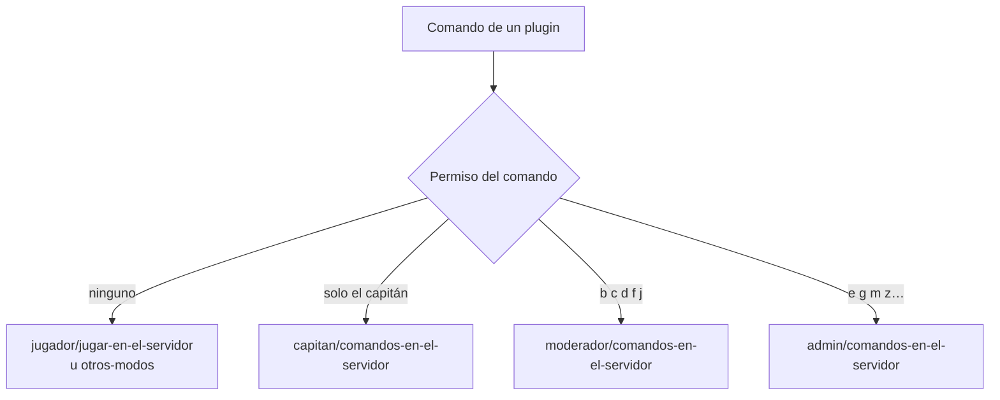

# Los comandos del servidor en el manual, por rol: documentación

## Qué hace

El manual de usuario (**Ayuda**, `/help`) explica los comandos del chat del servidor que usa cada rol, cada uno en la sección que ese rol ve. Antes solo estaban los del jugador, y les faltaban varios. Los del moderador estaban en un PDF del 2026-10-19 que había quedado viejo.

Desde ahora es regla: todo plugin nuevo, y todo comando nuevo o cambiado, se documenta en la página del rol que lo usa, en el mismo commit (`CLAUDE.md`, `docs/manual/README.md` y `docs/bitacora/PLANTILLA.md`).

## Las páginas

| Página | Quién la ve | Qué tiene |
|---|---|---|
| `jugador/jugar-en-el-servidor.md` | Todas las cuentas | Se sumaron el calentamiento (`!faltan`, `!armas`, `!nades`, `!rethrow`, `!unrtv`, `!coach`), `!eq`, `!voz`, `!admins`, pedir un arma (R y E) y las reglas del espectador |
| `jugador/otros-modos.md` | Todas las cuentas | Nueva. Deathmatch (`!guns`, `!hs`, `!rank`, `!top`), retake (`!guns`, `!rank`, `!top`) y 2v2 (`!ready`, cuchillo, pausas, `!rank`, `!top`) |
| `capitan/comandos-en-el-servidor.md` | Todas las cuentas | Nueva. Quién es el capitán en el juego, `!stay` / `!switch`, `!rr` entre los dos capitanes, `!match` y `!coach` |
| `moderador/comandos-en-el-servidor.md` | Moderadores y admins | Nueva. Reemplaza el PDF `guia_mods.html` de `2026-10-19-calladmin-moderadores` |
| `admin/comandos-en-el-servidor.md` | Admins | Nueva. Lo que suma el admin, los comandos para revisar el estado del servidor y cómo se da el permiso de moderador |

## De dónde salen los permisos

- Nuestros comandos: los `RegConsoleCmd` y `RegAdminCmd` de `server/addons/sourcemod/scripting/`.
- El grupo `Moderador` (`bcdfj`, inmunidad 50) y el override `"sm_cancelmatch" "g"`, iguales en los tres servidores (bajados por la API del panel el 2026-11-06).
- Los de SourceMod: `basecommands`, `basebans`, `basecomm`, `basechat`, `funcommands` y `playercommands`.

| Comando | Permiso | Rol |
|---|---|---|
| `!live`, `!swap`, `!team`, `!forcepause`, `!forceunpause`, `!whois`, `!pw`, `!npw`, `!rpw`, `!retake`, `!2v2`, `!2v2_start`, `!2v2_cancel`, `!who` | `b` | Moderador |
| `!rr` directo, `!match` sin confirmación | `b` (override `csstv_rr_admin` y acceso a `sm_live`) | Moderador |
| `!kick` | `c` | Moderador |
| `!ban` por tiempo | `d` | Moderador |
| `!slay`, `!slap`, `!beacon`, `!rename` | `f` | Moderador |
| `!mute`, `!gag`, `!silence`, `!say`, `!csay`, `!psay`, chat general de espectador en vivo | `j` | Moderador |
| `!map` | `g`, pero `csstv_calladmin` lo deja al moderador (`csstv_mod_map`) sin mix en curso | Moderador sin mix, admin siempre |
| `!cancelmatch` | `g` (override) | Admin |
| `!unban` | `e` | Admin |
| `!addban`, `!rcon`, `sm_csstv_status`, `sm_csstv_flush`, `sm_csstv_retryfailed`, `sm_perf`, `csstv_hud_status` | `m` | Admin |
| `!cvar` | `h` | Admin |
| `!vote`, `!votemap`, `!votekick` | `k` | Admin |

Sin página propia: el organizador, el streamer y el dueño de un servidor externo no tienen comandos en el juego. Los comandos de depuración (`*_fakecmd`, `*_setadmin`, `sm_mm_sides`…) no se documentan.

## Una corrección al PDF viejo

`guia_mods.html` decía que el moderador puede usar `sm_addban`. En `basebans` ese comando pide el flag `m` (RCON), que el grupo `Moderador` no tiene. La página nueva lo deja en la del admin y al moderador lo manda a banear desde la web.

## Qué cambia para cada rol

| Rol | Qué cambia | Página del manual |
|---|---|---|
| Jugador | Ve todos sus comandos, el pedido de armas y los modos aparte | [Jugar en el servidor](/help/jugador/jugar-en-el-servidor), [Deathmatch, retake y 2v2](/help/jugador/otros-modos) |
| Capitán | Sus comandos en el juego en una página | [Comandos del capitán en el servidor](/help/capitan/comandos-en-el-servidor) |
| Organizador | Nada | — |
| Moderador | Su guía de comandos en la web, al día | [Comandos del moderador en el servidor](/help/moderador/comandos-en-el-servidor) |
| Admin | Sus comandos y cómo revisar un servidor | [Comandos del admin en el servidor](/help/admin/comandos-en-el-servidor) |
| Streamer | Nada | — |
| Dueño de un servidor externo | Nada | — |

## Términos y privacidad

Sin cambios. Los términos ya dicen que los moderadores y los admins pueden advertir, silenciar y expulsar.

## Dónde está cada cosa

| Qué | Archivo / ubicación |
|---|---|
| Páginas del manual | `docs/manual/{jugador,capitan,moderador,admin}/` |
| La regla | `CLAUDE.md` (Convenciones), `docs/manual/README.md` ("Comandos del servidor"), `docs/bitacora/PLANTILLA.md` |
| Grupo `Moderador` y overrides | `addons/sourcemod/configs/admin_groups.cfg` y `admin_overrides.cfg` de cada servidor |
