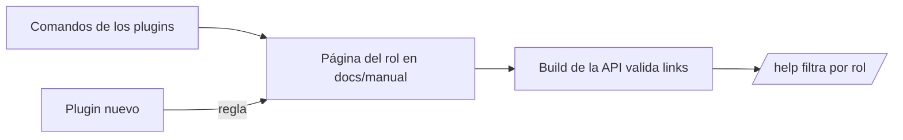

# Plan: los comandos del servidor en el manual, por rol

> Planeación original. Estado: **aprobado** por Daniel en el pedido (2026-11-06).

Pedido de Daniel (2026-11-06): que el manual de usuario (**Ayuda**, `/help`) tenga los comandos del chat del servidor que usa cada rol, y que quede como regla que todo plugin nuevo documenta ahí cómo se usa.

## Decisiones tomadas

| Tema | Decisión | Por qué |
|---|---|---|
| Qué hay hoy | El jugador tiene sus comandos en `jugador/jugar-en-el-servidor.md`, pero le faltan varios (`!faltan`, `!eq`, `!nades`, `!armas`, `!voz`, `!admins`, `!unrtv`, pedir un arma). Moderador, admin y capitán no tienen nada. La única guía de moderadores es el PDF del 2026-10-19 (`2026-10-19-calladmin-moderadores/guia_mods.html`), que quedó vieja | Revisado en `docs/manual/` y en los `Reg*Cmd` de `server/addons/sourcemod/scripting/` |
| Fuente | Los `RegConsoleCmd` / `RegAdminCmd` de nuestros plugins, el grupo `Moderador` (`bcdfj`) y el override `"sm_cancelmatch" "g"` de los tres servidores (bajados por la API del panel el 2026-11-06), y los comandos de SourceMod que trae ese grupo (`basecommands`, `basebans`, `basecomm`, `basechat`, `funcommands`, `playercommands`) | Que el manual diga lo que pasa hoy, no lo que dice una bitácora vieja |
| Jugador | Se completa la tabla de `jugar-en-el-servidor.md` y se suma una sección del calentamiento. Los modos aparte (deathmatch, retake y 2v2) van en una página nueva, `jugador/otros-modos.md`, para no alargar la primera | Una página por tarea y corta (estilo del manual) |
| Capitán | Página nueva `capitan/comandos-en-el-servidor.md`: elegir lado después del cuchillo, `!rr` entre los dos capitanes, `!match` y `!coach`. Aclara que en el juego el capitán es quien le da nombre al equipo | Son los comandos que dependen de ser capitán |
| Moderador | Página nueva `moderador/comandos-en-el-servidor.md`, con lo que trae el grupo `Moderador` (incluye lo nuevo desde el PDF: `!whois`, `!pw`, `!team`, `!forcepause`, `!rr` directo, `!match` solo, los modos). Aclara que el permiso en los servidores se da aparte del rol de la web | Un moderador de la web no tiene permisos en el juego hasta que lo suman al grupo |
| Admin | Página nueva `admin/comandos-en-el-servidor.md`: lo que suma sobre el moderador (cancelar, mapa con mix, ban permanente, desbanear, contraseña con matchmaking no, votos, consola) y los comandos para revisar el estado del servidor | Lo de moderador no se repite: se enlaza |
| Organizador, streamer y dueño de un servidor externo | Sin página: no tienen comandos propios en el juego | El organizador no tiene permisos en el servidor; el streamer mira por el HUD |
| Regla | En `CLAUDE.md` (Convenciones), en `docs/manual/README.md` (Cómo se mantiene) y en `docs/bitacora/PLANTILLA.md`: todo plugin nuevo, o comando nuevo de un plugin, documenta su uso en la página del manual del rol que lo usa, en el mismo commit | Pedido de Daniel |
| Despliegue | El manual lo sirve la API desde `dist/manual`: se publica con el próximo despliegue de la API. No se despliega en este requerimiento salvo que Daniel lo pida | Los despliegues de la API se hacen desde `main` |

## 1. El flujo completo

## 2. Páginas del manual

| Página | Cambio |
|---|---|
| `jugador/jugar-en-el-servidor.md` | Calentamiento (`!armas`, `!nades`, `!rethrow`, `!faltan`), la tabla de otros comandos completa, el pedido de armas y las reglas del espectador |
| `jugador/otros-modos.md` | Nueva: deathmatch, retake y 2v2 |
| `capitan/comandos-en-el-servidor.md` | Nueva |
| `moderador/comandos-en-el-servidor.md` | Nueva |
| `admin/comandos-en-el-servidor.md` | Nueva |

## 3. La regla

- `CLAUDE.md`, en Convenciones, junto al manual de usuario.
- `docs/manual/README.md`, en "Cómo se mantiene".
- `docs/bitacora/PLANTILLA.md`, en "Qué cambia para cada rol".

## 4. Requisitos antes de empezar

Ninguno: es documentación.

## 5. Orden de implementación

1. Escribir las páginas.
2. Correr los tests del manual de la API (`manual.test.ts`) y `build:check` para validar los links.
3. Escribir la regla.
4. `DOCUMENTACION.md`, `GUIA_IMPLEMENTACION.md`, la fila del índice y `CHANGELOG_DISCORD.txt`.
