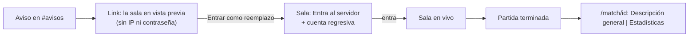

# La sala en el link de reemplazo, el detalle como sala y el ELO del abandono: documentación

## Qué hace

- **El link de reemplazo de Discord muestra la sala** de la partida en vista previa: la cabecera con el marcador, los dos equipos y, en el equipo del que se fue, un lugar libre "Aquí entrarías tú". La IP y la contraseña del servidor llegan recién al tomar el lugar.
- **En la sala, el reemplazo ocupa el lugar del que se fue**, con la etiqueta **Reemplazo**. El que se fue queda en una línea tachada al final de su equipo. Mientras el reemplazo no entró al servidor, ve arriba **Entra al servidor** con la cuenta regresiva.
- **El detalle de una partida del matchmaking (`/match/<id>`) es su sala**, con las pestañas **Descripción general** (la que abre) y **Estadísticas** (las tablas de siempre), como "Tu última partida". Los mixes sin sala del matchmaking siguen abriendo la sala de mix.
- **El que abandona pierde menos ELO si su equipo gana**: de 10 a 15 si su equipo ganó; si perdió o empató, de 6 a 10 pero nunca menos que una derrota normal. Dentro de cada rango, según la parte de la partida que no jugó.

## El ELO del que abandona

`f` es la parte de la partida que no jugó: `(rondas totales − rondas que jugó) / rondas totales` (sin estadísticas suyas, `f = 1`).

| Su equipo | Pierde |
|---|---|
| Ganó | `abandon_win_min + (abandon_win_max − abandon_win_min) · f`: de 10 (se fue al final) a 15 (al principio) |
| Perdió o empató | El mayor entre `abandon_loss_min + (abandon_loss_max − abandon_loss_min) · f` (de 6 a 10) y una **derrota normal** (`2 · base · prob`, la de antes sin el extra) |

- Con equipos parejos y la base de 25, la derrota normal es −25: pierde 25. Si su equipo era muy favorito y perdió, la derrota normal es chica y gana el rango (6 a 10).
- Así irse nunca sale más barato que perder, que era el riesgo de la regla "como mucho 10".
- El extra fijo de antes (`abandon_extra_elo`) deja de usarse; la columna queda por compatibilidad.
- Lo de sus compañeros y el rival no cambia (ganan más o pierden menos según cuánto faltó).
- Sale de datos guardados: si se recalcula el ELO de una temporada, las partidas viejas con abandono pasan a la regla nueva.

## Los reemplazos en la sala

`mm_lobby_json` trae `replacements`: cada pedido con su estado (`open`, `taken`, `connected`), quién se fue, quién entró, la ronda en que se pidió (`left_round`) y en la que entró (`joined_round`), y el plazo para conectarse mientras está tomado. Las rondas salen del mix en vivo del servidor.

## La página del link

`mm_replace_info` trae `room`: la sala sin el servidor ni lo de quien mira (reportes, felicitaciones, ELO en juego), solo mientras el link se puede tomar. Si no hay sala (vencido, tomado, propio), la página queda como antes.

## El detalle de la partida

`mm_game_room(juego)` devuelve la sala de una partida del matchmaking terminada a cualquiera con sesión, sin el servidor. Si el juego no es de una sala (un mix vinculado a un torneo, uno sin matchmaking), devuelve null y la web muestra la sala de mix. En el detalle no hay chat, reportes ni "jugar de nuevo"; cada jugador muestra sus números de esa partida y su cambio de ELO.

## Qué cambia para cada rol

| Rol | Qué cambia |
|---|---|
| Jugador | Ve la sala en el link de reemplazo, su fila en el lugar del que se fue y la cuenta regresiva; el detalle de sus partidas del matchmaking es la sala; quien abandona pierde de 10 a 15 si su equipo gana |
| Admin | En Administración › Matchmaking, **ELO del que abandona**: los cuatro topes |

Manual actualizado: `jugador/buscar-partida.md`, `jugador/elo-y-estadisticas.md` y `admin/matchmaking.md`.

## Términos y privacidad

- Sección 7: abandonar resta ELO (menos que una derrota si tu equipo gana; si pierde, al menos lo de una derrota).
- Sección 8: con sesión, la página del link muestra la sala con los nombres; la IP y la contraseña, solo a quien toma el lugar.
- Fecha: 6 de noviembre de 2026.

## Dónde está cada cosa

| Qué | Dónde |
|---|---|
| Base | `supabase/replanteo/78_mm_reemplazo_sala_y_abandono.sql` (inversa en `docs/bitacora/2026-10-14-replanteo-modelo-datos/reversas/`) |
| API | `web/backend/src/routes/mm.ts`: `GET /api/v1/mm/games/{id}/room` |
| Sala | `web/frontend/src/features/matchmaking/room/RoomOverview.tsx` (`mode`: `live`, `preview`, `detail`), `roomData.ts` (`roomRows`, `replacementOf`), `MatchRoom.tsx` |
| Link | `web/frontend/src/features/matchmaking/ReplacePage.tsx` |
| Detalle | `web/frontend/src/features/mixes/pages/MixRoomPages.tsx` |
| Administración | `web/frontend/src/features/matchmaking/admin/GeneralForm.tsx` |
