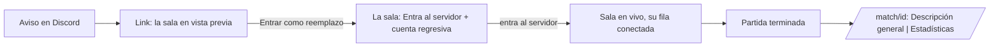

# Plan: la sala en el link de reemplazo, el detalle de la partida como sala y el ELO del abandono

Pedido por Daniel el 2026-11-06, sobre los reemplazos ya desplegados ([`2026-11-04-mm-reemplazos`](../2026-11-04-mm-reemplazos/)). Diseño aprobado en el artifact https://claude.ai/artifact/Ndp1drqtYpRVGVcohLewjU (cuatro vistas).

## Decisiones tomadas

- **El link de Discord muestra la sala** (vista 1): la cabecera y los dos equipos como en la sala de la partida, con un lugar vacío "Aquí entrarías tú, en lugar de X" en el equipo del que se fue y el botón en el centro. **Sin la IP ni la contraseña** hasta tomar el lugar (si no, cualquiera con el link entra al servidor sin tomarlo).
- **Después de tomarlo, la sala normal** (vista 2): la fila del reemplazo en el lugar del que se fue, con la etiqueta **Reemplazo** y "Reemplaza a X"; el que se fue, tachado debajo; y en el centro "Entra al servidor" con la cuenta regresiva del plazo para conectarse.
- **El detalle de una partida del matchmaking es la sala** (vistas 3 y 4): `/match/<id>` abre la sala de la partida con las pestañas **Descripción general** (la principal) y **Estadísticas** (las tablas de hoy), como "Tu última partida". Los mixes sin sala del matchmaking siguen como están.
- **ELO del que abandona, opción 2** (Daniel, 2026-11-06):
  - Si su equipo **ganó**: pierde de 1 a 5.
  - Si su equipo **perdió** (o empató): pierde de 6 a 10, **pero nunca menos que una derrota normal**, para que irse no salga más barato que perder.
  - Dentro de cada rango, según cuánto de la partida se perdió: irse al principio da el máximo y cerca del final, el mínimo.
  - El "extra" fijo de hoy (`abandon_extra_elo`) deja de usarse. La sanción de espera escalonada no cambia: esa es la sanción fuerte.
  - Los cuatro topes, configurables en Administración › Matchmaking.

## 1. El flujo

## 2. Base (replanteo `78_mm_reemplazo_sala_y_abandono.sql`)

- `mm_config`: `abandon_win_min` (1), `abandon_win_max` (5), `abandon_loss_min` (6), `abandon_loss_max` (10), con min ≤ max. `mm_set_config` los acepta y `manual_valores` los muestra (`mm.abandono_ganado`, `mm.abandono_perdido`).
- `mm_elo_delta`, rama del que abandonó: `f` = la parte de las rondas que no jugó. Ganó: `−(min + (max − min)·f)`. Perdió o empate: el menor entre la derrota normal (`2·base·(0 − prob)`, la de antes sin el extra) y `−(min + (max − min)·f)`.
- `mm_replacements.left_round` y `joined_round`: la ronda en que se pidió el reemplazo y en la que entró, del mix en vivo del servidor.
- `mm_lobby_json` suma `replacements`: quién reemplaza a quién, el estado, las rondas y, mientras no entró, el plazo para conectarse.
- `mm_replace_info` suma `room`: la sala sin el servidor ni lo privado de quien mira (reportes, felicitaciones, ELO en juego).
- `mm_game_room(p_game)`: la sala de una partida terminada del matchmaking, para cualquiera con sesión, sin el servidor ni el chat; null si la partida no es del matchmaking.

## 3. API

- `GET /api/v1/mm/replace/{token}` devuelve también `room` (sale de la base).
- `GET /api/v1/mm/games/{id}/room`: la sala de una partida (con el demo y los clips, como la última partida).

## 4. Web

- `ReplacePage`: la sala en vista previa (cabecera, equipos con el lugar vacío, el centro con el botón y el servidor con candado).
- La sala: la fila del reemplazo y la del que se fue, y el estado "Entra al servidor" con la cuenta regresiva.
- `/match/<id>` de una partida del matchmaking: la sala en modo lectura (sin chat, reportes ni "jugar de nuevo"), con cada jugador con sus números de la partida y su cambio de ELO, "Cambios en la partida" y las pestañas.
- Administración › Matchmaking: los cuatro topes del abandono.

## 5. Documentación

- Manual: `jugador/buscar-partida.md` (el ELO del abandono, el link y la sala), `admin/matchmaking.md` (los topes).
- Términos: la sección 7 dice cuánto ELO pierde quien abandona; la página del link muestra la sala a quien tiene sesión.
- `CHANGELOG_DISCORD.txt` (2.9.18).

## 6. Orden de implementación

1. La `78` con su inversa y sus pruebas en la base local.
2. La API y sus pruebas.
3. La web y sus pruebas.
4. Manual, términos, changelog, `DOCUMENTACION.md`, `GUIA_IMPLEMENTACION.md` e índices.
5. Commit en `main` (y copia a `feat/frontend-fase-1`; la base y la API a `feat/mm-claim-en-sala`). El despliegue, cuando Daniel lo pida.
