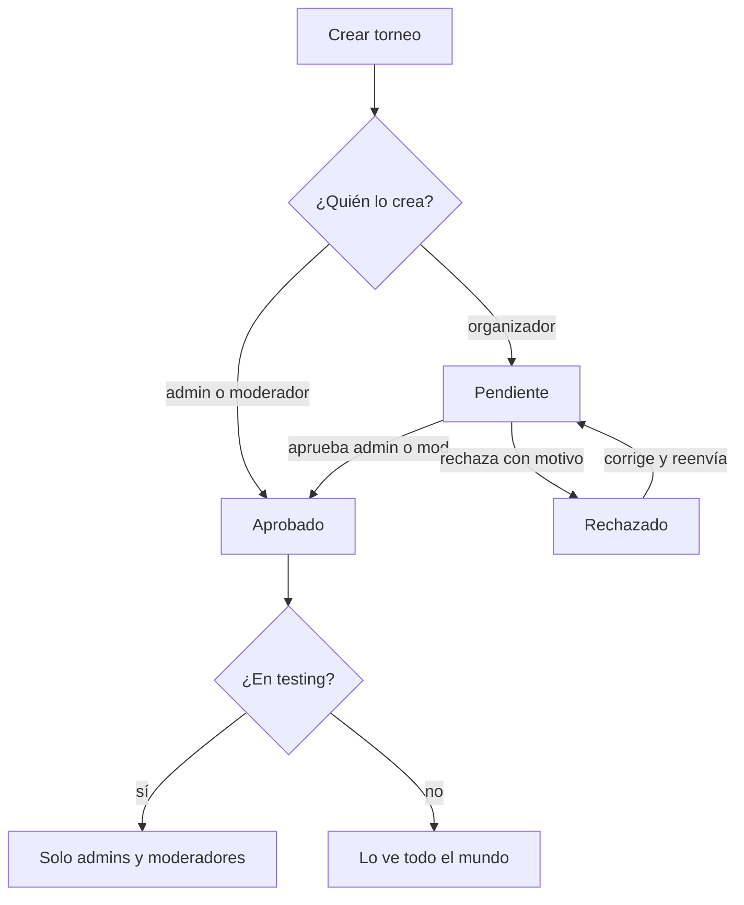
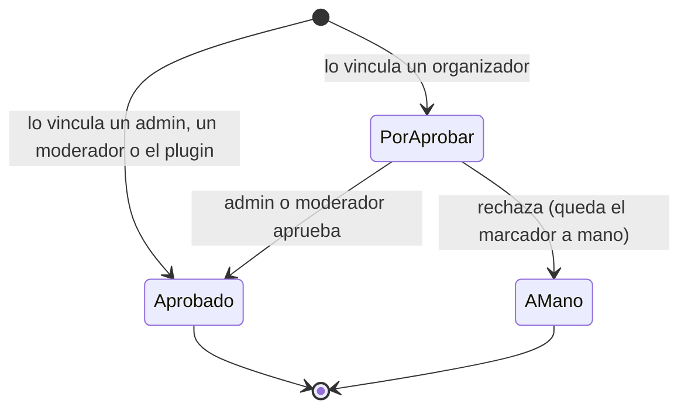
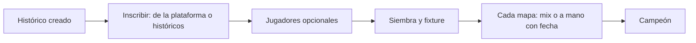

# Torneos históricos, aprobación de organizadores y fase de testing: documentación

## Qué hace

Tres cambios en el apartado de torneos, pedidos por Daniel el 2026-11-06:

1. **Torneos históricos.** Se puede subir el registro de un torneo que ya se jugó, dentro o fuera de la plataforma. Es un torneo normal con la marca `events.historic`: misma plantilla, misma llave y mismo motor. Cambian la inscripción (equipos de la plataforma o equipos históricos, jugadores opcionales), las fechas (obligatorias, y una fecha por mapa a mano y por W.O.), los avisos (ninguno) y el ranking (solo suman las series con todos sus mapas con un mix aprobado).
2. **Aprobación de lo que hace un organizador.** Todo torneo que crea un organizador nace **pendiente**, y todo mix que vincula a una partida queda **por aprobar**. Un admin o un moderador aprueba o rechaza (el torneo, con un motivo).
3. **Fase de testing.** Un admin o un moderador marca un torneo como "En fase de testing" y el torneo deja de existir para todos los demás, también para su organizador.

La regla de quién ve qué vive en la base (RLS y `event_visible`), así que la API no filtra nada a mano: para quien no lo puede ver, un torneo oculto responde `404`.

## Quién ve un torneo

| Torneo | Anónimo y jugador | Su organizador | Otro organizador | Moderador y admin |
|---|---|---|---|---|
| Aprobado | Sí | Sí | Sí | Sí |
| Pendiente o rechazado | No | Sí | No | Sí |
| En testing (aprobado o no) | No | No | No | Sí |

`event_visible(p_event)` aplica esta tabla. Las políticas de `select` de `events`, `matches` (las de torneo), `tournament_registrations`, `tournament_registration_players` y `event_stage_teams` la usan, y también las funciones `security definer` que muestran torneos (`event_ref`, `live_match_list`, `event_list`…). Un mix vinculado a un torneo oculto sigue siendo un mix visible, con su ELO: lo que no se ve es que pertenece al torneo.

## Aprobación

- **Torneo:** `events.approval` (`pending`, `approved`, `rejected`), `approval_note`, `reviewed_by` y `reviewed_at`. `event_review(p_event, p_approve, p_note)` (admin o moderador; rechazar pide motivo) y `event_resubmit(p_event)` (el organizador dueño, de rechazado a pendiente). Aprobar el torneo aprueba también los mixes que el organizador dejó vinculados. Los torneos que ya existían quedaron aprobados.
- **Mix vinculado:** `matches.parent_approved` (`false` por aprobar, `true` aprobado, `null` sin vincular). Mientras espera, el marcador cuenta en la llave, pero la serie no muestra sus estadísticas a quien no gestiona el torneo (`game_id` en `null` en `maps_detail`). `match_review_game(p_game, p_approve)`: aprobar lo deja en `true`; rechazar lo desvincula y deja el mapa con el mismo marcador y la misma fecha como resultado a mano, sin reabrir la serie ni tocar la llave.
- **Avisos:** `admin_event_review` y `admin_game_review` a admins y moderadores (categoría Administración: desde ahora los moderadores la ven en sus preferencias), y `event_reviewed` y `game_reviewed` al organizador. Los textos de la campana están en `features/shell/notifications/lib/model.ts`.

## Torneo histórico

- **Creación:** `historic` solo al crear (`events_guard`). Admin y organizador crean normales e históricos; el moderador, solo históricos. Pide `starts_on` y `ends_on`. No tiene suplentes, cierre de inscripciones, cupo ni tiempo de veto.
- **Equipos:** cualquier equipo oficial, sin mínimo de activos, plantel ni SteamID, o un **equipo histórico** (`teams.kind = 'historic'`: solo nombre, sigla y logo, sin capitán, plantel ni página). Se crea con `event_create_historic_team`, avisando antes de los parecidos (`historic_team_similar`), y se corrige con `historic_team_update` y `historic_team_set_logo`. No aparece en Buscar equipo, en el ranking ni en "Mi equipo", y se puede reusar en otro histórico.
- **Jugadores:** opcionales, de 0 a 10 por equipo, estén o no en el plantel. El torneo y el título de campeón salen en su perfil.
- **Mapas:** mix vinculado (candidatos sin el límite de 14 días ni el de inscritos, con filtros de fecha, mapa y servidor y paginados) o resultado a mano con `played_at`. Sin fecha, la del comienzo. El W.O. también lleva fecha (`match_set_played_at`).
- **Ranking:** `match_rankable()`. Nunca suman los torneos en testing, pendientes o rechazados. En un histórico, solo la serie con todos sus mapas jugados con un mix aprobado. La siembra por ranking usa la misma regla.
- **Avisos:** ninguno de un torneo histórico, en testing, pendiente o rechazado (`tg_notify_events`, `tg_notify_registrations`, `tg_notify_registration_players`, `notify_due`). `event_new` sale cuando un torneo pasa a ser público.

## API

| Endpoint | Qué hace |
|---|---|
| `POST /events`, `PATCH /events/{id}` | `historic` (solo al crear) y `testing` (solo admin o moderador) |
| `GET /events`, `GET /events/{id}` | `historic`, `testing`, `approval`, `approval_note`, `pending_games` y `viewer.can_review`. Filtros `historic`, `testing`, `approval` y `pending_games` |
| `POST /events/{id}/review`, `POST /events/{id}/resubmit` | Aprobar o rechazar; volver a enviar |
| `POST /events/{id}/historic-teams`, `GET /events/{id}/similar-teams`, `PATCH /historic-teams/{id}` | Equipo histórico: crear e inscribir, parecidos y corregir. El logo, con `PUT /teams/{id}/logo` |
| `PUT /events/{id}/registrations/{teamId}` | En un histórico, de 0 a 10 jugadores cualesquiera |
| `GET /matches/{id}/games/candidates` | Paginado (`GameCandidateList`), con `from`, `to`, `map` y `server` |
| `PUT /matches/{id}/maps`, `POST /matches/{id}/result` | `played_at` en el mapa a mano y en el W.O. `maps_detail` trae `approved` y `played_at` |
| `POST /matches/{id}/games/{gameId}/review` | Aprobar o rechazar un mix vinculado |
| `GET /admin/pending-games` | Mixes por aprobar, con su partida (admin o moderador) |

`TeamRef.historic` marca los equipos históricos en las inscripciones, las partidas y el campeón, para que la web no los enlace. `GET /teams/{id}` de un equipo histórico es `404`.

## Web

| Pantalla | Qué cambia |
|---|---|
| Administración › **Torneos** | Etiquetas Histórico, Testing, Pendiente y Rechazado; filtro por marca (Pendientes, Mixes por aprobar, Históricos, En testing, Rechazados; los dos del medio solo para el staff); aviso "N torneos y M mixes esperan aprobación"; botón **Subir torneo histórico**; "Qué falta" dice "Revisar y aprobar", "Rechazado…" o cuántos mixes esperan |
| **Crear torneo** | **Tipo de torneo** Normal o Histórico (el moderador solo histórico); con histórico, sin suplentes, cierre ni cupo y con fechas obligatorias; casilla **En fase de testing** (solo staff, desmarcada); el organizador ve el aviso de aprobación y **Crear y enviar a aprobación** |
| Gestión del torneo | Etiquetas en la cabecera; panel con **Aprobar** y **Rechazar** con motivo (staff), **Volver a enviar** (organizador), los mixes por aprobar y **Publicar (sacar de testing)**; en Configuración, la casilla de testing; en un histórico, sin el tiempo de veto ni la exigencia de activos |
| **Inscripciones** de un histórico | **Inscribir equipo de la plataforma**, **Equipo que no está en la plataforma** (con el aviso de parecidos e **Inscribir este**), **Editar** (nombre, sigla y logo de un histórico) y **Jugadores** (0 a 10) |
| Panel de una partida | **Jugado el** en cada mapa a mano; **Fecha del W.O.** en un histórico; **Mix por aprobar** con **Aprobar mix** y **Rechazar** (staff); buscador de mixes con **Desde**, **Hasta**, **Mapa**, **Servidor** y páginas; en un histórico, si la serie suma al ranking |
| **Torneos** (público) | Etiquetas en la lista y en la cabecera; franjas de testing, pendiente, rechazado e histórico para quien las ve; sin botón de inscribirse en un histórico; equipos históricos sin link (inscritos, posiciones y campeón); sin las reglas por defecto en un histórico; un `404` dice "Ese torneo no existe o todavía no está publicado" sin reintentar |
| Campana | Textos de `event_reviewed`, `game_reviewed`, `admin_event_review` y `admin_game_review` |

## Qué cambia para cada rol

| Rol | Qué cambia | Página del manual |
|---|---|---|
| Jugador | Ve la etiqueta **Histórico** y los torneos históricos donde lo cargaron en su perfil. No ve torneos pendientes, rechazados ni en testing | Sin página nueva |
| Capitán | No puede inscribir a su equipo en un histórico: lo carga quien lo gestiona | Sin cambios |
| Organizador | Sus torneos esperan aprobación (y se reenvían si los rechazan); sus mixes vinculados esperan aprobación; puede subir torneos históricos; fecha en los mapas a mano | [`organizador/crear-torneo.md`](../../manual/organizador/crear-torneo.md), [`organizador/resultados-y-llave.md`](../../manual/organizador/resultados-y-llave.md) y [`organizador/subir-torneo-historico.md`](../../manual/organizador/subir-torneo-historico.md) (nueva) |
| Moderador | Aprueba y rechaza torneos y mixes, pone y saca la fase de testing, sube torneos históricos (solo históricos) y recibe los avisos de Administración de lo que espera aprobación | [`moderador/aprobar-torneos-y-mixes.md`](../../manual/moderador/aprobar-torneos-y-mixes.md) y [`moderador/torneo-en-testing.md`](../../manual/moderador/torneo-en-testing.md) (nuevas) |
| Admin | Lo mismo que el moderador, además de crear torneos normales | Las del moderador (el admin ve esa sección) |
| Streamer y dueño de un servidor externo | Nada | — |

No hay comandos nuevos en el servidor: el plugin no cambia.

## Términos y privacidad

- **Términos (sección 9, Torneos, PCW y premios):** los torneos de un organizador y sus mixes vinculados se publican después de la aprobación de la liga; la liga puede publicar el registro de torneos jugados antes o fuera de la plataforma (nombre, sigla y logo de los equipos, resultados y, si se cargan, sus jugadores), y quien aparezca puede pedir que se corrija o se quite su nombre.
- **Privacidad (sección 4, Qué es público):** lo mismo del lado de los datos: qué se publica de un torneo histórico y que el torneo aparece en el perfil de los jugadores cargados.
- Actualizados la página de la web (`TermsPage.tsx` y `PrivacyPage.tsx`) y los `.html` de `terms/`, con fecha 6 de noviembre de 2026.

## Dónde está cada cosa

| Qué | Archivo / ubicación |
|---|---|
| Replanteo y su inversa | `supabase/replanteo/80_torneos_historicos_testing.sql` y `docs/bitacora/2026-10-14-replanteo-modelo-datos/reversas/80_torneos_historicos_testing.sql` |
| Pruebas SQL | `pruebas/prueba_80.sql` y `pruebas/probar_80.sh` |
| API | `web/backend/src/routes/events.ts`, `routes/matches.ts`, `routes/teams.ts`, `schemas/events.ts`, `schemas/matches.ts`, `schemas/players.ts` y `services/matches.ts` |
| Pruebas de la API | `web/backend/test/integration/historicos-testing.test.ts` (y `approveEvent` en `local.ts`) |
| Contrato | `docs/frontend/contrato/torneos.md`, `partidas.md` y `notificaciones.md` |
| Web: administración | `web/frontend/src/features/admin/events/` (`AdminEventsPage`, `AdminEventPages`, `EventForm`, `ReviewPanel`, `HistoricRegistrations`, `MatchSheet`, `ManageTabs`, `api/queries.ts`) |
| Web: público | `web/frontend/src/features/events/` (`EventMarks`, `EventView`, `EventList`, `SummaryTab`, `StandingsTab`) |
| Permisos y avisos | `web/frontend/src/auth/permissions.ts` y `features/shell/notifications/lib/model.ts` |
| Manual | `docs/manual/organizador/subir-torneo-historico.md`, `moderador/aprobar-torneos-y-mixes.md`, `moderador/torneo-en-testing.md` y los cambios en `organizador/crear-torneo.md` y `resultados-y-llave.md` |
