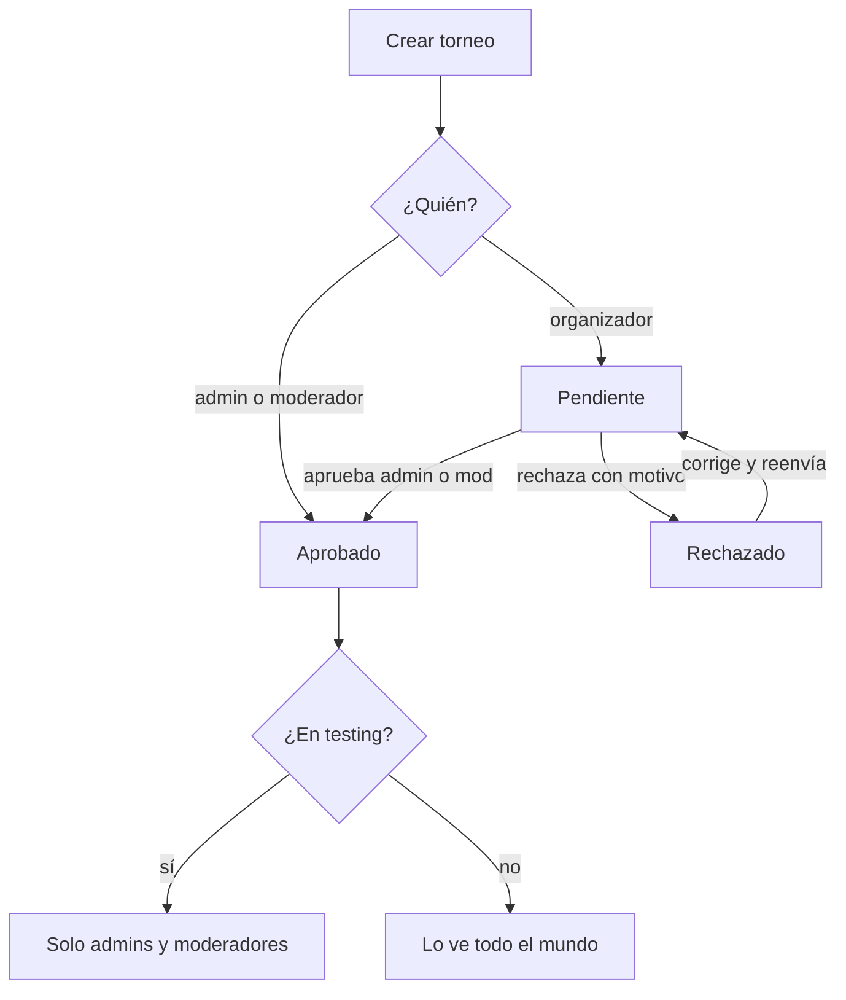
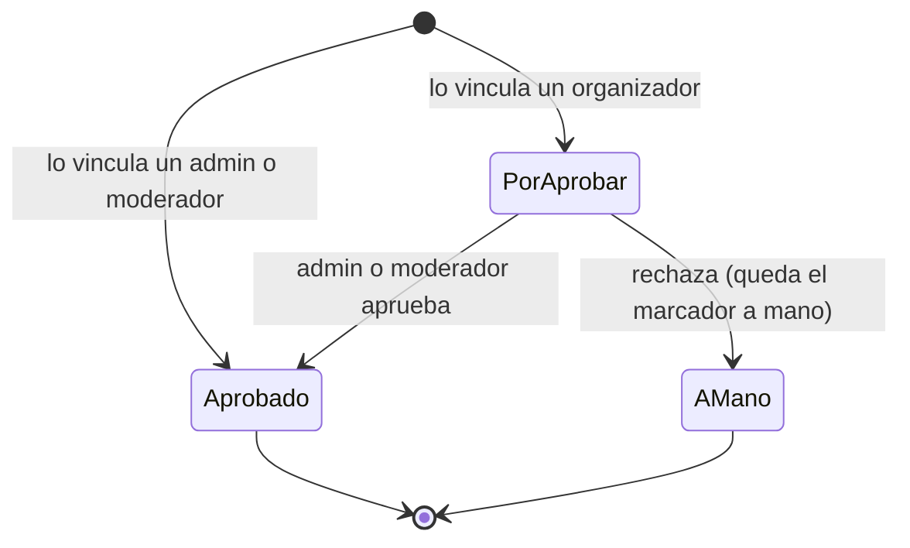
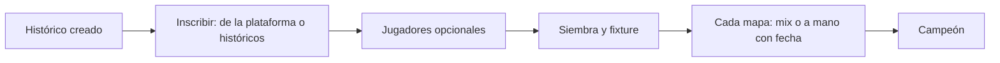

# Plan: torneos históricos, aprobación de organizadores y fase de testing

> Planeación original. Estado: **aprobado por Daniel (2026-11-06)** sobre el [artifact "Torneos históricos y testing"](https://claude.ai/artifact/2iA9sTaDhZrd2LUG3N3dsu) (versión 12).

Tres pedidos de Daniel (2026-11-06) para el apartado de torneos:

1. **Torneos históricos.** Subir el registro de un torneo que ya se jugó y cómo terminó. Hoy no se puede: `event_register` solo inscribe equipos oficiales que existen en la plataforma, con exactamente los activos del modo, todos del plantel y con SteamID. Cada mapa se completa como desde la `41`: con un mix jugado en la plataforma vinculado a la partida, o con el resultado a mano (por ejemplo 16-13), "Sin detalle de la partida".
2. **Aprobación de lo que hace un organizador.** Hoy un torneo de un organizador se publica al instante. Desde ahora, todo torneo que crea un organizador (normal o histórico) y todo mix que vincula a una partida esperan la aprobación de un admin o moderador.
3. **Torneos en fase de testing.** Admins y moderadores marcan un torneo como "En fase de testing" y desaparece para todos los demás en todos los lugares donde se muestran torneos (activos y finalizados), para probar en producción.

## Decisiones tomadas

| Tema | Decisión | Por qué |
|---|---|---|
| Qué es un histórico | Un torneo normal con la marca `events.historic`: mismas plantillas, misma llave, mismo motor (siembra, fixture, avance, campeón). Cambian la inscripción, las fechas, los avisos y el ranking | Reusa todo lo de la `41`. Un formato que no calza exacto se arma con byes o W.O. |
| La marca histórico | Se elige al crear y no se cambia | Un torneo real que pasa a histórico dejaría inscripciones y avisos a medias |
| Quién crea | Normal: admin y organizador (como hoy). Histórico: admin, moderador y organizador | Daniel |
| Aprobación del torneo | El de un organizador nace **pendiente**. Lo ven él, los moderadores y los admins. Lo prepara entero (en un histórico, todo el registro). Un admin o moderador lo **aprueba** o lo **rechaza con un motivo**; el rechazado se corrige y se vuelve a enviar. El de un admin o moderador nace aprobado. Los que ya existen quedan aprobados | Daniel: "los organizadores deben ser aprobados por un admin/mod" |
| Aprobar el torneo aprueba sus mixes | Al aprobar un torneo pendiente se aprueban también los mixes que dejó vinculados el organizador | Se revisa todo junto |
| Después de aprobado | El organizador sigue gestionando su torneo como hoy. Lo que vincula después también espera aprobación | Diseño aprobado |
| Mix vinculado por un organizador | En **cualquier torneo** queda **por aprobar**. Mientras espera, el marcador del mix ya cuenta en la llave (avanza igual), pero la serie no muestra sus stats. Aprobado: stats y, si corresponde, ranking. Rechazado: el mix se desvincula y el mapa queda con ese marcador como resultado a mano. Admins y moderadores vinculan aprobado al instante | Daniel ("también en normales"). Que el rechazo no rompa la llave cuando ya se jugaron partidas que dependían de esa |
| Ranking en un histórico | Una serie suma solo si **todos sus mapas jugados** tienen un mix **aprobado**. Con un mapa a mano, un mix por aprobar o un W.O., no suma | Daniel: "solo cuentan las partidas que tengan un mix asociado"; "serie con todos sus mapas con mix" |
| Ranking en un normal | Como hoy (cuenta la serie cerrada, también con resultado a mano). El mix por aprobar solo cambia las stats | No cambiar las reglas de los torneos que ya se juegan |
| Ranking: lo que nunca suma | Torneos en testing, pendientes o rechazados, para nadie. La misma regla para la siembra por ranking | El ranking es el mismo para todos y las pruebas no lo ensucian |
| Equipos que no existen | **Equipo histórico**: `teams.kind = 'historic'`, solo nombre, tag y logo. Sin capitán, plantel ni página propia. No aparece en Buscar equipo, en el ranking ni en "Mi equipo". Se crea desde la inscripción ("Equipo que no está en la plataforma"), avisando antes si hay equipos de la plataforma con nombre parecido. Se puede reusar en otro histórico | `matches.team1/team2`, la siembra y la llave necesitan un `team_id` |
| Equipos que sí existen | En un histórico se inscribe cualquier equipo oficial, sin mínimo de activos, plantel ni SteamID, y el torneo entra en su historial | Muchos equipos del pasado existen hoy |
| Jugadores en un histórico | Opcionales: 0 a 10 fichas por equipo, estén o no en su plantel. Si se cargan, el torneo y el título de campeón aparecen en su perfil y el bando del mix se deduce solo. Un jugador, un equipo por torneo | Diseño aprobado |
| Mix en un histórico | Candidatos sin el límite de 14 días ni el de inscritos, con filtros de fecha, mapa y servidor y paginados. Sin inscritos, el bando lo elige quien vincula | El torneo puede ser de hace meses |
| Fechas | El histórico pide inicio y fin (`starts_on`, `ends_on`). Cada mapa a mano y cada W.O. llevan `played_at`; si falta, la del inicio. El mix trae la suya | Hoy `matches_played_at` pone la del momento en que se carga |
| Avisos de un histórico | Ninguno a los jugadores ni a los equipos | Nadie tiene que hacer nada |
| "En fase de testing" | Solo admins y moderadores la ponen y la sacan, ven y gestionan esos torneos. Al organizador no le aparece la casilla y **no ve** un torneo en testing, aunque sea suyo. En el formulario de crear viene desmarcada | Daniel |
| Avisos de testing | Un torneo en testing no avisa a nadie | Avisar a alguien de algo que no puede ver lo delata |
| Dónde se oculta | En la base: RLS en `events` y en lo que cuelga del torneo, más el filtro en cada función `security definer` y vista que muestra torneos. Para quien no puede verlo, el torneo no existe (`404`) | La API consulta con el token del usuario |
| Mix vinculado a un torneo oculto | El mix sigue siendo un mix (visible, con su ELO). Lo que no se ve es que pertenece al torneo | El mix es real |
| Partida de testing en un servidor | Se juega igual; el plugin no cambia | Lo que se ve en la web sale de la base |
| Histórico + testing | Se pueden combinar | Se sube, se revisa y se publica |

## 1. El flujo completo

## 2. Base de datos (replanteo `79`)

### 2.1 Columnas nuevas

| Tabla | Columna | Qué es |
|---|---|---|
| `events` | `historic boolean not null default false` | Torneo histórico. Solo al crear |
| `events` | `testing boolean not null default false` | En fase de testing. Solo la cambian admins y moderadores |
| `events` | `approval text not null default 'approved'` (`pending`, `approved`, `rejected`), `approval_note text`, `reviewed_by uuid`, `reviewed_at timestamptz` | Aprobación. `events_guard` la pone en `pending` si crea un organizador; solo un admin o moderador la pasa a `approved` o `rejected`; el organizador pasa un `rejected` a `pending` |
| `matches` | `parent_approved boolean` | En un mix vinculado: `false` por aprobar, `true` aprobado; `null` si no está vinculado |
| `teams` | `kind` acepta `'historic'` | Equipo que no está en la plataforma |

### 2.2 Visibilidad

- `event_visible(p_event uuid) returns boolean` (`stable security definer`):
  - admin o moderador: siempre;
  - si no, `not testing` y (`approval = 'approved'` u `organizer_id = auth.uid()`).
- Políticas de `select`: `events` (`event_visible(id)`); `matches` (`event_id is null or event_visible(event_id)`); `tournament_registrations`, `tournament_registration_players` y `event_stage_teams` (`event_visible(event_id)`).
- Las vistas `security_invoker` heredan la política. `team_standings` además filtra explícitamente (testing, no aprobados, y en los históricos las series sin todos sus mapas con mix aprobado), para que el ranking sea igual para todos.
- Funciones `security definer` que muestran torneos o el vínculo de un mix, con el filtro `event_visible(...)` y una prueba por cada una: `match_list`, `match_ref`, `match_series_maps`, `match_chat_public`, `match_schedule`, `team_event_history`, `team_results`, `team_ref`, `player_titles`, `player_matches` si es definer, `event_seed_ranking`, y lo que alimenta Inicio, "Para ti" y lo en vivo. La lista final sale de revisarlas todas en la implementación.
- `match_series_maps` (y lo que dé las stats de una serie): un mix por aprobar muestra el marcador, sin `game_id` para quien no gestiona el torneo.

### 2.3 Aprobación

- `event_review(p_event, p_approve boolean, p_note text)`: admin o moderador. Al aprobar, también pone `parent_approved = true` en los mixes de sus partidas.
- `event_resubmit(p_event)`: el organizador dueño, de `rejected` a `pending`.
- `match_set_maps`: el mix que entra lo deja con `parent_approved = is_moderator()`. Uno ya aprobado que se mantiene, sigue aprobado.
- `match_review_game(p_game, p_approve boolean)`: admin o moderador. Aprobar: `parent_approved = true`. Rechazar: el mapa pasa a resultado a mano con el mismo mapa, marcador y fecha, y el mix se desvincula, sin reabrir la serie ni tocar la llave.
- Avisos (`notifications`): a admins y moderadores, "torneo por aprobar" y "mix por aprobar"; al organizador, "torneo aprobado o rechazado" (con el motivo) y "mix aprobado o rechazado".

### 2.4 Avisos de siempre

`tg_notify_events`, `tg_notify_registrations`, `tg_notify_registration_players` y `notify_due` no avisan de un torneo histórico, en testing, pendiente o rechazado.

### 2.5 Torneo histórico

- `events_guard`: `historic` solo en el insert; un organizador lo crea pendiente; un moderador puede crear torneos solo si son históricos.
- `event_register`: en un histórico acepta equipos `official` o `historic`, 0 a 10 jugadores (todos `active`), sin plantel, SteamID, cupo de activos ni cierre de inscripciones.
- `event_create_historic_team(p_event, p_name, p_tag)`: crea el equipo histórico y lo inscribe. `historic_team_similar(p_name)` lista los equipos con nombre parecido.
- `match_game_candidates`: en un histórico, sin los 14 días ni el requisito de inscritos, con `p_from`, `p_to`, `p_map`, `p_server`, `p_page`, `p_per`.
- `match_set_maps`: `played_at` en cada mapa a mano y en el W.O.; en un histórico, si falta, `starts_on`. `matches_played_at` no pisa una fecha ya puesta.
- Los equipos `historic` quedan fuera de `team_ranking`, `team_standings` y Buscar equipo. En Administración › Equipos, un filtro "Históricos" para corregir nombre y logo.

## 3. API (`web/backend`)

| Endpoint | Cambio |
|---|---|
| `POST /events` | `historic` y `testing` (este, solo admin o moderador) |
| `PATCH /events/{id}` | `testing` |
| `GET /events`, `GET /events/{id}` | `historic`, `testing`, `approval` y `approval_note`. `GET /events` filtra por `historic`, `testing` y `approval` |
| `POST /events/{id}/review` | Aprobar o rechazar (`{ approve, note }`) |
| `POST /events/{id}/resubmit` | Volver a enviar un rechazado |
| `POST /events/{id}/historic-teams`, `GET /teams/similar` | Equipo histórico y aviso de parecidos |
| `PUT /events/{id}/registrations/{teamId}` | En un histórico, sin las validaciones de plantel |
| `GET /matches/{id}/games/candidates` | En un histórico, `from`, `to`, `map`, `server`, `page`, `per` |
| `PUT /matches/{id}/maps` | `played_at` en mapas a mano y W.O.; cada mapa con mix devuelve `approved` |
| `POST /matches/{id}/games/{gameId}/review` | Aprobar o rechazar un mix vinculado |
| `GET /admin/reviews` | Torneos y mixes por aprobar, paginado, con filtros y orden |

El resto no cambia de código: lo filtra la base. Pruebas de integración con anónimo, usuario, organizador dueño, otro organizador y moderador.

## 4. Web (`web/frontend`, solo en `feat/frontend-fase-1`)

Como el diseño aprobado:

1. **Administración › Torneos (lista):** aviso "N torneos y M mixes esperan aprobación", filtros (Pendientes, Mixes por aprobar, Históricos, En testing, Rechazados), etiquetas y "Aprobar" / "Rechazar" con motivo. El organizador ve los suyos con "Esperando aprobación" o el motivo y "Volver a enviar"; sin el filtro ni los torneos en testing.
2. **Crear:** tipo Normal o Histórico (fechas de inicio y fin; sin cupo, cierre, suplentes ni veto) y la casilla "En fase de testing" (solo admin y moderador, desmarcada). El organizador ve el aviso de que queda pendiente y el botón "Crear y enviar a aprobación".
3. **Inscripciones de un histórico:** "Inscribir equipo de la plataforma" y "Equipo que no está en la plataforma", y los jugadores opcionales.
4. **Partida:** fecha en el mapa a mano y en el W.O.; "Mix por aprobar" con "Aprobar mix" y "Rechazar" para el staff; buscador de mixes con fechas, mapa, servidor y paginado; la marca de si la serie suma al ranking.
5. **Torneos (público):** etiqueta "Histórico"; franjas "En fase de testing" y "Pendiente de aprobación" para quien las ve.

## 5. Manual, términos y privacidad

- Manual: "Subir un torneo histórico" (admin, moderador y organizador), "Aprobar torneos y mixes" (admin y moderador), "Probar un torneo en fase de testing" (admin y moderador), y se actualizan las de crear y gestionar torneos del organizador (aprobación) y la de vincular mixes.
- Términos: los torneos de un organizador y sus mixes vinculados se publican después de la aprobación de la liga; la liga puede publicar el registro de torneos jugados antes o fuera de la plataforma, con los nombres de los equipos y, si se cargan, sus jugadores. Privacidad: ese mismo dato. Página de la web y `.html` de `terms/` en el mismo commit.

## 6. Requisitos antes de empezar

- Base local con la `78` aplicada.

## 7. Orden de implementación

1. Replanteo `79`, su inversa y pruebas SQL: visibilidad con cinco roles, aprobación de torneos y de mixes (con el rechazo que no toca la llave), ranking con históricos, avisos, inscripción histórica, equipo histórico, candidatos y fechas.
2. Revisión de cada función `security definer` y vista que muestra torneos, con su prueba.
3. API, esquemas, `schema.d.ts` y pruebas de integración.
4. Web: las cinco pantallas del diseño.
5. Prueba en local de punta a punta con cada rol.
6. Manual, términos y privacidad; `DOCUMENTACION.md`, `GUIA_IMPLEMENTACION.md`, `CHANGELOG_DISCORD.txt` y `docs/PENDIENTES.md`.
7. Desplegar la `79` en la base del VPS, la API y la web. No toca el matchmaking: va solo en `feat/frontend-fase-1`.
