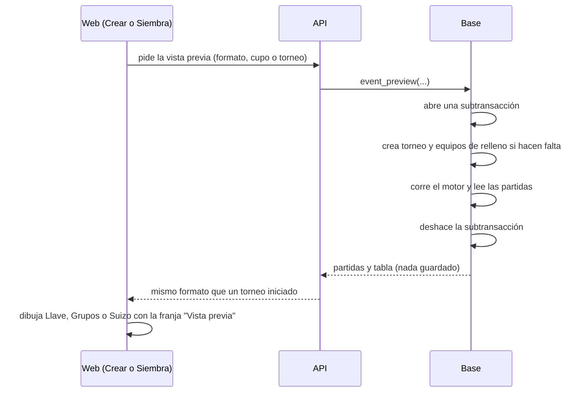

# Plan: vista previa de la llave, los grupos y el suizo

> Planeación original. Estado: **propuesta**, pendiente de aprobación de Daniel. Diseño: pantalla 7 del [artifact "Torneos históricos y testing"](https://claude.ai/artifact/2iA9sTaDhZrd2LUG3N3dsu).

Pedido de Daniel (2026-11-06): que quien arma un torneo vea cómo va a quedar la llave, los grupos o el suizo, igual que en el detalle de un torneo iniciado, antes de generar el fixture.

Hoy no se puede sin generar: la pestaña Siembra muestra solo los cruces de la primera ronda, y "Generar fixture" cambia el torneo de verdad (pasa a "en curso", cierra las inscripciones de los capitanes y crea las partidas). "Volver a la siembra" lo deshace mientras no empezó ninguna partida, pero en un torneo publicado los jugadores ven el fixture mientras tanto.

## Decisiones tomadas

| Tema | Decisión | Por qué |
|---|---|---|
| Cuándo | En dos momentos: al **crear o configurar** (sin equipos, con "Siembra 1", "Siembra 2"… según el formato y el cupo) y en la pestaña **Siembra** (con los inscritos, o con el cupo lleno completando con lugares vacíos) | Daniel preguntó si iba recién con los equipos; sirve antes, para elegir el formato |
| Cómo se arma | La base corre el motor de siempre (`event_generate` y los `event_build_*`) dentro de una subtransacción, lee las partidas que creó y **la deshace**. No se guarda nada | Se ve exactamente como va a quedar, sin un segundo armador de llaves en la web que haya que mantener igual al de la base |
| Cómo se dibuja | La respuesta tiene la forma de `GET /events/{id}/matches` (y de `standings` en grupos y suizo), con ids temporales, así que la dibujan los mismos componentes de Llave, Grupos y Suizo del detalle del torneo | Mismo aspecto que el torneo iniciado |
| Quién la ve | Quien gestiona el torneo (`can_manage_event`); al crear, quien puede crear torneos | Es una herramienta del organizador, no se publica |
| Suizo | Solo los cruces de la primera ronda y la etapa de entrada de cada equipo; las rondas siguientes y los playoffs, vacíos | Dependen de los resultados |
| Grupos + playoffs | Los grupos con sus equipos y partidas, y los playoffs con "1.º del grupo A", "2.º del grupo B"… | Si el motor arma los playoffs recién al terminar los grupos, la función los arma con esos lugares (se confirma al implementar) |
| Requerimiento aparte | Va después de [`2026-11-06-torneos-historicos-y-testing`](../2026-11-06-torneos-historicos-y-testing/) y no depende de él | Más fácil de probar y de revertir |

## 1. El flujo completo

## 2. Base de datos (replanteo `81`)

- `event_preview(p_event uuid, p_fill boolean)`: con un torneo. Usa sus inscritos y su siembra; con `p_fill`, completa hasta `max_teams` con lugares vacíos. Exige `can_manage_event`.
- `event_preview_config(p_template text, p_config jsonb, p_teams int)`: sin torneo (formulario de crear). Exige `is_organizer()` o `is_moderator()`.
- Las dos, `security definer` y `volatile`. Dentro de un bloque `begin … exception`:
  1. si hace falta, insertan el torneo y los equipos de relleno ("Siembra N"), las inscripciones y la siembra;
  2. corren el armado del motor sin las validaciones de jugadores mínimos (una variante interna de `event_generate` que comparte el código; la pública no cambia);
  3. guardan en una variable las partidas (y la tabla de grupos o suizo) como `jsonb`;
  4. levantan un error propio para deshacer todo, lo atrapan y devuelven la variable.
- Se revisa que nada de lo que corre adentro deje rastro fuera de la transacción: avisos (`notifications`, que se deshacen), `pg_notify` (transaccional) y secuencias (no se deshacen, sin efecto).
- Los mismos errores del motor que hoy (por ejemplo, la cantidad de equipos que pide un suizo) salen como respuesta de la vista previa, para que el organizador los vea antes de generar.

## 3. API (`web/backend`)

| Endpoint | Qué hace |
|---|---|
| `GET /api/v1/events/{id}/preview?fill=` | Vista previa con los inscritos (o con el cupo lleno) |
| `POST /api/v1/events/preview` | Vista previa de un formato sin torneo: `{ template, config, teams }` |

La respuesta: `{ matches, standings }` con el mismo esquema que `GET /events/{id}/matches` y `GET /events/{id}/standings`, más `summary` (partidas, byes, rondas y máximo de mapas). Con un límite de pedidos por minuto, porque cada llamada corre el motor.

## 4. Web (`web/frontend`, solo en `feat/frontend-fase-1`)

- **Crear y Configuración:** un panel "Vista previa" al lado del resumen del formato, que se actualiza al cambiar la plantilla, los BO o el cupo (con espera corta para no pedir en cada tecla).
- **Siembra:** la vista previa completa debajo del ordenador, con "Con los inscritos" o "Con el cupo lleno", que se actualiza al mover la siembra.
- Una franja "Vista previa: no se guarda nada y nadie más la ve" y las tarjetas de partida sin link ni detalle.
- Los componentes `BracketTree`, `GroupsPhase`, `GroupsDoublePhase` y `SwissPhase` reciben los datos de la vista previa sin cambios de dibujo.

## 5. Manual, términos y privacidad

- Manual: se suma la vista previa a las páginas de crear un torneo y de la siembra (organizador, moderador y admin).
- Términos y privacidad: sin cambios (no se guarda ni se publica nada).

## 6. Requisitos antes de empezar

- Que Daniel apruebe el plan y la pantalla 7 del diseño.
- Terminado (o al menos con la base lista) el requerimiento de torneos históricos y testing, para no pisar la `79`.

## 7. Orden de implementación

1. Replanteo `81`, su inversa y pruebas SQL: cada plantilla con y sin equipos, con byes, con cupo lleno, y que después de la vista previa no quede ninguna fila nueva (torneos, equipos, inscripciones, partidas ni avisos).
2. API, esquemas, `schema.d.ts` y pruebas de integración (permisos y límite de pedidos).
3. Web: el panel en Crear y Configuración y la vista en Siembra.
4. Prueba en local con cada formato.
5. Manual; `DOCUMENTACION.md`, `GUIA_IMPLEMENTACION.md`, `CHANGELOG_DISCORD.txt` y `docs/PENDIENTES.md`.
6. Desplegar la `81`, la API y la web.
