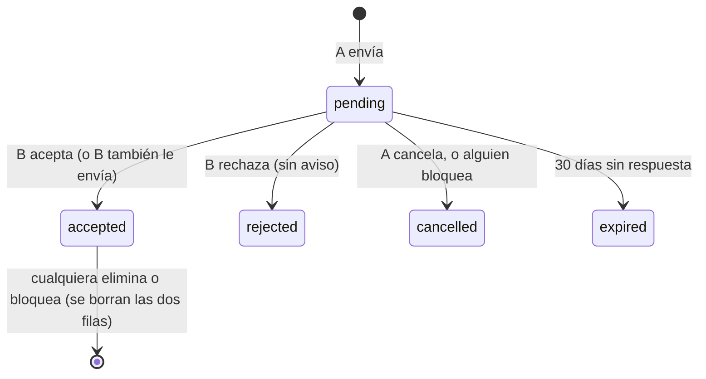

# Amigos con solicitudes: documentación

## Qué hace

La amistad funciona con solicitudes. Un jugador le envía una solicitud a otro (desde el panel **Amigos** de Jugar o desde el perfil público). A la otra persona le llega una notificación con **Aceptar / Rechazar**, y la ve también arriba del panel y en el perfil de quien la envió. Si acepta, quedan amigos los dos y al que la envió le llega "aceptó tu solicitud". Si rechaza, no se le avisa: la solicitud simplemente desaparece.

Antes no había solicitudes: cada uno "marcaba" a otro por su cuenta, el otro no se enteraba y solo eran amigos si los dos se habían marcado (replanteo 48 y 71).

## Reglas

| Regla | Detalle |
|---|---|
| Quién puede enviar | Un jugador con sesión y con ficha, a otro con cuenta. No a sí mismo, ni si hay un bloqueo en cualquier sentido |
| Solicitudes cruzadas | Si B le envía a A cuando A ya le había enviado, quedan amigos al instante (se acepta la de A) |
| Tope | 20 enviadas sin responder |
| Tras un rechazo | 7 días sin poder volver a enviarle a esa persona. El mensaje no dice que fue un rechazo: "Ya le enviaste una solicitud hace poco" |
| Vencimiento | 30 días. Las vencidas no se muestran; se marcan `expired` en la próxima acción de amigos de cualquiera |
| Eliminar | Borra la amistad para los dos, sin aviso. Cancela también la solicitud enviada |
| Bloquear | Borra la amistad y cancela las solicitudes entre los dos |
| Estado de los amigos | Siempre visible (antes, solo si los dos se habían marcado) |

## Datos

- `mm_friend_requests`: `id`, `from_user`, `to_user`, `status` (`pending`, `accepted`, `rejected`, `cancelled`, `expired`), `created_at`, `answered_at`. Una sola pendiente por par (índice único parcial). Sin acceso directo: todo pasa por funciones.
- `mm_friends`: una fila por sentido. Una amistad son dos filas (A→ficha de B y B→ficha de A).
- `replanteo85_marcas`: las marcas de antes de la 85, para la inversa.

## Funciones de la base

| Función | Qué hace |
|---|---|
| `mm_add_friend(p_player)` | Envía la solicitud, o acepta la que esa persona ya había enviado |
| `mm_friend_answer(p_player, p_accept)` | Acepta o rechaza la solicitud de ese jugador |
| `mm_remove_friend(p_player)` | Elimina la amistad o cancela la enviada |
| `mm_friendship(p_player)` | `self`, `unavailable`, `friends`, `received`, `sent` o `none` (el botón del perfil) |
| `mm_friend_cut(p_player)` | La llama `mm_block`: corta todo entre los dos |
| `mm_friend_accept`, `mm_friend_close`, `mm_friend_expire` | Internas |
| `mm_my_profile()` | `friends` con el estado siempre y `friend_requests` (`received` y `sent`) |

Cada cambio avisa `friend.changed` por el socket a los dos, y la web vuelve a pedir la lista.

## Notificaciones

| Tipo | Categoría | Cuándo | Aceptar / Rechazar |
|---|---|---|---|
| `friend_request` | `friends` | Te envían una solicitud. Llega siempre, aunque apagues Amigos | Sí. Se resuelve junto con la solicitud (`accepted`, `rejected`, `cancelled` o `expired`) |
| `friend_accepted` | `friends` | Aceptaron la tuya | No |

La categoría nueva **Amigos** está en Mi perfil › Preferencias.

## Datos de antes

Al aplicar la 85 en producción había 53 marcas: 9 pares mutuos (18 marcas), que siguen como amigos, y 35 de un solo lado. Esas pasan a solicitudes pendientes, con su notificación ya leída (no suben el número de la campana). Las marcas hacia fichas sin cuenta, o de cuentas sin ficha, se borran. En la copia local: 28 solicitudes pendientes y 16 filas de amistad.

## Qué cambia para cada rol

| Rol | Qué cambia | Página del manual |
|---|---|---|
| Jugador | Envía solicitudes de amistad, las acepta o rechaza, ve el estado de sus amigos y los elimina | [`jugador/amigos.md`](../../manual/jugador/amigos.md) (nueva), [`jugador/notificaciones.md`](../../manual/jugador/notificaciones.md), [`jugador/buscar-partida.md`](../../manual/jugador/buscar-partida.md) |

## Términos y privacidad

Privacidad: se guardan tus amigos y las solicitudes que envías y recibes (con su resultado), mientras tengas la cuenta; los ves solo tú. Términos: sin cambios.

## Dónde está cada cosa

| Qué | Dónde |
|---|---|
| Migración e inversa | `supabase/replanteo/85_amigos_con_solicitudes.sql`, `docs/bitacora/2026-10-14-replanteo-modelo-datos/reversas/85_amigos_con_solicitudes.sql` |
| Pruebas de la base | `pruebas/probar_85.sh` y `pruebas/prueba_85.sql` |
| API | `web/backend/src/routes/mm.ts` (rutas `/api/v1/mm/friends…`), `schemas/notifications.ts` (categoría `friends`) |
| Web | `features/matchmaking/FriendsPanel.tsx`, `features/player/components/FriendButton.tsx`, `features/shell/notifications/` |
