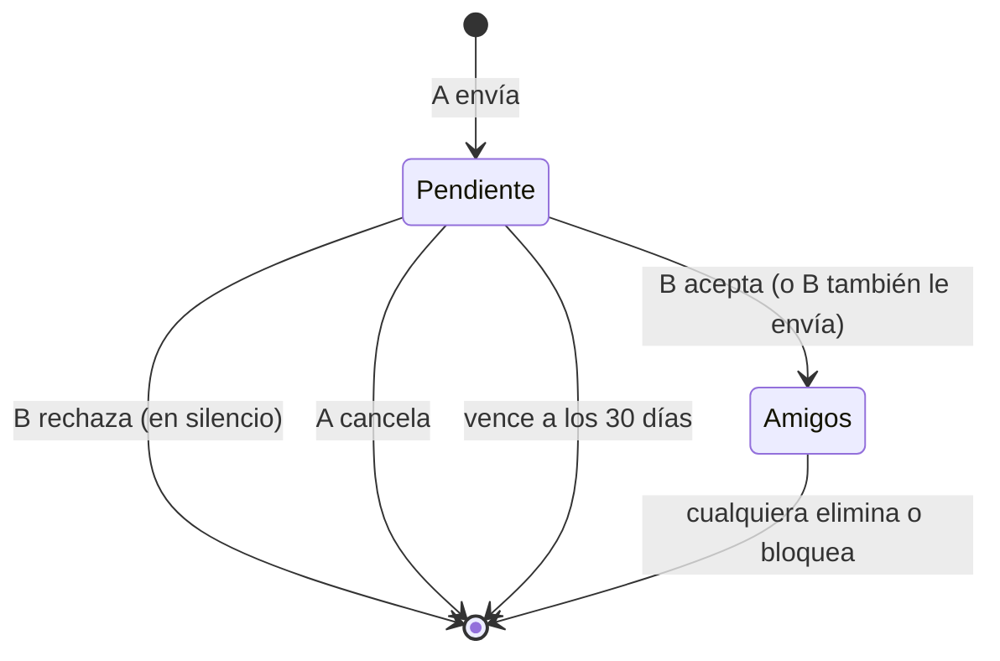

# Plan: amigos con solicitudes (replanteo 85)

> Planeación original. Estado: **aprobada por Daniel el 2026-11-07** (diseño en el lienzo "Amigos con solicitudes").

Hoy no hay solicitudes. Cada jugador "marca" a otro (`mm_friends`), el otro no se entera, y solo son amigos (se ven el estado y se invitan) si los dos se marcaron. En producción hay 53 marcas: 9 pares mutuos (18) y 35 de un solo lado.

## Decisiones tomadas

| Tema | Decisión | Por qué |
|---|---|---|
| Modelo | Solicitud → Aceptar / Rechazar. La amistad es de los dos | Lo pidió Daniel: como estaba era raro y nadie se enteraba |
| Aviso | Notificación `friend_request` con Aceptar / Rechazar (pestaña Solicitudes de la campana), y arriba del panel Amigos | Reusa el mecanismo de las invitaciones a equipos |
| Aceptada | Al que la envió le llega `friend_accepted` | Para que sepa que ya son amigos |
| Rechazada | **En silencio** (Daniel): al que la envió no le llega nada y su solicitud desaparece | Evita el mal momento |
| Solicitudes cruzadas | Si B le envía a A cuando A ya le había enviado a B, quedan amigos al instante | No tiene sentido pedir que acepten las dos |
| Eliminar | Se borra para los dos, sin aviso | Igual que en cualquier red |
| Bloqueo | Bloquear borra la amistad y las solicitudes entre los dos; el bloqueado no te puede enviar | Un bloqueado no puede seguir siendo amigo |
| Vencimiento | 30 días sin respuesta | Que no queden pendientes para siempre |
| Spam | Máximo 20 enviadas sin responder; tras un rechazo, 7 días para volver a enviar a la misma persona | Que no se pueda insistir |
| Categoría | Nueva, **Amigos** (`friends`) en las preferencias. La solicitud llega siempre (como las de equipo); el "aceptó" se puede apagar | Igual que las invitaciones a un equipo |
| Datos viejos (Daniel) | Los 9 pares mutuos siguen como amigos. Las 35 marcas de un solo lado pasan a **solicitudes pendientes**, con su notificación ya leída (no suben el número de la campana) | Ninguna se pierde y no llegan 35 avisos de golpe |
| Fichas sin cuenta | No se les puede enviar solicitud; las marcas viejas hacia ellas se borran | No hay quién la acepte |

## 1. El flujo completo

## 2. Base de datos (`supabase/replanteo/85_amigos_con_solicitudes.sql`)

- Tabla nueva `mm_friend_requests`: `id`, `from_user`, `to_user`, `status` (`pending`, `accepted`, `rejected`, `cancelled`, `expired`), `created_at`, `answered_at`. Una sola pendiente por par (índice único parcial). RLS sin acceso directo: todo pasa por funciones.
- `mm_friends` pasa a guardar las dos filas de cada amistad (A→B y B→A).
- Funciones:
  - `mm_add_friend(p_player)`: envía la solicitud (o acepta si la otra persona ya le había enviado). Valida: no a sí mismo, ficha con cuenta, sin bloqueo en ningún sentido, no amigos ya, tope de 20 y los 7 días tras un rechazo.
  - `mm_friend_answer(p_player, p_accept)`: acepta o rechaza la solicitud de esa persona.
  - `mm_remove_friend(p_player)`: elimina la amistad o cancela la solicitud enviada.
  - `mm_friendship(p_player)`: el estado con esa persona, para el botón del perfil: `none`, `sent`, `received` o `friends`.
  - `mm_block`: además borra la amistad y cierra las solicitudes entre los dos.
- `mm_my_profile`: `friends` con el estado siempre visible, y `friend_requests` con `received` y `sent`.
- Notificaciones: tipos `friend_request` (accionable, llega siempre) y `friend_accepted`, categoría `friends`. La notificación se resuelve (`accepted`, `rejected`, `cancelled`, `expired`) junto con la solicitud.
- Avisos por el socket: `friend.changed` a los dos en cada cambio.
- Migración de datos según la tabla de decisiones.
- Inversa en `reversas/85_…` y `probar_85.sh` con su `prueba_85.sql`.

## 3. API (`web/backend`)

- `POST /api/v1/mm/friends` (enviar), `DELETE /api/v1/mm/friends/{id}` (eliminar o cancelar): los mismos de siempre.
- Nuevos: `POST /api/v1/mm/friends/{id}/accept`, `POST /api/v1/mm/friends/{id}/reject` y `GET /api/v1/mm/friends/{id}` (el estado con esa persona).
- `friends` en las categorías de notificaciones y sus preferencias; mensajes de error de las validaciones.

## 4. Web (`web/frontend`)

- Panel Amigos de Jugar: solicitudes recibidas (Aceptar / Rechazar), la lista, las enviadas (Cancelar) y "Agregar amigo".
- Campana: `friend_request` con Aceptar / Rechazar y `friend_accepted`.
- Perfil público (de otro jugador, con sesión): el botón con sus 4 estados.
- Preferencias: la categoría Amigos.

## 5. Manual, términos y privacidad

- Manual: la página del jugador sobre amigos (o la de Jugar) y la de notificaciones.
- Privacidad: se guarda a quién le enviaste solicitud y si la aceptó.

## 6. Requisitos antes de empezar

Ninguno: todo es local (la base local es copia de producción).

## 7. Orden de implementación

1. La 85, su inversa y sus pruebas (`probar_85.sh docker`).
2. API y sus pruebas.
3. Web y sus pruebas.
4. Manual, términos, privacidad y la documentación.
