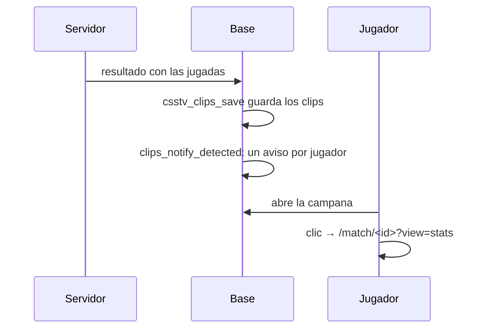
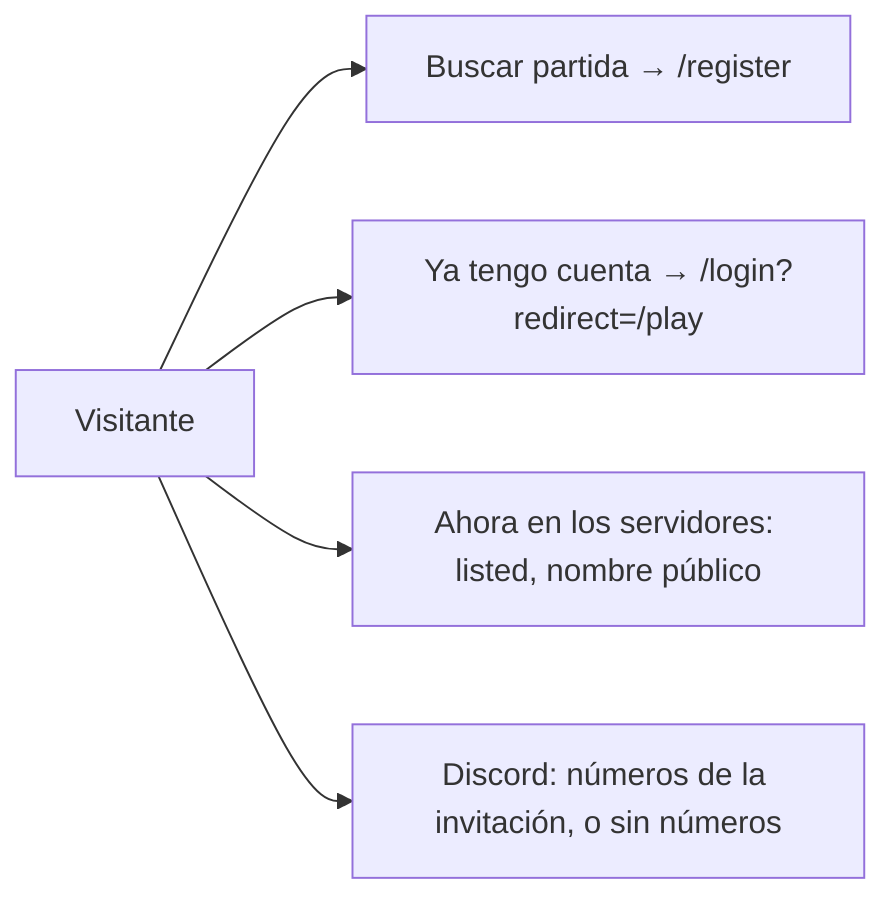

# Una notificación por partida con jugadas, la sección Juega del inicio y equipos más parejos: documentación

## Qué hace

Son tres ajustes que pidió Daniel el 2026-11-07, en el replanteo `83`:

1. **Jugadas destacadas:** cuando llega el resultado de una partida y el servidor detectó jugadas, cada jugador recibe **un solo aviso** en la campana con cuántas son y de qué tipo. Al tocarlo va a las estadísticas de esa partida. Antes llegaba un aviso por cada clip, cuando terminaba su video.
2. **Sección "Juega" del inicio:** reemplaza a "Entra a jugar ahora". La acción principal es buscar partida desde la web. Los servidores se muestran con su **nombre público** (genérico) y sin el botón Conectar, y solo los que están marcados para el inicio. La tarjeta del Discord muestra números reales o ninguno.
3. **Equipos más parejos:** el ELO de armado del matchmaking le da más peso al rating (400 puntos por cada 1,00 de rating, tope de 200 y 3 mapas de corrección, antes 200, 100 y 5).

## El aviso de jugadas

- **Tipo:** `clips_detected`, categoría `elo` ("Mixes y ELO" en las preferencias, la misma que tenía `clip_ready`).
- **Cuándo:** al final de `csstv_clips_save`, que corre al recibir el resultado de una partida (también una cancelada que trae jugadas).
- **A quién:** a la cuenta dueña de cada SteamID con jugadas **visibles** en la partida (`match_clip_list`: respeta los topes por partida y por jugador y saca las rechazadas). Una ficha sin cuenta no recibe nada.
- **Una sola vez:** `ref = 'clips:<partida>:<SteamID>'`. Si el resultado se vuelve a recibir, no se repite.
- **Datos:** `match_id`, `map`, `count` (cuántas jugadas), `kills` (las kills de cada jugada sin clutch, por ronda) y `clutches` (el 1vX de cada clutch).
- **Texto en la web:** "Tienes 3 jugadas destacadas en de_mirage_rc1" y "2 rondas de 4 kills y un clutch 1v2." (`clipsSummary`). Con una sola: "Tienes una jugada destacada".
- **Link:** `/match/<id>?view=stats`. En una partida del matchmaking la sala abre en **Estadísticas**; en un mix normal se ve la sala del mix, que ya muestra las tablas y "Lo más destacado".
- **`clip_ready`:** ya no se manda cuando termina el video. Queda solo para un clip que se volvió a grabar y que un admin **aprueba** (`video_review = 'approved'`).

## Nombres públicos y el inicio

| Columna de `game_servers` | Qué es |
|---|---|
| `name` | El **nombre público**: lo ve todo el mundo (inicio, sala de la partida, avisos de PCW y torneos, partidas en vivo). Único |
| `internal_name` | Cómo lo llamamos nosotros (flow, MVZG…). Solo en Administración. Opcional y único. La `83` copió ahí el nombre que tenía cada servidor |
| `listed` | Sale en "Ahora en los servidores" del inicio. Por defecto, sí |

- Se usó `name` como el público (y no una columna nueva) porque el nombre se muestra en muchos lugares: así todos pasan a mostrar el genérico sin tocar cada función.
- `game_servers_public` suma `listed`, y `GET /api/v1/servers/status` solo trae los que lo tienen. Las demás vistas que usan `game_servers_public` (partidas, mixes en vivo) siguen viendo todos los servidores, también los ocultos.
- `admin_server_list` suma `internal_name` y `listed`, y el buscador encuentra el nombre interno.
- Producción: `CM League #1` (MVZG), `#2` (flow) y `#3` (aurav34); los históricos `CM League (anterior)` y `(anterior 2)`, ocultos (`pruebas/nombres_publicos_produccion.sql`).

## La sección Juega

- **Arriba:** en la cola, partidas en vivo y jugando ahora. "En la cola" sale de `mm_public_counts()` (solo números, sin nombres), en `totals.in_queue` del estado de los servidores, junto con `mm_open`.
- **Matchmaking 5v5:** si la cola está abierta, los tres pasos (entrar a la cola, aceptar y vetar el mapa, conectarse) y los dos botones. El inicio solo lo ven visitantes (con sesión se va a `/home`).
- **Ahora en los servidores:** nombre público, mapa, estado ("Partida en vivo", el modo o "Fuera de línea") y jugadores. Sin la IP ni el botón Conectar.
- **Discord:** `GET /api/v1/community/discord` lee la invitación pública de Discord (`invites/<código>?with_counts=true`, sin token y sin datos del visitante) y la guarda 10 minutos (1 minuto si falló). El código sale de `DISCORD_INVITE_CODE` (por defecto `bn5Yxsh9tc`, el mismo link de "Para ti", `COMMUNITY.discordUrl`). Si Discord no responde, la tarjeta sale sin números. Se borraron los 214 y 1386 que estaban fijos en `config/site.ts`.

## Equipos más parejos

- `mm_config.balance_rating_weight` 400, `balance_rating_cap` 200 y `balance_rating_prior_maps` 3, como valores por defecto y en la fila de hoy (la `83` solo la cambia si seguía con 200, 100 y 5, los de antes).
- ELO de armado = ELO + 400 × (rating corregido − 1), entre −200 y +200. Rating corregido = (mapas × rating + 3) / (mapas + 3), con las partidas 5v5 de los últimos 60 días.
- **Por qué:** con los 115 mixes de producción (todos los que tienen el ELO previo guardado), el equipo con más ELO de armado ganó:

| Fuerza del equipo | Acierta al ganador | Log loss |
|---|---|---|
| Solo ELO | 60 % | 0,651 |
| Armado de antes (200, 100, 5) | 64 % | 0,628 |
| **Armado nuevo (400, 200, 3)** | **66 %** | **0,604** |
| μ de TrueSkill | 62 % | 0,656 |

  Armar con la μ de TrueSkill se descartó: predice peor que el armado de antes.
- **El caso que lo motivó:** team_1GRIM contra team_Angel2k (07-nov, de_mirage_rc1, 11-3). Con el armado de antes, TrueSkill le daba 63 % al equipo de 1GRIM. Con el nuevo, el reparto habría sido Lukzz, 1GRIM, shevchenko, phonkk y valeh contra nachyz, romanxz, kobassj, Angel2k e iv. (49 %). La comparación de la tabla se puede repetir con `pruebas/backtest_armado.py` (los datos que lee no van al repo: tienen SteamID).
- Quién entra a la sala, el capitán, el veto y el ELO que se gana o pierde no cambian.

## Qué cambia para cada rol

| Rol | Qué cambia | Página del manual |
|---|---|---|
| Jugador | Un aviso por partida con sus jugadas, que lleva a las estadísticas; ya no uno por video. Los equipos del matchmaking tienen más en cuenta el rating | `jugador/clips-y-demos.md`, `jugador/notificaciones.md`, `jugador/buscar-partida.md` |
| Admin | Nombre público, nombre interno y "Mostrar en el inicio" en cada servidor; los valores nuevos del armado | `admin/servidores.md`, `admin/matchmaking.md` |
| Visitante (sin cuenta) | La sección Juega del inicio | (no tiene manual: la ayuda es con sesión) |
| Capitán, organizador, moderador, streamer, dueño de un servidor externo | Nada | |

## Términos y privacidad

Sin cambios:

- El aviso de jugadas usa datos que ya se guardaban (las jugadas y las notificaciones).
- La consulta a Discord la hace nuestra API, sin datos de ningún usuario.
- Los términos ya dicen que el matchmaking puede usar el rating para emparejar.

## Dónde está cada cosa

| Qué | Dónde |
|---|---|
| Base | `supabase/replanteo/83_jugadas_inicio_emparejamiento.sql`; inversa en `docs/bitacora/2026-10-14-replanteo-modelo-datos/reversas/` |
| Aviso | `clips_notify_detected`, `csstv_clips_save`, `tg_notify_match_clips`, `notification_category` |
| API | `web/backend/src/routes/servers.ts`, `services/servers.ts`, `services/discord.ts`, `routes/admin-servers.ts`, `schemas/servers.ts`, `env.ts` (`DISCORD_INVITE_CODE`) |
| Web | `features/landing/components/ServersSection.tsx`, `features/shell/notifications/lib/model.ts`, `features/admin/servers/components/ServersTab.tsx`, `features/matchmaking/room/MatchRoom.tsx`, `features/mixes/pages/MixRoomPages.tsx`, `features/mixes/lib/search.ts`, `routes/_app/match.$id.tsx` |
| Nombres de producción | `pruebas/nombres_publicos_produccion.sql` |
| Diseño | https://claude.ai/artifact/LsFJh5Q1zPyTFqVpoJSvii |
