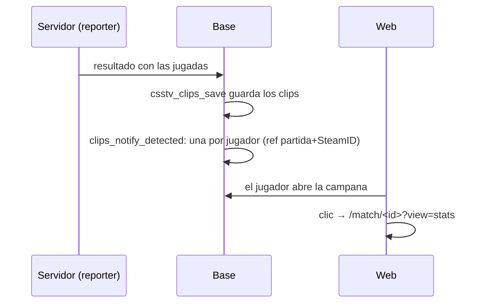
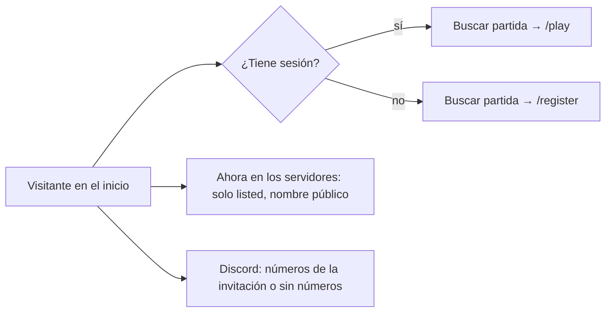

# Plan: una notificación por partida con jugadas, la sección Juega del inicio y equipos más parejos

Pedido por Daniel el 2026-11-07, en tres ajustes ("Queremos hacer algunos ajustes básicos"). Aprobado el mismo día ("Apruebo las 3, implementa"). Diseño de la sección del inicio en el artifact https://claude.ai/artifact/LsFJh5Q1zPyTFqVpoJSvii (versión 3, con la nota de los nombres públicos).

## Decisiones tomadas

| Tema | Decisión | Por qué |
|---|---|---|
| Aviso de jugadas | **Una sola notificación por jugador y partida** (`clips_detected`) apenas se detectan las jugadas, con cuántas son y de qué tipo. Lleva a las estadísticas de la partida | Hoy llega un `clip_ready` por cada clip, cuando termina su video: con 3 jugadas son 3 avisos |
| Cuándo se manda | Al guardar las jugadas de la partida (`csstv_clips_save`), solo con las que se ven (`match_clip_list`). Una vez: la clave `ref` es la partida y el SteamID, y una reingesta no repite el aviso | Los clips de una partida se guardan todos juntos al llegar el resultado |
| `clip_ready` | Deja de mandarse cuando termina cada video. Queda solo cuando un admin **aprueba** un clip reprocesado, que pasa días después | Si no, el jugador vuelve a recibir un aviso por clip |
| A dónde lleva | `/match/<id>?view=stats`: en una partida del matchmaking, la sala abre en **Estadísticas**; en un mix normal, la sala del mix (que ya muestra las tablas y los destacados) | Daniel: "que cuando le des click te lleve a las estadísticas de esa partida" |
| Sección del inicio | "Entra a jugar ahora" pasa a **"Juega · Tu próxima partida, a un clic."**: la tarjeta del matchmaking 5v5 (en la cola, partidas en vivo, jugando ahora, los tres pasos y **Buscar partida**), "Ahora en los servidores" sin botón Conectar y el Discord | Hoy se busca partida desde la web, no pegando la IP |
| Buscar partida | Con sesión lleva a `/play`; sin sesión, a `/register`. Segundo botón: "Crear cuenta gratis" (sin sesión) | |
| Cuántos en la cola | Dato nuevo y público en `GET /api/v1/servers/status`: `totals.in_queue` y `mm_open`, de una función nueva `mm_public_counts()` (solo números, sin nombres) | No hay hoy un dato público de la cola |
| Discord | El link es el mismo de "Para ti" (`COMMUNITY.discordUrl`). Los números (en línea y miembros) salen de la invitación pública de Discord, leída por la API con caché de 10 minutos (`GET /api/v1/community/discord`). Si Discord no responde, la tarjeta se muestra sin números | Hoy 214 y 1386 están fijos en el código |
| Nombres de los servidores | **`game_servers.name` pasa a ser el nombre público** (lo que ve todo el mundo: inicio, sala, avisos, partidas en vivo). Columna nueva **`internal_name`**, solo para Administración (flow, MVZG, aurav34…) | El nombre se muestra en muchos lugares (sala del matchmaking, avisos de PCW, partidas en vivo, detalle): cambiar el significado de una columna es más seguro que tocar cada función |
| Servidores que salen en el inicio | Columna nueva **`listed`** (por defecto sí). Los históricos de producción (flow histórico, Old Server, …) se apagan al desplegar | Hoy aparecen servidores que ya no existen |
| Nombres en producción | Al desplegar: `CM League #1`, `CM League #2` y `CM League #3`, con el nombre de hoy en `internal_name` (script aparte, con los id de producción) | Daniel: "los servidores de abajo siempre deberían tener nombres genéricos" |
| Emparejamiento | **Propuesta 1**: el ELO de armado con más peso del rating. `balance_rating_weight` 200 → **400**, `balance_rating_cap` 100 → **200**, `balance_rating_prior_maps` 5 → **3**, como valores por defecto y en producción | Con los 115 mixes de producción, ese reparto acierta al ganador el 66 % de las veces (log loss 0,604), contra 64 % (0,628) del actual y 62 % (0,656) de la μ de TrueSkill. En la partida de team_1GRIM contra team_Angel2k (07-nov, 11-3) habría dejado 49 % - 51 % en vez de 63 % - 37 % |
| Armar con la μ de TrueSkill | **Descartado** | Predice peor que el armado actual (ver la fila anterior) |
| Número | Replanteo `83` (la `81` está reservada para la vista previa de la llave y la `82` para la caída con abandono) | |

## 1. Los flujos

## 2. Base (replanteo `83_jugadas_inicio_emparejamiento.sql`)

1. `notification_category`: `clips_detected` en la categoría `elo` (la misma de `clip_ready`, así la preferencia del usuario sigue valiendo).
2. `clips_notify_detected(p_match)`: por cada SteamID con jugadas visibles en `match_clip_list`, si no hay ya una notificación con `ref = 'clips:<partida>:<SteamID>'`, llama a `notify(users_of_steam(...), 'clips_detected', {match_id, map, count, kills, clutches}, ref, true)`. `kills` es la lista de kills de cada jugada sin clutch; `clutches`, la de los 1vX.
3. `csstv_clips_save` la llama al final (con `pg_temp.reemplazar`, sin reescribir la función).
4. `tg_notify_match_clips`: solo la rama del clip aprobado.
5. `game_servers.internal_name` (texto, opcional, único entre los que lo tienen) y `game_servers.listed` (booleano, por defecto `true`). El replanteo copia el `name` de hoy a `internal_name`, para no perder cómo los llamamos.
6. `game_servers_public` suma `listed` al final. `admin_server_list` suma `internal_name` y `listed`, y los busca.
7. `mm_public_counts()`: `{open, in_queue}` (cuántos en la cola de cualquier modo), para `anon`.
8. `mm_config`: los valores por defecto nuevos (400, 200, 3) y la fila de hoy con esos valores **solo si sigue con los de antes** (200, 100, 5): si un admin ya los cambió, no se pisan.
9. Inversa en `docs/bitacora/2026-10-14-replanteo-modelo-datos/reversas/83_jugadas_inicio_emparejamiento.sql` y pruebas en una transacción con rollback (`pruebas/probar_83.sh` y `prueba_83.sql`).

## 3. API

- `GET /api/v1/servers/status`: solo los servidores con `listed`, y `totals.in_queue` y `mm_open`.
- `GET /api/v1/community/discord` (pública): `{online, members}` de `https://discord.com/api/v9/invites/<código>?with_counts=true`, con caché de 10 minutos; `null` en los dos si Discord no responde. El código sale del link de la comunidad (variable `DISCORD_INVITE_CODE`, con `bn5Yxsh9tc` por defecto).
- Administración › Servidores: `internal_name` y `listed` en la lista, el detalle, el alta y la edición.

## 4. Web

- Campana: el texto de `clips_detected` ("Tienes 3 jugadas destacadas en de_mirage_rc1" y el detalle "2 de 4 kills y un clutch 1v2") y el link con `view=stats`. `NotificationLink` admite `search`.
- `/match/<id>`: el parámetro `view=stats` abre la sala del matchmaking en Estadísticas.
- Inicio: `ServersSection` con el diseño del artifact. Fuera los números fijos de Discord en `config/site.ts`.
- Administración › Servidores: "Nombre público" (el `name`), "Nombre interno" y "Mostrar en el inicio".

## 5. Documentación

- Manual: la página de notificaciones del jugador, `admin/servidores` (nombres e inicio) y `admin/matchmaking` (los valores del armado), las que correspondan según `docs/manual/README.md`.
- Términos y privacidad: revisar si dicen algo de cómo se avisan las jugadas, de los nombres de los servidores o de Discord; si no, "Sin cambios".
- `CHANGELOG_DISCORD.txt`.

## 6. Requisitos

- Ninguno nuevo: base local con Docker, y los datos de producción solo para leer (las simulaciones del emparejamiento ya se hicieron).

## 7. Orden de implementación

1. La `83`, su inversa y `probar_83.sh` en la base local.
2. La API y sus pruebas.
3. La web y sus pruebas.
4. Manual, términos, changelog, `DOCUMENTACION.md`, `GUIA_IMPLEMENTACION.md` (con el script de nombres de producción) e índices.
5. Desplegar solo cuando Daniel lo pida.
