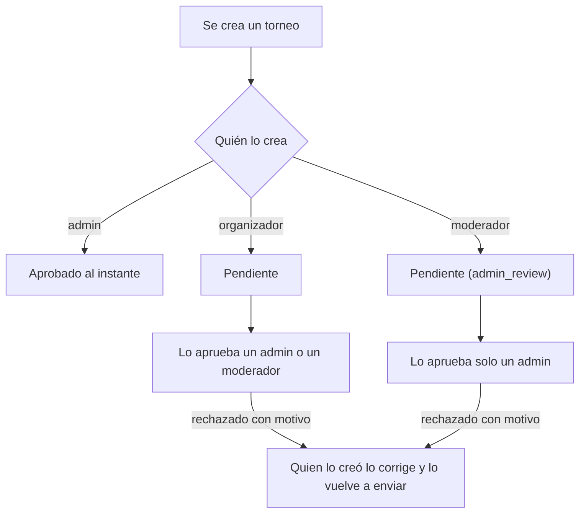

# El moderador crea torneos y el premio con monto y divisa

Pedido por Daniel el 2026-11-07, al probar en local los torneos históricos con un moderador. Replanteo `84`. Sigue a [`2026-11-06-torneos-historicos-y-testing`](../2026-11-06-torneos-historicos-y-testing/).

## Qué hace

1. **El moderador crea torneos**, normales e históricos (antes solo históricos, aprobados solos). Todo lo que crea queda **pendiente** y lo aprueba o lo rechaza **solo un admin**.
2. **El premio tiene monto y divisa**: un monto opcional, la divisa (USD, Pesos argentinos u Otra, con su nombre) y el texto libre de siempre como detalle.

## Quién aprueba qué

- `events.admin_review` lo pone la base al crear: `true` si lo creó un moderador. No se cambia después, así que un cambio de rol de quien lo creó no cambia quién lo aprueba.
- `event_review` responde `42501` (`403` en la API) a un moderador sobre un torneo con `admin_review`.
- El aviso `admin_event_review` (al crear y al volver a enviar) va solo a los admins si el torneo es de un moderador; el de un organizador sigue yendo a admins y moderadores.
- El moderador es **dueño** de lo que creó (`can_own_event`): lo cancela y lo borra. Lo vuelve a enviar aunque esté en testing.
- Los mixes que vincula un moderador siguen aprobados al instante (no cambió).

## El premio

| Columna | Qué guarda |
|---|---|
| `prize` | El detalle en texto libre (hasta 200), como antes |
| `prize_amount` | `numeric(12,2)`, mayor que 0. Opcional |
| `prize_currency` | `USD`, `ARS` u `other`. Va junto con el monto |
| `prize_currency_other` | El nombre de la otra divisa (1 a 12 caracteres), solo con `other` |

La web lo muestra con `prizeText` (`features/events/lib/model.ts`), igual en la lista, el detalle, el resumen, el inicio y la vitrina del equipo: "US$ 100 + medalla", "$ 50.000 ARS + rol en Discord", "200,5 BRL", solo el detalle si no hay monto, o "Sin premio".

## API

- `EventCreate`/`EventPatch`: `prize_amount`, `prize_currency`, `prize_currency_other`.
- `EventSummary`: esos tres y `admin_review`. Filtro `admin_review` en `GET /events`.
- `viewer.can_approve`: si quien mira puede aprobar o rechazar ese torneo. `viewer.can_review` sigue siendo "es del staff" (testing y mixes).
- Un premio inválido (monto sin divisa, "Otra" sin nombre…) responde `400 VALIDATION_ERROR` con un mensaje sobre el premio.

## Web

- El moderador ve **Crear torneo** y el selector **Normal / Histórico**, con la casilla de testing. El aviso dice "cuando un admin lo apruebe".
- `ReviewPanel`: **Aprobar** y **Rechazar** con `viewer.can_approve`. Un moderador, en el torneo de otro moderador, lee "Lo creó un moderador: lo aprueba o lo rechaza un admin".
- Administración › Torneos: **Qué falta** dice **Revisar y aprobar** a quien puede, **Espera aprobación** o **Espera a un admin** a los demás. El aviso de pendientes no le cuenta a un moderador lo que aprueba un admin.
- Formulario: **Monto**, **Divisa** (con el nombre si es **Otra**) y **Detalle**, con un "Se ve: …" debajo.

## Qué cambia para cada rol

| Rol | Qué cambia | Manual |
|---|---|---|
| Moderador | Crea torneos normales e históricos, que esperan a un admin. No aprueba los de otro moderador | [`organizador/crear-torneo.md`](../../manual/organizador/crear-torneo.md), [`moderador/aprobar-torneos-y-mixes.md`](../../manual/moderador/aprobar-torneos-y-mixes.md), [`organizador/subir-torneo-historico.md`](../../manual/organizador/subir-torneo-historico.md) |
| Admin | Aprueba también lo que crean los moderadores; le llegan sus avisos | [`moderador/aprobar-torneos-y-mixes.md`](../../manual/moderador/aprobar-torneos-y-mixes.md) |
| Organizador | El premio con monto y divisa | [`organizador/crear-torneo.md`](../../manual/organizador/crear-torneo.md) |
| Todos | Ven el premio con su divisa | — |

## Términos y privacidad

- **Términos:** se suma que los torneos que crea un moderador se publican cuando los aprueba un administrador (`TermsPage.tsx` y `terms/terminos.html`).
- **Privacidad:** sin cambios (el premio no es un dato personal).
