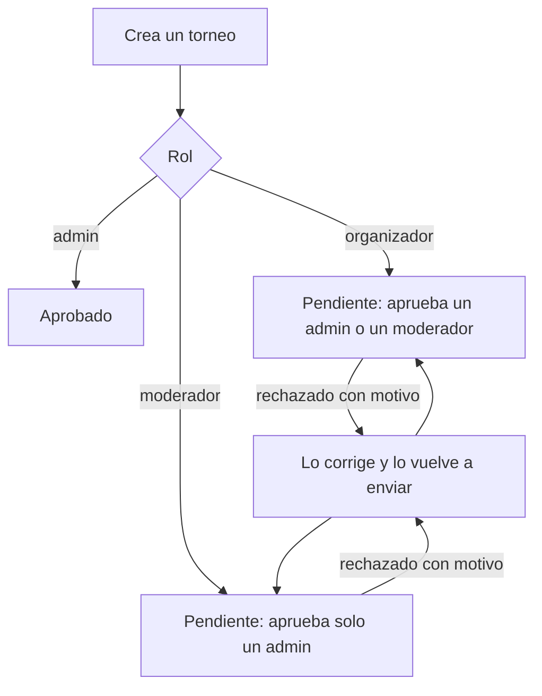

# Plan: el moderador crea torneos (con aprobación de un admin) y el premio con monto y divisa

> Planeación original. Estado: **aprobada** por Daniel el 2026-11-07 (respuestas en el chat). Sigue a [`2026-11-06-torneos-historicos-y-testing`](../2026-11-06-torneos-historicos-y-testing/).

Pedido de Daniel (2026-11-07), al probar en local con un moderador: "el moderador no tiene el botón para crear torneo, él también debería poder hacerlo aunque también requiere aprobación de un admin y además agreguemos un campo para elegir divisa en los premios, es decir que tenga USD/Pesos argentinos/Otro".

Hoy (replanteo `80`) un moderador crea solo torneos históricos y le quedan aprobados solos. El premio es un texto libre.

## Decisiones tomadas

| Tema | Decisión | Por qué |
|---|---|---|
| Qué crea un moderador | Torneos normales e históricos | Pedido de Daniel |
| Qué espera aprobación | **Todo** lo que crea un moderador (normal o histórico), igual que lo de un organizador | Daniel (2026-11-07) |
| Quién aprueba lo de un moderador | **Solo un admin**. Otro moderador no lo aprueba ni lo rechaza. Lo de un organizador lo siguen aprobando admins y moderadores | Daniel (2026-11-07) |
| Cómo se marca | `events.admin_review` (boolean), que fija la base al crear: `true` si lo creó un moderador | Si se mirara el rol actual de quien lo creó, un cambio de rol cambiaría quién puede aprobarlo |
| Mixes vinculados por un moderador | Siguen aprobados solos (como hoy) | Daniel lo decidió el 2026-11-06 para admins y moderadores; no lo cambió |
| Testing | Un moderador sigue pudiendo marcar testing. Testing y aprobación son independientes: un torneo de un moderador en testing también espera a un admin para publicarse | Ya funcionan así para el admin y el organizador |
| Aviso de revisión | El de un torneo de un moderador (`admin_event_review`) les llega solo a los admins | Solo ellos lo pueden aprobar |
| Premio | Tres campos: monto (opcional), divisa (`USD`, `ARS` o `other` con su nombre) y el texto libre de siempre como detalle | Daniel eligió "Monto + divisa + texto" |
| Cómo se ve | `US$ 100 + medalla`, `$ 50.000 ARS + rol en Discord`, `200 BRL`; sin monto, solo el detalle; sin nada, "Sin premio" | Monto con separador de miles en español |

## 1. El flujo completo

## 2. Base de datos (replanteo `84`)

- `events.admin_review boolean not null default false`. Lo pone `events_guard` al crear: `true` si quien crea es moderador (no admin). No se cambia después.
- Columnas del premio en `events`:
  - `prize_amount numeric(12,2)`: mayor que 0.
  - `prize_currency text`: `USD`, `ARS` u `other`.
  - `prize_currency_other text`: hasta 12 caracteres.
  - Constraints: con monto hace falta la divisa (y al revés), y `other` necesita su nombre (y solo `other` lo lleva).
- Política "torneos: crear": un moderador crea cualquier torneo (hoy solo históricos).
- `events_guard`:
  - el moderador crea normales;
  - la aprobación nace `approved` solo para un admin (o sin usuario, mantenimiento);
  - `admin_review` no se cambia.
- `event_review`: si `admin_review`, solo un admin (`42501` para un moderador).
- `event_resubmit`: el moderador vuelve a enviar su torneo rechazado aunque esté en testing.
- `can_own_event`: el moderador también es dueño de lo que creó (borrar y cancelar), como el organizador.
- Avisos (`tg_notify_events` y `event_resubmit`): con `admin_review`, `admin_event_review` va solo a los admins.
- `event_list` suma `admin_review`, `prize_amount`, `prize_currency` y `prize_currency_other`.
- Inversa y pruebas SQL en una transacción con rollback, como la `80`.

## 3. API (`web/backend`)

- `EventCreate` y `EventPatch`: `prize_amount`, `prize_currency` y `prize_currency_other`.
- `EventSummary` y el detalle: esos tres y `admin_review`.
- `viewer.can_approve` (nuevo): si quien mira puede aprobar o rechazar **ese** torneo (admin, o moderador si no es `admin_review`). `viewer.can_review` sigue siendo "es del staff" (testing y mixes).
- Los errores del premio (constraints) salen como `400` con un mensaje claro.
- Pruebas de integración: el moderador crea un normal pendiente; otro moderador no lo aprueba; un admin sí; el aviso llega solo a los admins; el premio con y sin monto, y los errores.

## 4. Web (`web/frontend`)

- `canCreateEvent`: suma al moderador. El formulario le muestra Normal e Histórico.
- "Pendiente de aprobación" para el moderador: "cuando un admin lo apruebe".
- `ReviewPanel`: Aprobar y Rechazar con `viewer.can_approve`. A un moderador, en el torneo de otro moderador, le dice que lo aprueba un admin.
- Administración › Torneos: el siguiente paso de un pendiente con `admin_review`, para un moderador, dice "Espera a un admin".
- Formulario: el premio con monto, divisa (USD, Pesos argentinos, Otra con su nombre) y detalle.
- `prizeText(event)`: un solo formato para la lista, el detalle, el resumen y el inicio.

## 5. Manual, términos y privacidad

- Manual:
  - `moderador/aprobar-torneos-y-mixes.md`: lo de otro moderador lo aprueba un admin.
  - Página nueva `moderador/crear-torneo.md`.
  - `organizador/crear-torneo.md` y `admin`: el premio con divisa, y que lo del moderador lo aprueba el admin.
- Términos: lo que puede hacer el moderador (crear torneos, sujetos a aprobación de un admin). Privacidad: sin cambios (el premio no es un dato personal).

## 6. Requisitos antes de empezar

- La `80` en producción (desplegada el 2026-11-07). Los números `81`, `82` y `83` están tomados por otros requerimientos (vista previa, caída con abandono y jugadas); este usa el `84`.

## 7. Orden de implementación

1. Replanteo `84`, su inversa y pruebas SQL.
2. API, esquemas, `db/types.ts`, `schema.d.ts` y pruebas.
3. Web.
4. Prueba en local con los usuarios de prueba (admin, moderador y organizador).
5. Manual, términos, `DOCUMENTACION.md`, `GUIA_IMPLEMENTACION.md`, `CHANGELOG_DISCORD.txt` y `docs/PENDIENTES.md`.
6. Commit y despliegue cuando Daniel lo pida.
