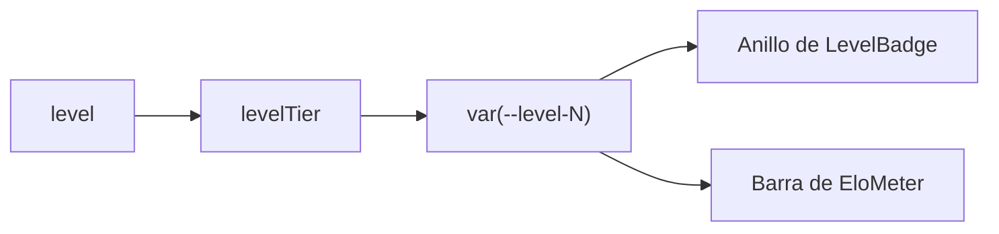

# El nivel con el anillo de 10 segmentos y su color

Pedido por Daniel el 2026-11-07. Solo la web: no toca la base ni la API.

## Qué hace

En toda la web el nivel de un jugador (1 a 10) se dibuja como un **anillo de 10 segmentos**: se encienden tantos como el nivel, con el color de su tramo, y el número va en el centro. Antes era un cuadrado con el número, y del 4 al 7 tomaba el color del texto (blanco en modo oscuro).

| Nivel | Tramo | Color |
|---|---|---|
| 1 | `--level-1` | Neutro (gris claro en oscuro, gris en claro) |
| 2 y 3 | `--level-2` | Verde |
| 4 a 7 | `--level-4` | Amarillo |
| 8 y 9 | `--level-8` | Naranja |
| 10 | `--level-10` | Rojo |

Los segmentos apagados usan `--level-off`, y el número, el color del texto. Las variables están en `web/frontend/src/index.css`, en claro (`:root`) y en oscuro (`.dark`).

## Dónde está

- `components/brand/LevelBadge.tsx`: el SVG en línea (lienzo de 240, los 10 caminos calculados una vez), `levelTier` y `levelColor`. Mismos tamaños que antes (20, 22, 24, 26, 30 y 48 px) y mismo `title`, con `role="img"` y `aria-label` "Nivel N".
- `features/matchmaking/EloMeter.tsx`: la barra de los 10 niveles de **Jugar** se enciende con el color del nivel (antes, el naranja principal).
- Lo usan los 23 lugares que ya tenían `LevelBadge`: ranking, perfil, sidebar, sala del mix, Jugar, comparador, inicio, etc.
- Tres lugares dibujaban el nivel a mano y ahora usan `LevelBadge`:
  - la tarjeta **Nivel** del perfil público (`PlayerProfile.tsx`), con el anillo de 60 px. Su escalera de 10 tramos toma el color del nivel (los superados un poco más tenues);
  - la pestaña **Temporadas** del perfil (`SeasonsTab.tsx`), con el nivel de cada temporada;
  - el menú de la cuenta, abajo del sidebar (`AccountMenu.tsx`).
- "Sin nivel todavía" (`NoLevelBadge` en `components/illustrations`) es el mismo anillo, apagado y con un "?", en lugar del hexágono.

## Origen del diseño

La propuesta de `badges/nuevas/niveles/` (copia `v34frag-main`, 2026-11-04). Se mantuvo la forma y la escala por tramos, pero con **tonos propios**: la propuesta copiaba los colores exactos de FACEIT. No se usaron sus SVG (el número en blanco solo servía sobre fondo oscuro) ni la variante con letras.

## Qué cambia para cada rol

| Rol | Qué cambia | Manual |
|---|---|---|
| Todos | El nivel se ve como un anillo de color en toda la web | Sin cambios (el manual no describe cómo se ve) |

## Términos y privacidad

Sin cambios.
