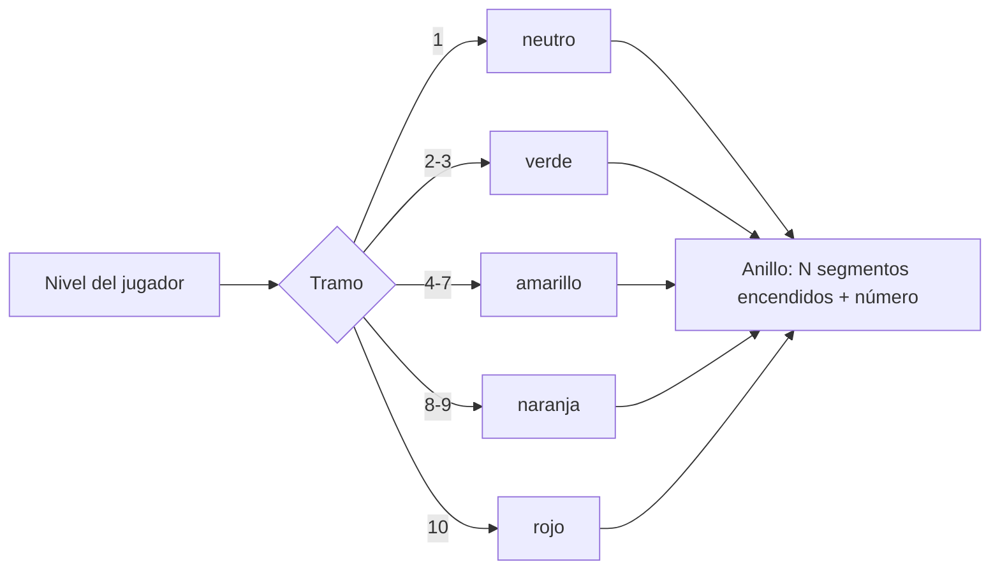

# Plan: el nivel con el anillo de 10 segmentos y su color

> Planeación original. Estado: **aprobada** por Daniel el 2026-11-07 ("implementa en el local").

Pedido de Daniel (2026-11-07): "en todas las partes de la aplicación se ve el nivel con un fondo blanco y recuerdo que habíamos diseñado unos niveles que variaban de color según qué tan alto/bajo estuviera".

El diseño es la propuesta de `badges/nuevas/niveles/` (copia `v34frag-main`, rama `feat-missions-badges`, 2026-11-04): un anillo de 10 segmentos que se encienden según el nivel, con el número en el centro y un color por tramo. El plan de las medallas lo dejó fuera. Hoy `LevelBadge` es un cuadrado con el número; del 4 al 7 usa el color del texto, que en modo oscuro es blanco.

## Decisiones tomadas

| Tema | Decisión | Por qué |
|---|---|---|
| Forma | El anillo de la propuesta: 10 segmentos, tantos encendidos como el nivel, y el número en el centro | El diseño que Daniel recordaba |
| Números o letras | Números | La propuesta tiene una variante con letras (D a S); Daniel no la eligió, y los números son los que ya usa toda la web |
| Escala de colores | La misma idea por tramos (1, 2-3, 4-7, 8-9, 10: de neutro a verde, amarillo, naranja y rojo), con **tonos propios** | La propuesta copiaba los hex exactos de FACEIT; se mantiene la escala, no la paleta de otra marca |
| Modo claro | Variante propia: el 1 en gris, los colores un poco más oscuros, los segmentos apagados en gris claro y el número del color del texto | La propuesta solo servía sobre fondo oscuro |
| Cómo se dibuja | Un SVG en línea dentro de `LevelBadge`, con los colores como variables del tema (`--level-*` en `index.css`) | Un solo componente para los 23 lugares que lo usan, con los mismos tamaños (20 a 48 px) y sin pedir imágenes |
| La barra de `EloMeter` | Los segmentos encendidos con el color del nivel | Es la misma barra de 10 niveles |
| Fuente | La de la web (Montserrat queda para después, Daniel 2026-11-06) | — |

## 1. Qué cambia

## 2. Web (`web/frontend`)

- `index.css`: `--level-1`, `--level-2`, `--level-4`, `--level-8`, `--level-10` y `--level-off`, en claro y en oscuro.
- `components/brand/LevelBadge.tsx`: el anillo (los 10 caminos se calculan una vez), el número y `title`/`aria-label` "Nivel N". Exporta `levelColor(level)`.
- `features/matchmaking/EloMeter.tsx`: la barra con `levelColor`.
- Pruebas: el tramo de cada nivel y cuántos segmentos se encienden.

## 3. Manual, términos y privacidad

- Manual: sin cambios (no describe cómo se ve el nivel).
- Términos y privacidad: sin cambios.

## 4. Orden de implementación

1. Variables del tema y `LevelBadge`.
2. `EloMeter`.
3. Pruebas, lint y revisión en local (claro y oscuro).
4. `DOCUMENTACION.md`, `GUIA_IMPLEMENTACION.md`, `CHANGELOG_DISCORD.txt` y `docs/PENDIENTES.md`.
5. Commit y despliegue de la web cuando Daniel lo pida.
