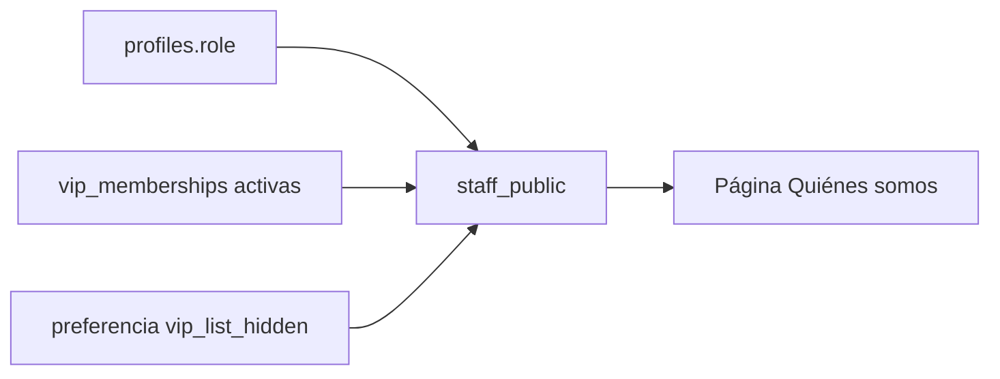

# La página del Equipo (Quiénes somos): documentación

## Qué hace

La página **Quiénes somos** (`/equipo`, en Comunidad del menú) muestra a las personas detrás de CMLeague:

- **Administración:** los admins, en tarjetas grandes con avatar, nick, la etiqueta Admin y los botones "Ver perfil" y "Discord".
- **Moderación:** los moderadores, en tarjetas chicas que llevan a su perfil.
- **Gracias a los VIP:** los VIP activos (sin los admins), del más antiguo al más nuevo, con "VIP desde". El botón **Cómo ser VIP** abre una ventana: "Comunícate con uno de nuestros administradores por Discord" y "Abrir Discord".

La lista se arma sola con el rol de cada cuenta (`profiles.role`) y el VIP vigente. Solo salen las cuentas con ficha de jugador. Un VIP puede ocultarse desde **Mi perfil › Privacidad**.

## Nombre en el menú

El link se llama **Quiénes somos**, no "Equipo": en el menú ya está **Mi equipo** (el equipo con el que juega cada uno), y "Equipo" a secas confundía.

## Funciones y API

| Función | Ruta | Qué hace |
|---|---|---|
| `staff_public()` | `GET /api/v1/staff` | `{ admins, moderators, vips }` con `player_id`, `nick`, `photo_url`, `level` (y `since` en los VIP) |
| `vip_list_me()` | `GET /api/v1/me/vip-list` | `{ vip, hidden }` |
| `vip_list_hidden_set(p_hidden)` | `PUT /api/v1/me/vip-list` | Ocultarse o volver a la lista (`user_preferences.preferences.vip_list_hidden`) |

Todo pide sesión: la página está dentro de la web con sesión, como el resto de la Comunidad.

## Web

- `routes/_app/equipo.tsx` y `features/staff/StaffPage.tsx`.
- `features/vip/VipDialog.tsx`: la ventana "Cómo ser VIP" (la usa también la tarjeta de visitas).
- `features/profile/components/VipListCard.tsx`: el interruptor "Aparecer en la lista de VIP" en Mi perfil › Privacidad, solo para VIP.
- `features/shell/lib/nav.ts`: el ítem **Quiénes somos**.

## Qué cambia para cada rol

| Rol | Qué cambia | Página del manual |
|---|---|---|
| Jugador | Ve la página Quiénes somos; si es VIP, aparece en el agradecimiento y puede ocultarse | [`jugador/quienes-somos.md`](../../manual/jugador/quienes-somos.md) (nueva) |
| Moderador y admin | Aparecen en la página con su rol | La misma |

## Términos y privacidad

Privacidad: si eres admin o moderador, tu rol se muestra en Quiénes somos; si eres VIP, tu nick y desde cuándo lo eres, salvo que te ocultes. Términos: sin cambios.

## Dónde está cada cosa

| Qué | Dónde |
|---|---|
| Migración e inversa | `supabase/replanteo/87_pagina_equipo.sql`, `docs/bitacora/2026-10-14-replanteo-modelo-datos/reversas/87_pagina_equipo.sql` |
| Pruebas de la base | `pruebas/probar_87.sh` y `pruebas/prueba_87.sql` |
| API | `web/backend/src/routes/community.ts` |
