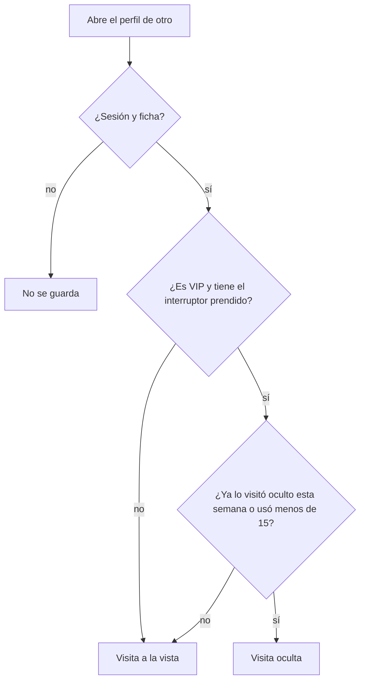

# Visitas a tu perfil: documentación

## Qué hace

Cuando un jugador con sesión abre el perfil público de otro, la web registra la visita. El dueño ve en su propio perfil (pestaña Resumen) la tarjeta **Visitas a tu perfil**: cuántos jugadores lo visitaron en 30 días y en los últimos 7. Sin VIP ve solo el número y una grilla de siluetas de colores al azar; con VIP ve quiénes son (avatar, nick, nivel y cuándo), las últimas tres y "Ver todas". Nadie ve las visitas del perfil de otro.

Un VIP puede **navegar sin dejar rastro**: con el interruptor prendido, sus visitas no se ven ni suman, hasta 15 perfiles distintos por semana. Desde el 16, se ven.

## Reglas

| Regla | Detalle |
|---|---|
| Qué cuenta | Una visita por visitante, perfil y día (fecha de Bogotá). No cuentan las propias, las de una cuenta sin ficha, las sin sesión ni las de fichas sin cuenta (no tienen dueño) |
| Plazo | 30 días. Cada visita borra las de más de 30 días de ese perfil |
| Sin VIP | La API manda solo `total` y `week`; `items` e `incognito` van en `null`. Los colores de las siluetas los elige la web al azar |
| Con VIP | `items`: hasta 100 visitantes, el más reciente primero |
| Modo oculto | Solo VIP. Hasta 15 perfiles distintos por semana (lunes 00:00 a domingo, Bogotá). Volver a uno oculto esa semana no gasta otro. Si el mismo día hubo una visita a la vista, queda a la vista |
| Visitas ocultas | No se muestran ni suman al número del dueño |
| VIP vencido | El interruptor sigue guardado pero no vale: visita a la vista |

## Datos y funciones

- `profile_visits`: `player_id`, `visitor`, `day`, `visited_at`, `hidden`. Clave `(player_id, visitor, day)`. Sin acceso directo.
- `user_preferences.preferences.profile_incognito`: el interruptor.
- `profile_visit(p_player)`, `my_profile_visits()`, `profile_incognito_set(p_on)` (prenderlo sin VIP: `42501`), `bogota_today()` y `bogota_week_start()`.

## API

| Ruta | Qué hace |
|---|---|
| `POST /api/v1/players/{id}/visit` | Registra la visita (204). La web la llama una vez al abrir el perfil de otro |
| `GET /api/v1/me/profile-visits` | `ProfileVisits`: `vip`, `total`, `week`, `items`, `incognito` |
| `PUT /api/v1/me/profile-visits/incognito` | `{ enabled }`. Devuelve `ProfileVisits` |

## Web

- `features/player/components/ProfileVisitsCard.tsx`: la tarjeta, en la columna derecha del Resumen, solo si es el perfil propio (`SummaryTab.tsx`).
- `features/player/pages/PlayerProfile.tsx`: registra la visita cuando ya se sabe que el perfil no es el propio.
- `features/vip/VipDialog.tsx`: "Ser VIP" abre "Comunícate con uno de nuestros administradores" con el botón al Discord.

## Qué cambia para cada rol

| Rol | Qué cambia | Página del manual |
|---|---|---|
| Jugador | Ve cuántos visitaron su perfil; con VIP, quiénes, y puede navegar sin dejar rastro | [`jugador/visitas-al-perfil.md`](../../manual/jugador/visitas-al-perfil.md) (nueva) |

## Términos y privacidad

- Privacidad: se guarda qué perfiles abres con tu sesión y quién abre el tuyo, 30 días. El dueño ve el número y, si es VIP, quiénes; un VIP puede visitar hasta 15 perfiles por semana sin dejar rastro.
- Términos: la sección VIP suma "ver quién visitó tu perfil y visitar hasta 15 perfiles por semana sin dejar rastro".

## Dónde está cada cosa

| Qué | Dónde |
|---|---|
| Migración e inversa | `supabase/replanteo/86_visitas_al_perfil.sql`, `docs/bitacora/2026-10-14-replanteo-modelo-datos/reversas/86_visitas_al_perfil.sql` |
| Pruebas de la base | `pruebas/probar_86.sh` y `pruebas/prueba_86.sql` |
| API | `web/backend/src/routes/community.ts` |
