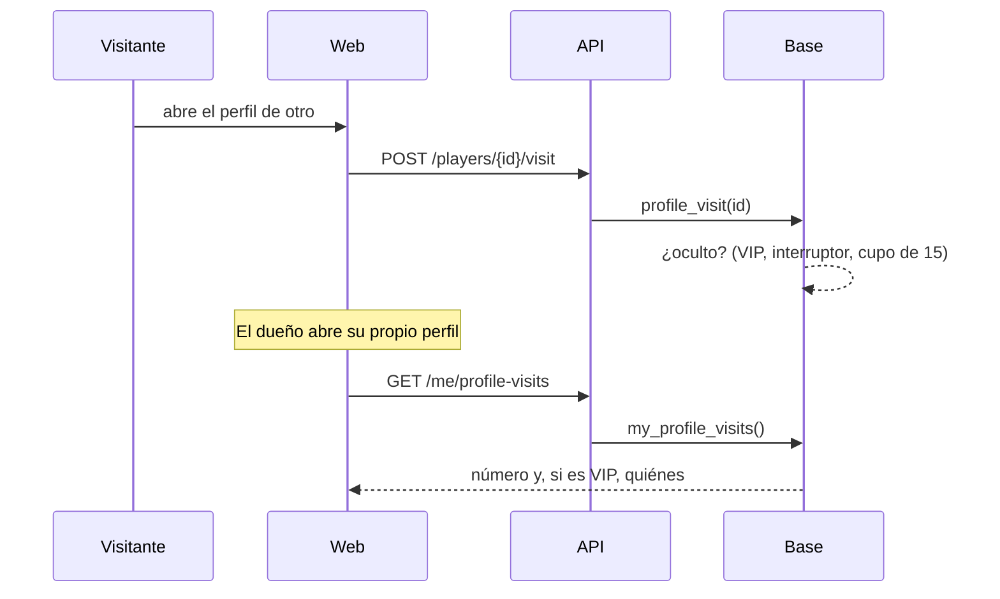

# Plan: visitas a tu perfil (replanteo 86)

> Planeación original. Estado: **aprobada por Daniel el 2026-11-07** (diseño en el lienzo "Equipo y visitas al perfil", tableros "Visitas" y "Tu perfil público").

## Decisiones tomadas

| Tema | Decisión | Por qué |
|---|---|---|
| Quién ve | Solo el dueño, en su propio perfil público. Nadie ve las visitas de otro | Lo pidió Daniel |
| Sin VIP | Cuántos jugadores visitaron tu perfil (30 días y los últimos 7) y una grilla de siluetas | Lo pidió Daniel: el número sí, quiénes no |
| Con VIP | Además, quiénes son (avatar, nick, nivel y cuándo), con "Ver todas" | Beneficio VIP |
| Las siluetas | Colores al azar en la web; la API no manda nada de quién visitó a alguien sin VIP | Que no se pueda espiar desde el navegador |
| Qué cuenta | Una visita por jugador y por día, con sesión y con ficha de jugador. No cuentan las propias | Que el número sea de personas |
| Plazo | 30 días; lo más viejo se borra | Lo mínimo para mostrar la tarjeta |
| Navegar sin dejar rastro (Daniel) | Solo VIP, un interruptor en la tarjeta. Hasta **15 perfiles distintos por semana** (lunes a domingo, hora de Bogotá). Volver a uno ya visitado en modo oculto esa semana no gasta otro. Desde el perfil 16, la visita se ve | Lo pidió Daniel |
| Visitas ocultas | No se muestran ni suman al número del dueño | Si sumaran, se podría deducir quién fue |
| VIP que vence | El interruptor deja de valer (se visita a la vista) | Es un beneficio VIP |

## 1. El flujo

## 2. Base de datos (`supabase/replanteo/86_visitas_al_perfil.sql`)

- Tabla `profile_visits`: `player_id` (el perfil), `visitor` (la cuenta), `day` (fecha en Bogotá), `visited_at`, `hidden`. Clave `(player_id, visitor, day)`. RLS sin acceso directo.
- `profile_visit(p_player)`: registra la visita (o no hace nada: sin sesión, sin ficha, perfil propio, ficha sin cuenta). Decide si va oculta y borra las de más de 30 días de ese perfil.
- `my_profile_visits()`: el número de visitantes (30 días y 7 días), si es VIP, la lista (hasta 100) y el estado del modo oculto (prendido, usados, 15, cuándo se renueva).
- `profile_incognito_set(p_on)`: prende o apaga el modo oculto (solo VIP para prender). Se guarda en `user_preferences.preferences.profile_incognito`.
- Inversa y `probar_86.sh` con `prueba_86.sql`.

## 3. API

- `POST /api/v1/players/{id}/visit` (con sesión): 204.
- `GET /api/v1/me/profile-visits` y `PUT /api/v1/me/profile-visits/incognito` (`{ enabled }`).

## 4. Web

- Al abrir el perfil de otro jugador con sesión, la web registra la visita (una vez por página).
- En tu propio perfil, columna derecha del Resumen, la tarjeta **Visitas a tu perfil**: sin VIP, el número, la grilla de siluetas y "Con VIP ves quiénes son"; con VIP, los avatares, las últimas tres, el interruptor con el cupo y "Ver todas" (una ventana con la lista).
- El botón "Ser VIP" abre la misma ventana que en la página de Equipo: "Comunícate con uno de nuestros administradores" y el Discord.

## 5. Manual, términos y privacidad

- Manual: página nueva del jugador "Visitas a tu perfil" y la del VIP si existe.
- Privacidad: se guarda quién visitó qué perfil (30 días); lo ve el dueño si es VIP.
- Términos: el beneficio VIP.

## 6. Orden

1. La 86, su inversa y sus pruebas. 2. API. 3. Web. 4. Manual, términos, privacidad y documentación.
