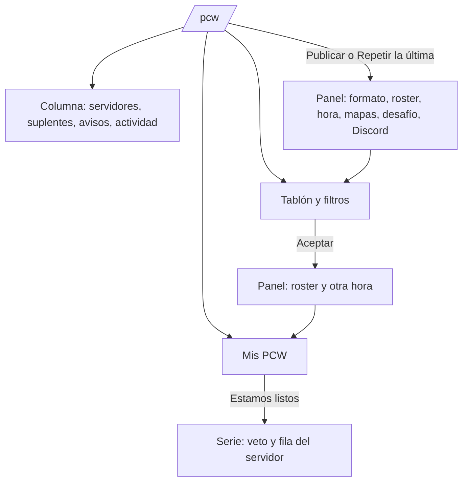
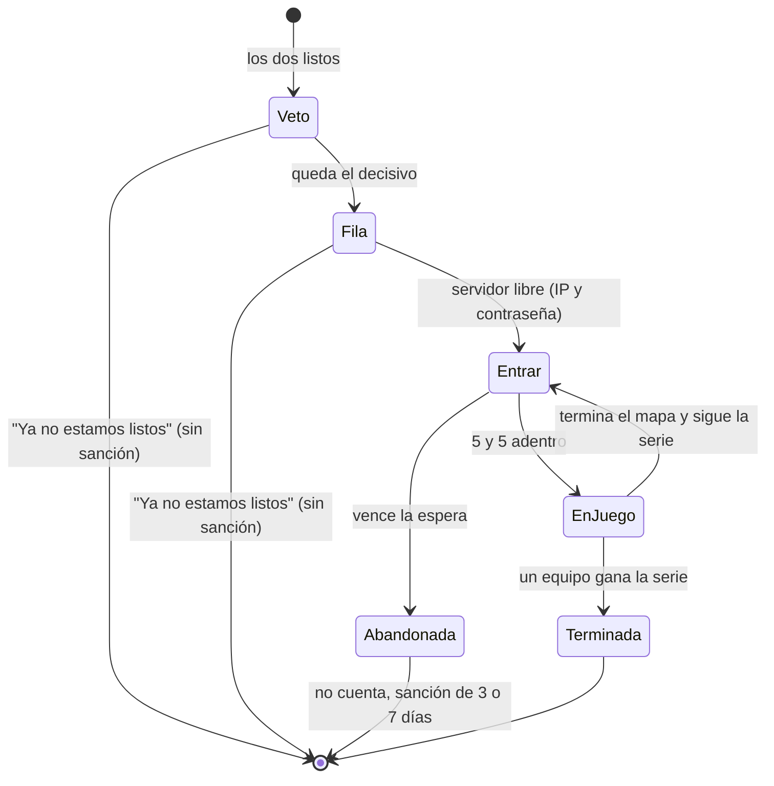

# Página de PCW (prototipo en `/demo/pcw`): documentación

## Qué hace

Es el prototipo de la página `/pcw`, que hoy es un "Próximamente". Se ve en `/demo/pcw` del frontend de `repo`, solo en `pnpm dev`, con datos en memoria y sin API. Es para que Esteban arme la página real y Daniel sume lo que necesita backend.

La página tiene tres partes:

- **Mis PCW:** las prácticas próximas con su cuenta regresiva y "Estamos listos", y las últimas jugadas.
- **El tablón:** los anuncios abiertos con filtros y, si tengo uno abierto, "Tu anuncio".
- **Una columna al costado:** servidores para PCW, suplentes, avisos a medida y la actividad.

Publicar y aceptar se hacen en paneles laterales.

## Reglas que muestra

| Regla | Dónde | De dónde sale |
|---|---|---|
| 4 jugadores con cuenta y como mucho 7 en el roster | Publicar y aceptar, con el aviso en el momento | Base (`create_pcw_post`, `accept_pcw`) |
| Como equipo, todo el roster con cuenta es del plantel | Publicar | Base |
| Solo los formatos habilitados | Publicar | `GET /pcw/formats` |
| Una sanción de PCW del equipo impide publicar como equipo y aceptar | Aviso arriba y en los paneles | `GET /teams/{id}/pcw-ban` |
| "Parejo" hasta 75 de diferencia de ELO medio | Tarjeta y aceptar | Propio de la página (`EVEN_GAP`) |
| "De mi nivel" hasta 150 de diferencia | Filtro | Propio de la página (`MY_LEVEL_GAP`) |
| Las PCW no suman ni restan ELO individual, nunca: ni como equipo ni como mix de amigos. Solo la PCW ganada como equipo suma al ranking de equipos | Publicar y aceptar | Kyan, 2026-11-08. Replanteo `88_pcw_sin_elo.sql` (sin aplicar en producción): ver la guía |
| El ELO medio cuenta solo a los que tienen cuenta | Tarjeta, suplentes y aceptar | Los invitados no tienen ELO |
| La cuenta regresiva se ve solo si falta menos de un día | Mis PCW | Propio de la página |
| El recordatorio se ve desde 15 minutos antes | Mis PCW | Idea m (backend) |
| Un desafío a otro equipo no aparece en el tablón; uno a mi equipo va primero y resaltado | Tablón | Idea h (backend) |

## Ideas y si necesitan backend

| | Idea | En la demo | Backend |
|---|---|---|---|
| a | Repetir la última | Botón en Mis PCW: abre Publicar con el último roster, formato y mapas | No |
| b | Servidores PCW libres y la fila | Panel "Servidores para PCW" | No (`GET /servers/free?kind=pcw`) |
| c | Copiar el link | En cada tarjeta y en cada práctica | No |
| d | Agregar al calendario | `.ics` con aviso 15 min antes y 45 min por mapa | No |
| e | Historial entre los dos equipos | "Contra ustedes: 1-1 en las últimas 2" | No (`GET /matches?kind=pcw`) |
| f | Nivel parejo | "Parejo", "Ellos +228", "Ustedes +152" | No |
| g | Aviso en Discord al publicar | Casilla en Publicar | Sí |
| h | Desafío directo | "Desafío directo" en Publicar; "Te desafían" en el tablón | Sí |
| i | Proponer otra hora | Al aceptar; el otro acepta o mantiene la hora en Mis PCW | Sí |
| j | Avisos a medida | Panel "Avisame cuando aparezca" | Sí |
| k | Confiabilidad del equipo y racha | "96 % de sus PCW jugadas", jugadas, canceladas, abandonadas y "14 seguidas sin cancelar" | Sí |
| l | Buscar suplentes | Panel "Buscan suplentes": publicar "nos falta 1" y "Me anoto" | Sí |
| m | Recordatorio 15 minutos antes | Aviso en la práctica con CMLeague Conectar | Sí |

Las medallas de PCW quedaron afuera (Kyan, 2026-11-08).

## Menos información a la vez (agregado el 2026-11-08)

Kyan pidió que la página agobie menos y se vea mejor en pantallas chicas:

- **Pestañas Tablón y Mis PCW**, con la cantidad en cada una. Abre en Mis PCW si hay una serie en marcha o una práctica que empieza en menos de una hora; si no, en el tablón. Desde el tablón, una franja avisa de esa práctica y lleva a Mis PCW.
- **Tarjetas del tablón compactas:** a la vista quedan el equipo, el formato, la hora, el ELO medio, si es parejo, la confiabilidad, la nota (dos líneas) y Aceptar. El roster, el historial, los mapas, el detalle de la confiabilidad, el link y el calendario van en "Detalle".
- **Filtros:** el formato queda a la vista; horario, tipo y "de mi nivel" van en "Más filtros", con la cantidad de filtros activos y "Limpiar".
- **Columna lateral en una sola tarjeta con pestañas** (Servidores, Suplentes, Avisos y Actividad) en lugar de cuatro tarjetas apiladas. En escritorio queda fija al bajar.
- En celular, "Publicar una PCW" y las pestañas ocupan todo el ancho.

## Después de "los dos listos" (agregado el 2026-11-08)

Kyan preguntó qué pasa cuando los dos equipos están listos. Ya está en la base (replanteo `56`, punto 1.48 de `docs/PENDIENTES.md`), y la demo ahora lo muestra en la misma fila de Mis PCW, con cuatro pasos: Veto, Servidor, Entrar y En juego.

| Paso | Qué se ve | Regla (replanteo `56`) |
|---|---|---|
| Veto | Los mapas del pool con su foto; en mi turno se hace clic para banear o elegir. Reloj del turno | 30 s por turno; si vence, un mapa al azar. El orden de la demo (dos bans, los picks, bans hasta el decisivo) es de ejemplo: el real es el de `veto_act` |
| Servidor | "Buscando un servidor libre" o "En la fila: 2 PCW antes" | Fila por orden de llegada entre los servidores aptos para PCW |
| Entrar | Servidor reservado para toda la serie, el mapa que toca, `connect …; password …` con Copiar y Entrar (`steam://`), cuánto falta y cuántos hay adentro de cada lado (x/5) | 15 min el primer mapa y 5 los siguientes; los suplentes cuentan; con los dos completos arranca solo |
| En juego | Mapa n de la serie, el marcador de la serie y los mapas jugados | Al terminar un mapa vuelve a Entrar con el siguiente |
| Abandonada | Quién no entró y la sanción | La PCW se cancela (no cuenta aunque se haya jugado un mapa), el servidor se libera y el que faltó queda sin PCW 3 días, 7 si se repite en 30 |

Mientras no haya servidor, "Ya no estamos listos" baja a los dos a esperar de nuevo, sin sanción.

## Chat de Jugar: grupo y global (agregado el 2026-11-08)

Kyan notó que en Jugar no hay dónde hablar antes de la sala: el único chat es el de la sala (`LobbyChat`). Primero fue una columna dentro de la tarjeta de "Tu equipo", pero achicaba la interfaz. Quedó así, en `/demo/matchmaking`:

- **Ventana aparte, abajo a la derecha**, encima de la página y sin achicar la tarjeta. Se minimiza a un botón "Chat" con los mensajes sin leer, y recuerda si quedó abierta (`csstv.mm.chat-open`). En celular arranca minimizada.
- **Dos pestañas:**
  - **Grupo:** solo los del grupo, con "X se unió al grupo" y "X salió del grupo", y respuestas de un toque ("Dale", "¿Uno más?", "Listo", "Me voy en esta"). Se habilita con un grupo de más de uno y se borra al deshacerse.
  - **Global:** todos los que están en Jugar.
- Cada pestaña marca lo que llegó sin leer. Mensajes de hasta 300 caracteres, como el de la sala.
- La API no lo tiene: `MmSource.globalChat`, `sendGlobalChat`, `partyChat` y `sendPartyChat` son opcionales y solo la demo los implementa, así que en `/play` no aparece hasta que exista el backend.

## Menú al tocar un nombre (agregado el 2026-11-08)

Tocar el nombre de un jugador en Jugar abre un menú con:

- **Ver perfil:** abre `/player/<nick>` en otra pestaña, para no salir de Jugar mientras se busca partida.
- **Agregar de amigo:** manda la solicitud. No aparece si ya es amigo.
- **Bloquear:** el bloqueo de siempre (VIP, con su tope); avisa si no se puede.
- **Denunciar:** elegís el motivo y dejás una nota. En la sala va como el reporte de la sala; fuera de la sala (chat global o del grupo) es una denuncia nueva (`reportPlayer`, solo en la demo).

Con tu propio nombre solo queda "Ver perfil". Está en el chat de Jugar (grupo y global), el chat de la sala, las tarjetas del grupo y la lista de amigos.

## La barra "Demo"

| Interruptor | Qué muestra |
|---|---|
| Tengo un anuncio abierto | "Tu anuncio" con el último que se publicó |
| Tablón vacío | El vacío con "Publicar la primera"; la columna sigue llena |
| Equipo sancionado | El aviso de sanción y los paneles que no dejan publicar como equipo ni aceptar |
| Servidores ocupados | Los tres ocupados y dos PCW en la fila |
| Me falta un jugador | El último roster con 3 con cuenta, para ver el aviso |
| El rival no entra al servidor | El rival se queda en 3 de 5 y, al vencer la espera, la PCW queda abandonada |
| Adelantar la espera (botón) | La espera para entrar vence en 5 segundos |

En `/demo/matchmaking` se suma el botón "El compañero escribe" (un mensaje del compañero en el chat del grupo).

## Qué cambia para cada rol

Nada para los usuarios: es un prototipo que no está en producción.

## Términos y privacidad

Sin cambios. `/terminos` ya dice que las PCW no mueven el ELO: el replanteo 88 hace que la base lo cumpla. Cuando se haga de verdad, el aviso en Discord (g) y los avisos a medida (j) son datos y envíos nuevos para revisar en `/privacidad`.

## Dónde está cada cosa

| Qué | Archivo |
|---|---|
| Tipos (los de la API y los de las ideas con backend, marcados) | `web/frontend/src/features/pcw/types/index.ts` |
| Reglas puras (hora, nivel, filtros, roster, historial, confiabilidad, `.ics`) | `web/frontend/src/features/pcw/lib/pcw.ts` y `pcw.test.ts` |
| Datos de ejemplo y acciones de la demo | `web/frontend/src/features/pcw/demo.ts` |
| La página | `web/frontend/src/features/pcw/pages/PcwPage.tsx` |
| Piezas | `web/frontend/src/features/pcw/components/` (`PostCard`, `MyPcw`, `PublishSheet`, `AcceptSheet`, `RosterPicker`, `SidePanels`, `share`) |
| Ruta | `web/frontend/src/routes/demo.pcw.tsx` |
| La serie después de los listos | `features/pcw/lib/series.ts` y `series.test.ts` (orden del veto, marcador, abandono), `components/SeriesPanel.tsx`, `tickSeries` en `features/pcw/demo.ts` |
| Menú del nombre | `features/matchmaking/PlayerMenu.tsx` (`PlayerName`), `reportPlayer` opcional en `source.ts` y en la demo |
| Chat de Jugar (grupo y global) | `features/matchmaking/ChatDock.tsx`, `MmPartyChatMessage` en `types.ts`, los métodos opcionales en `source.ts`, los avisos `party.chat` y `chat.global` en `queries.ts` y la demo en `demo.ts` |
| Las PCW sin ELO | `supabase/replanteo/88_pcw_sin_elo.sql`, su inversa en `docs/bitacora/2026-10-14-replanteo-modelo-datos/reversas/` y `pruebas/probar_88.sh` con `prueba_88.sql` |
