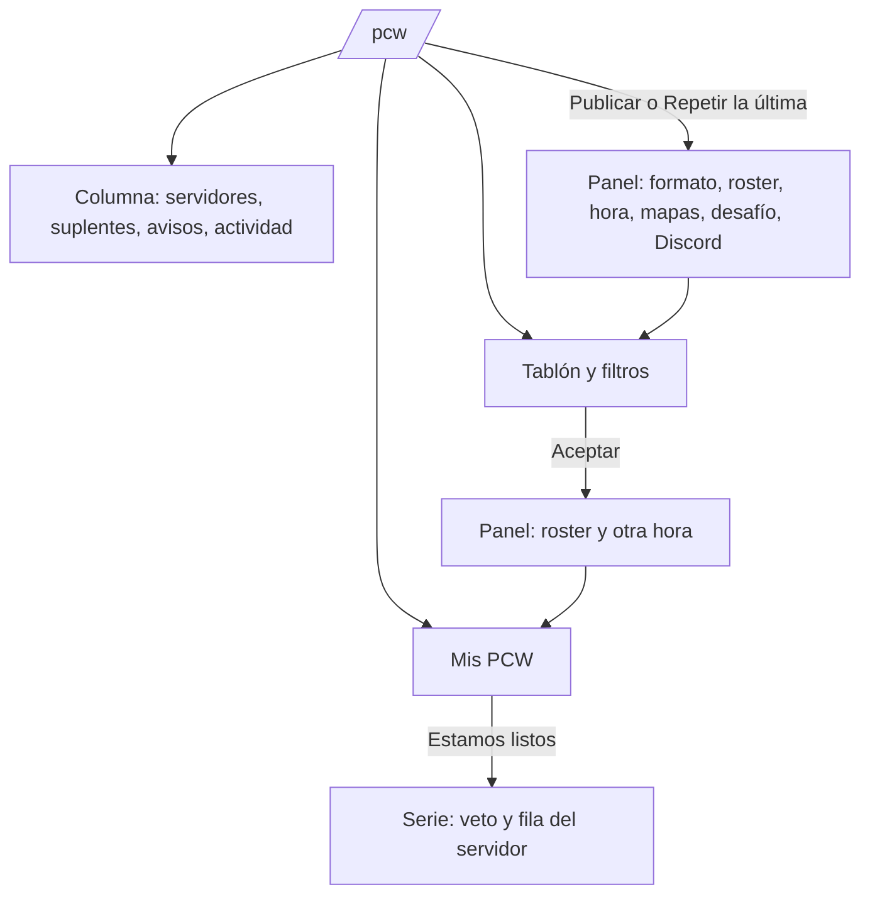
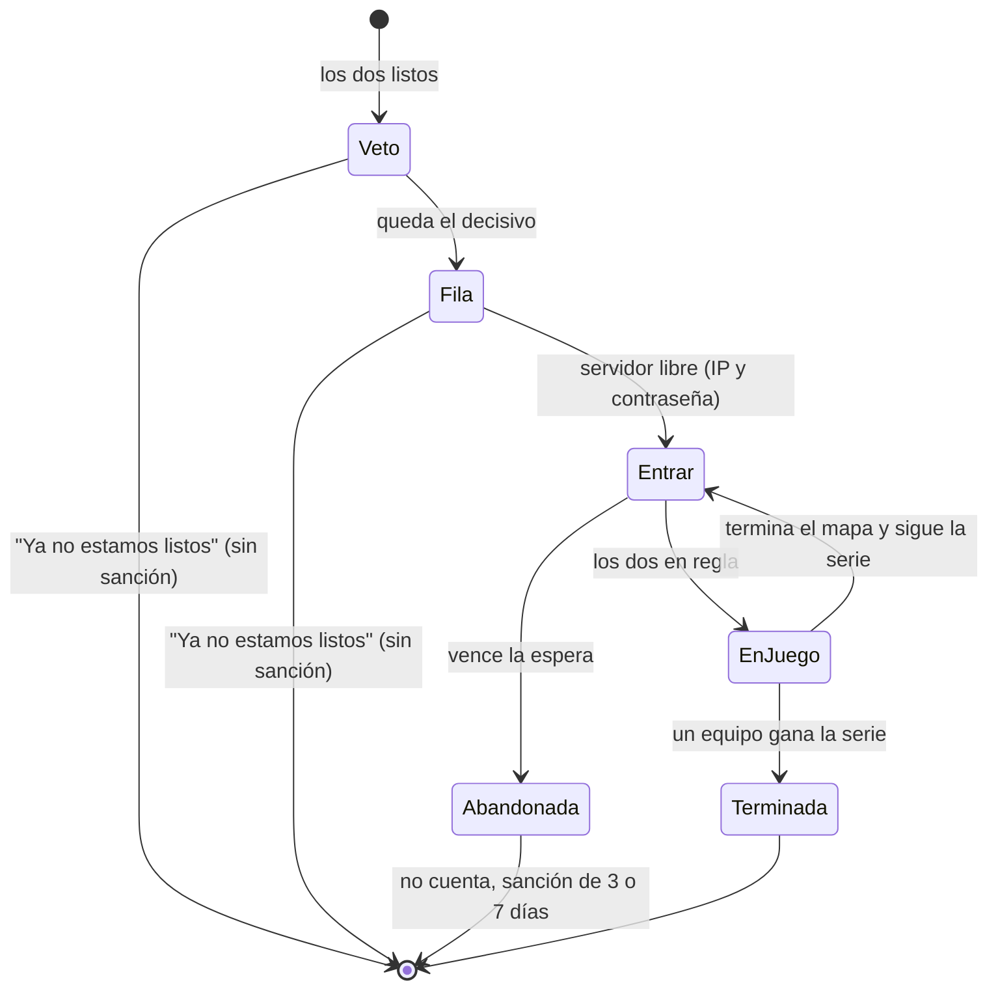

# Página de PCW (prototipo en `/demo/pcw`): documentación

## Qué hace

Es el prototipo de la página `/pcw`, que hoy es un "Próximamente". Se ve en `/demo/pcw` del frontend de `repo`, solo en `pnpm dev`, con datos en memoria y sin API. Es para que Esteban arme la página real y Daniel sume lo que necesita backend.

La página tiene tres partes:

- **Mis PCW:** las prácticas próximas con su cuenta regresiva y "Estamos listos", y las últimas jugadas.
- **El tablón:** los anuncios abiertos con filtros y, si tengo uno abierto, "Tu anuncio".
- **Una columna al costado:** servidores para PCW, suplentes, avisos a medida y la actividad.

Publicar y aceptar se hacen en paneles laterales.

## Reglas que muestra

| Regla | Dónde | De dónde sale |
|---|---|---|
| 4 jugadores con cuenta y como mucho 7 en el roster | Publicar y aceptar, con el aviso en el momento | Base (`create_pcw_post`, `accept_pcw`) |
| Como equipo, todo el roster con cuenta es del plantel | Publicar | Base |
| Solo los formatos habilitados | Publicar | `GET /pcw/formats` |
| Una sanción de PCW del equipo impide publicar como equipo y aceptar | Aviso arriba y en los paneles | `GET /teams/{id}/pcw-ban` |
| "Parejo" hasta 75 de diferencia de ELO medio | Tarjeta y aceptar | Propio de la página (`EVEN_GAP`) |
| "De mi nivel" hasta 150 de diferencia | Filtro | Propio de la página (`MY_LEVEL_GAP`) |
| Las PCW no suman ni restan ELO individual, nunca: ni como equipo ni como mix de amigos. Solo la PCW ganada como equipo suma al ranking de equipos | Publicar y aceptar | Kyan, 2026-11-08. Replanteo `88_pcw_sin_elo.sql` (sin aplicar en producción): ver la guía |
| El ELO medio cuenta solo a los que tienen cuenta | Tarjeta, suplentes y aceptar | Los invitados no tienen ELO |
| La cuenta regresiva se ve solo si falta menos de un día | Mis PCW | Propio de la página |
| El recordatorio se ve desde 15 minutos antes | Mis PCW | Idea m (backend) |
| Un desafío a otro equipo no aparece en el tablón; uno a mi equipo va primero y resaltado | Tablón | Idea h (backend) |

## Ideas y si necesitan backend

| | Idea | En la demo | Backend |
|---|---|---|---|
| a | Repetir la última | Botón en Mis PCW: abre Publicar con el último roster, formato y mapas | No |
| b | Servidores PCW libres y la fila | Panel "Servidores para PCW" | No (`GET /servers/free?kind=pcw`) |
| c | Copiar el link | En cada tarjeta y en cada práctica | No |
| d | Agregar al calendario | `.ics` con aviso 15 min antes y 45 min por mapa | No |
| e | Historial entre los dos equipos | "Contra ustedes: 1-1 en las últimas 2" | No (`GET /matches?kind=pcw`) |
| f | Nivel parejo | "Parejo", "Ellos +228", "Ustedes +152" | No |
| g | Aviso en Discord al publicar | Casilla en Publicar | Sí |
| h | Desafío directo | "Desafío directo" en Publicar; "Te desafían" en el tablón | Sí |
| i | Proponer otra hora | Al aceptar; el otro acepta o mantiene la hora en Mis PCW | Sí |
| j | Avisos a medida | Panel "Avisame cuando aparezca" | Sí |
| k | Confiabilidad del equipo y racha | "96 % de sus PCW jugadas", jugadas, canceladas, abandonadas y "14 seguidas sin cancelar" | Sí |
| l | Buscar suplentes | Panel "Buscan suplentes": publicar "nos falta 1" y "Me anoto" | Sí |
| m | Recordatorio 15 minutos antes | Aviso en la práctica con CMLeague Conectar | Sí |

Las medallas de PCW quedaron afuera (Kyan, 2026-11-08).

## Menos información a la vez (agregado el 2026-11-08)

Kyan pidió que la página agobie menos y se vea mejor en pantallas chicas:

- **Pestañas Tablón y Mis PCW**, con la cantidad en cada una. Abre en Mis PCW si hay una serie en marcha o una práctica que empieza en menos de una hora; si no, en el tablón. Desde el tablón, una franja avisa de esa práctica y lleva a Mis PCW.
- **Tarjetas del tablón compactas:** a la vista quedan el equipo, el formato, la hora, el ELO medio, si es parejo, la confiabilidad, la nota (dos líneas) y Aceptar. El roster, el historial, los mapas, el detalle de la confiabilidad, el link y el calendario van en "Detalle".
- **Filtros:** el formato queda a la vista; horario, tipo y "de mi nivel" van en "Más filtros", con la cantidad de filtros activos y "Limpiar".
- **Columna lateral en una sola tarjeta con pestañas** (Servidores, Suplentes, Avisos y Actividad) en lugar de cuatro tarjetas apiladas. En escritorio queda fija al bajar.
- En celular, "Publicar una PCW" y las pestañas ocupan todo el ancho.

## Después de "los dos listos" (agregado el 2026-11-08)

Kyan preguntó qué pasa cuando los dos equipos están listos. Ya está en la base (replanteo `56`, punto 1.48 de `docs/PENDIENTES.md`), y la demo ahora lo muestra en la misma fila de Mis PCW, con cuatro pasos: Veto, Servidor, Entrar y En juego.

| Paso | Qué se ve | Regla (replanteo `56`) |
|---|---|---|
| Veto | Los mapas del pool con su foto; en mi turno se hace clic para banear o elegir. Reloj del turno | 30 s por turno; si vence, un mapa al azar. El orden de la demo (dos bans, los picks, bans hasta el decisivo) es de ejemplo: el real es el de `veto_act` |
| Servidor | "Buscando un servidor libre" o "En la fila: 2 PCW antes" | Fila por orden de llegada entre los servidores aptos para PCW |
| Entrar | Servidor reservado para toda la serie, el mapa que toca, `connect …; password …` con Copiar y Entrar (`steam://`), cuánto falta y cuántos hay adentro de cada lado | 15 min el primer mapa y 5 los siguientes; cada lado necesita al menos 4 adentro, 3 del roster anotado y hasta 2 suplentes (corregido el 2026-11-08: es lo que aplican el plugin, `MM_BOOKING_MIN_SIDE`, y la base, `min_roster` 3 y `max_standins` 2) |
| En juego | Mapa n de la serie, el marcador de la serie y los mapas jugados | Al terminar un mapa vuelve a Entrar con el siguiente |
| Abandonada | Quién no entró y la sanción | La PCW se cancela (no cuenta aunque se haya jugado un mapa), el servidor se libera y el que faltó queda sin PCW 3 días, 7 si se repite en 30 |

Mientras no haya servidor, "Ya no estamos listos" baja a los dos a esperar de nuevo, sin sanción.

## Chat del grupo en Jugar (agregado el 2026-11-08)

Kyan notó que en Jugar no hay dónde hablar con el grupo antes de la sala: el único chat es el de la sala (`LobbyChat`). Primero fue una columna dentro de la tarjeta de "Tu equipo", pero achicaba la interfaz. Quedó así, en `/demo/matchmaking`:

- **Ventana aparte, abajo a la derecha**, encima de la página y sin achicar la tarjeta. Aparece solo con un grupo de más de uno y se va cuando el grupo se deshace.
- Se minimiza a un botón "Chat del grupo" con los mensajes sin leer, y recuerda si quedó abierta (`csstv.mm.chat-open`). En celular arranca minimizada.
- Lo ven solo los del grupo. Avisa "X se unió al grupo" y "X salió del grupo", tiene respuestas de un toque ("Dale", "¿Uno más?", "Listo", "Me voy en esta") y mensajes de hasta 300 caracteres.
- **Sin chat global:** se probó una pestaña Global, pero Kyan la sacó para no cargar el socket con mensajes para todos.
- La API no lo tiene: `MmSource.partyChat` y `sendPartyChat` son opcionales y solo la demo los implementa, así que en `/play` no aparece hasta que exista el backend.

## Menú al tocar un nombre (agregado el 2026-11-08)

Tocar el nombre de un jugador en Jugar abre un menú con:

- **Ver perfil:** abre `/player/<nick>` en otra pestaña, para no salir de Jugar mientras se busca partida.
- **Agregar de amigo:** manda la solicitud. No aparece si ya es amigo.
- **Bloquear:** el bloqueo de siempre (VIP, con su tope); avisa si no se puede.
- **Denunciar:** elegís el motivo y dejás una nota. En la sala va como el reporte de la sala; fuera de la sala (chat del grupo) es una denuncia nueva (`reportPlayer`, solo en la demo).

Con tu propio nombre solo queda "Ver perfil". Está en el chat del grupo, el chat de la sala, las tarjetas del grupo y la lista de amigos.

## El nombre del equipo lleva a su perfil (agregado el 2026-11-08)

En la página de PCW, tocar el nombre de un equipo oficial abre su perfil (`/teams/<id>`) en otra pestaña: en las tarjetas del tablón, en Mis PCW (próximas y últimas jugadas), en Suplentes y en Actividad. Un mix de amigos no tiene perfil y queda como texto. Está en `features/pcw/components/TeamName.tsx`.

## Mis PCW más liviana (agregado el 2026-11-08)

Cada práctica es una fila: el escudo, "vs Equipo", la línea "BO3 · En 53 min · faltan 53:09" y el estado solo si no es "esperando", el botón principal ("Estamos listos") y un menú "⋯" con Copiar link, Agregar al calendario y Cancelar la práctica. La propuesta de otra hora queda en una línea corta, y "Últimas jugadas" viene plegada.

## La partida encontrada en cualquier pantalla (agregado el 2026-11-08)

Antes la ventana para aceptar solo salía en Jugar. Ahora va en el layout de la web (`GlobalMatchAlerts` en `routes/_app.tsx`), así que sale en cualquier página, con su sonido. Al aceptar, lleva a Jugar (veto, servidor y chat). También avisa con un toast cuando el servidor está listo o la partida se cancela.

Mientras buscás fuera de Jugar:

- **Barra de arriba** (`SearchingPill`, entre la búsqueda y el tema): "Buscando 1:23" con el ícono girando; tocarlo lleva a Jugar y la X deja de buscar. Con una sala abierta dice "¡Partida encontrada!" o "Partida en curso". Es el lugar recomendado: se ve en todas las páginas, también en celular, donde el menú lateral queda cerrado.
- **Título de la pestaña:** "Buscando partida · …" y, cuando aparece, "¡Partida encontrada! · CM League", para verlo desde otra pestaña.

En Jugar no cambia nada: ahí ya están la ventana y la cola. En `/demo/matchmaking`, el botón "Otra pantalla" lo muestra.

## La sala de la PCW es la del matchmaking (agregado el 2026-11-08)

Con los dos listos, la PCW pasa a su sala (`/demo/pcw?sala=<id>`), que es **la misma sala del matchmaking** (`MatchRoom`): la cabecera con el mapa de fondo, el ELO promedio y la probabilidad de ganar, las columnas de jugadores (con quién está conectado), el veto, el servidor con Conectar, los chats de equipo y general, y Descripción general y Estadísticas. Kyan pidió que se vea igual y que se reutilice todo.

Para eso la sala del matchmaking aprendió tres cosas, todas opcionales (el matchmaking se ve igual que antes):

| Qué | Dónde | Para qué |
|---|---|---|
| `sides` y `kind_label` en `MmLobby` | `types.ts`, `labels.ts` (`sideLabel`), `roomData.ts`, `RoomHeader`, `RoomOverview`, `VetoBoard` | "Vértigo" y "Ruido Blanco" en lugar de "Equipo A/B", y "PCW BO3 · serie 1-0" en lugar de "Matchmaking 5v5" |
| `kind: "pick"` en los bans y `next_kind` en el veto | `types.ts`, `VetoBoard` | Los picks de una BO3 o BO5: "Elegir" en lugar de "Banear", y el mapa elegido como "Mapa 1 · Vértigo" |
| `crests` en `MmLobby` | `RoomHeader` | El escudo del equipo en la cabecera en lugar de la foto del capitán (un mix de amigos sigue con la foto) |
| `status_hint` en `MmLobby` y `extra` en `MatchRoom` | `RoomOverview`, `MatchRoom` | La explicación de cada paso propia de la PCW y, arriba del centro, la serie (marcador, mapas, "Ya no estamos listos", reglas) |

La PCW se convierte en una sala con `pcwToLobby` (`features/pcw/lib/room.ts`) y la sala le habla a una fuente propia (`PcwRoom.tsx`): el veto va a la serie de la demo y el chat queda en memoria. En Mis PCW, la práctica muestra "Ir a la sala".

## Ofertas, como en pracc (agregado el 2026-11-08)

Kyan tomó de referencia el buscador de scrims de pracc.com (lo público: el buscador pide cuenta). Lo que se trajo: **el que publica elige entre ofertas**, en lugar de "el primero que acepta se la queda".

- En el tablón, "Aceptar" pasa a **"Mandar oferta"** (con el roster y, si quiere, otra hora). La tarjeta queda con "Oferta enviada · esperando que elijan" y "Retirar". En la demo, a los 6 s te eligen y la práctica aparece en Mis PCW.
- En **Tu anuncio**, las ofertas van llegando ("Ofertas · 2"): cada una con el equipo (link a su perfil), el ELO medio, si es parejo, su confiabilidad y la hora que propone. "Elegir" crea la práctica y cierra el anuncio; a las demás se les avisa que no.

Otras ideas de pracc que quedan para después: grupos por nivel (hoy es el filtro "de mi nivel"), la agenda del equipo sin dos prácticas a la misma hora, y avisos por mail o al celular antes de la práctica.

## Tablón y Mis PCW como listas (agregado el 2026-11-08)

A Kyan no lo convencían las tarjetas. Las dos partes pasaron a ser listas, como una tabla:

- **Tablón:** una fila por anuncio con Equipo (escudo, nombre con link al perfil, "Te desafían", hace cuánto y confiabilidad), Ranking (el puesto del equipo en el ranking de equipos, "#4"; "Mix" para un mix de amigos), Mapa (el nombre del elegido, o "BO3 · Ban"), Hora, Parejo y "Mandar oferta" (o "Enviada" con Retirar). Tocar la fila abre el detalle: nota, roster, historial contra ustedes, mapas del veto, confiabilidad completa, link y calendario (`PostRow.tsx`). Tu anuncio con sus ofertas sigue como tarjeta arriba.
- **Mis PCW:** "Próximas" con Rival, BO, Hora (y cuánto falta), Estado y la acción ("Estamos listos" o "Ir a la sala") con el menú "⋯"; la propuesta de otra hora va debajo de su fila. "Últimas jugadas" es otra lista plegada, con el resultado.
- En celular cada fila se acomoda en dos o tres líneas, sin scroll horizontal.

## La próxima PCW en grande (agregado el 2026-11-08)

Arriba de Mis PCW va la próxima práctica en grande (`NextPcw.tsx`): primero la que está en sala y si no la de hora más cercana. Muestra los dos escudos y nombres, si cada uno marcó "Listos", la cuenta regresiva grande (o "EN SALA" con el paso de la serie), el roster de cada lado con su ELO medio, la propuesta de otra hora, el historial contra ese rival, y Copiar link, Al calendario, Cancelar y la acción que toca. Abajo, "Las siguientes" con el resto. En celular el reloj va arriba y los equipos debajo.

## Mapas elegidos en el anuncio: sin veto (agregado el 2026-11-08)

Si el anuncio elige tantos mapas como el formato (1 en BO1, 3 en BO3), la PCW se juega en esos mapas y en ese orden, **sin veto**: al estar los dos listos, la sala pasa directo a buscar servidor. Con más mapas que el formato (o el pool por defecto), se vetan. En el tablón, la columna **Mapa** muestra el nombre del mapa elegido ("Dust2"); sin mapas fijos, el formato con veto ("BO3 · Ban"). También lo dicen el panel para mandar la oferta ("Se juega Dust2, sin veto.") y el de publicar. La regla está en `fixedMaps` (`lib/series.ts`). En la demo, "Pick de kira" es una BO1 en Dust2.

En la sala, un invitado sin cuenta cuenta con el ELO promedio de su lado, para que no baje el promedio ni la probabilidad de ganar.

## "Tu anuncio" como lista y avisos (agregado el 2026-11-08)

- **Tu anuncio** (`MyPost.tsx`) usa el formato de la lista del tablón: la fila del anuncio (ranking, mapa, hora y ELO) con "Esperando ofertas" o "2 ofertas" y Borrar, y debajo las ofertas como lista: equipo y confiabilidad, ranking, ELO medio, la hora (la tuya o la que propone), si es pareja y Elegir. La tarjeta vieja (`PostCard`) se borró.
- **Avisos**, en la **campana de notificaciones de la web** (la misma de la barra de arriba, `NotificationsMenu`), al lado de "Publicar una PCW":
  - te llegó una oferta a tu anuncio;
  - eligieron tu oferta (queda en Mis PCW);
  - eligieron otra oferta (el anuncio se cierra);
  - tu PCW empieza en 15 minutos (o menos).
  
  Cada uno sale también como toast (y avisa si también llegó por Discord). En la demo, un desafío directo siempre te elige; los demás, 6 de cada 10.

  La campana aprendió los tipos nuevos (`pcw_offer`, `pcw_offer_chosen`, `pcw_offer_rejected`) y dos que la base ya manda y no mostraba bien (`pcw_soon` y `pcw_expired`), en `notifications/lib/model.ts`. Para que la demo la use, la campana acepta una fuente propia (`notifications/api/source.ts`); sin ella, como siempre, lee la API. En la demo, `DemoNotifications` le pasa los avisos de PCW con la forma de la API.

## Equipo o mix al publicar y ofertar (agregado el 2026-11-08)

Al publicar y al mandar una oferta se elige **con quién se juega** (`SidePicker.tsx`):

- **Tu equipo** (por defecto): no se arma un roster. Se muestra el plantel y entra cualquiera de ellos; en el servidor cuentan los que entren (al menos 3 del plantel y hasta 2 suplentes). Hace falta que el plantel tenga 4 jugadores con cuenta.
- **Mix de amigos:** se le pone **nombre al equipo** ("Pick de kyan" si se deja vacío) y se elige el roster como antes.

Además se ordenó la página: la campana y "Publicar una PCW" a la misma altura, la cantidad de anuncios a la derecha de los filtros y el encabezado "Oferta" alineado con sus botones.

## Publicar es para VIP (agregado el 2026-11-08)

Solo una cuenta VIP puede **publicar** una PCW (Kyan, 2026-11-08). Mandar una oferta a un anuncio del tablón sigue siendo para todos, así que cualquiera puede jugar una PCW.

- Sin VIP, "Publicar una PCW" muestra una corona y, al tocarlo, no abre el panel: avisa "Publicar una PCW es para VIP…" con el botón "Hacete VIP" (`vipToast` de `features/vip/upsell.tsx`). Lo mismo con "Publicar la primera" y "Repetir la última".
- En la barra "Demo", el interruptor "No soy VIP".

## La barra "Demo"

| Interruptor | Qué muestra |
|---|---|
| Tengo un anuncio abierto | "Tu anuncio" con el último que se publicó |
| Tablón vacío | El vacío con "Publicar la primera"; la columna sigue llena |
| Equipo sancionado | El aviso de sanción y los paneles que no dejan publicar como equipo ni aceptar |
| Servidores ocupados | Los tres ocupados y dos PCW en la fila |
| Me falta un jugador | El último roster con 3 con cuenta, para ver el aviso |
| El rival no entra al servidor | El rival se queda en 3 de 5 y, al vencer la espera, la PCW queda abandonada |
| No soy VIP | "Publicar una PCW" con corona: avisa que es para VIP en vez de abrir el panel |
| Adelantar la espera (botón) | La espera para entrar vence en 5 segundos |

En `/demo/matchmaking` se suma el botón "El compañero escribe" (un mensaje del compañero en el chat del grupo).

## Qué cambia para cada rol

Nada para los usuarios: es un prototipo que no está en producción.

## Términos y privacidad

`/terminos` ya dice que las PCW no mueven el ELO: el replanteo 88 hace que la base lo cumpla. Se agregó que publicar una PCW es para cuentas VIP y ofertar es para todos, en `TermsPage.tsx` y en `terms/terminos.html` (en la sección de PCW, que sigue marcada "en preparación"). Cuando se haga de verdad, el aviso en Discord (g) y los avisos a medida (j) son datos y envíos nuevos para revisar en `/privacidad`.

## Dónde está cada cosa

| Qué | Archivo |
|---|---|
| Tipos (los de la API y los de las ideas con backend, marcados) | `web/frontend/src/features/pcw/types/index.ts` |
| Reglas puras (hora, nivel, filtros, roster, historial, confiabilidad, `.ics`) | `web/frontend/src/features/pcw/lib/pcw.ts` y `pcw.test.ts` |
| Datos de ejemplo y acciones de la demo | `web/frontend/src/features/pcw/demo.ts` |
| La página | `web/frontend/src/features/pcw/pages/PcwPage.tsx` |
| Piezas | `web/frontend/src/features/pcw/components/` (`PostCard`, `MyPcw`, `PublishSheet`, `AcceptSheet`, `RosterPicker`, `SidePanels`, `share`) |
| Ruta | `web/frontend/src/routes/demo.pcw.tsx` |
| Sala de la PCW | `features/pcw/pages/PcwRoom.tsx`, `features/pcw/lib/room.ts` (`pcwToLobby`) y los agregados de la sala del matchmaking |
| Ofertas | `PcwOffer` y `offers`/`my_offer` en `features/pcw/types/index.ts`, `accept`, `withdrawOffer` y `chooseOffer` en `demo.ts`, `OffersList` en `PostCard.tsx` |
| Partida encontrada en toda la web | `features/matchmaking/MatchAlerts.tsx` (`GlobalMatchAlerts`, `SearchingPill`), `routes/_app.tsx` y `features/shell/components/Topbar.tsx` |
| La serie después de los listos | `features/pcw/lib/series.ts` y `series.test.ts` (orden del veto, marcador, abandono), `components/SeriesPanel.tsx`, `tickSeries` en `features/pcw/demo.ts` |
| Menú del nombre | `features/matchmaking/PlayerMenu.tsx` (`PlayerName`), `reportPlayer` opcional en `source.ts` y en la demo |
| Chat del grupo | `features/matchmaking/ChatDock.tsx`, `MmPartyChatMessage` en `types.ts`, los métodos opcionales en `source.ts`, el aviso `party.chat` en `queries.ts` y la demo en `demo.ts` |
| Las PCW sin ELO | `supabase/replanteo/88_pcw_sin_elo.sql`, su inversa en `docs/bitacora/2026-10-14-replanteo-modelo-datos/reversas/` y `pruebas/probar_88.sh` con `prueba_88.sql` |
