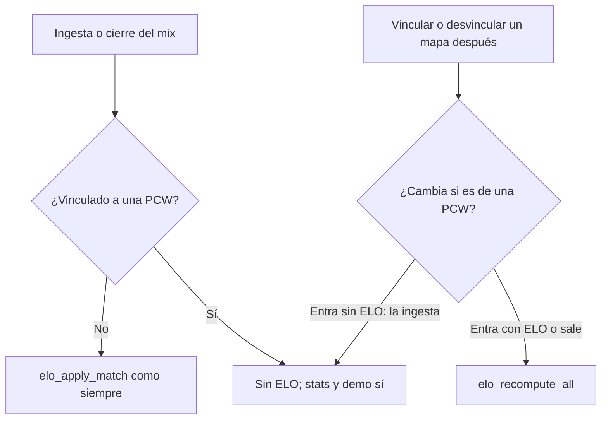

# Página de PCW (prototipo en `/demo/pcw`): guía de implementación

## Estado

**Prototipo hecho el 2026-11-08** en `kyan/pruebas`, commiteado y subido ese día. Pedido por Kyan con todas las ideas propuestas, menos las medallas de PCW. Además trae el replanteo `88_pcw_sin_elo.sql` (sin aplicar en producción) y cambios en Jugar que sí van a `/play` al desplegar la web: el menú al tocar un nombre y la lista de amigos con barra. El chat de Jugar, la serie de PCW y la página de PCW son solo de las demos. No toca el plugin ni los servidores.

## Cómo verlo

1. En `web/frontend`, `pnpm dev`; en Claude Code, la configuración `frontend-repo` de `.claude/launch.json` (puerto 5174, o el siguiente libre).
2. Abrir `http://localhost:5174/demo/pcw`.
3. Usar la barra "Demo" para ver cada estado.

## Pruebas hechas

- `pnpm typecheck` y `pnpm lint` sin errores.
- 13 pruebas nuevas en `features/pcw/lib/pcw.test.ts`. Todo el frontend en verde: 719 pruebas en 117 archivos.
- En el navegador:
  - Desktop en oscuro y 375 px en claro, sin scroll horizontal.
  - Aceptar un anuncio, que pasa a Mis PCW.
  - Publicar, con los avisos de roster.
  - "Repetir la última", los filtros y la contraoferta de hora.
- Después de "los dos listos" (agregado): 9 pruebas en `features/pcw/lib/series.test.ts`; en el navegador, una BO3 completa: veto (6 pasos alternados), servidor, entrar (la serie arranca sola con 5 y 5), mapa 1 jugado, mapa 2 con 5 min, y con "El rival no entra" y "Adelantar la espera", la PCW abandonada con la sanción del rival.
- Chat del grupo (agregado): en `/demo/matchmaking`, aceptar una invitación muestra el chat con "colo se unió al grupo"; la respuesta rápida, un mensaje escrito y las respuestas del compañero llegan; al salir el compañero, el chat se va. Sin scroll horizontal.
- Todo el frontend: 728 pruebas, typecheck y lint sin errores.
- No se probó con datos reales, porque es una demo sin API.

## Cambios durante la implementación (respecto del plan)

- La cuenta regresiva se muestra solo si falta menos de un día: "24 h 59 min" no aportaba nada.
- Publicar como equipo avisa si alguien con cuenta no es del plantel. La regla es de la base y el plan no la nombraba.
- La racha ("14 seguidas sin cancelar") va como dato de la confiabilidad, sin medalla.

## Lo que tiene que hacer cada uno

### Esteban (frontend)

1. Pasar `features/pcw` a la página real `/pcw`:
   - `pages/PcwPage.tsx` recibe hoy el estado de la demo (`PcwDemo`). Cambiarlo por consultas de `api/queries.ts`:
     - `GET /pcw/posts`, `/me/pcw/post` y `/me/pcw/matches`;
     - `POST /pcw/posts` y `/pcw/posts/{id}/accept`;
     - `DELETE /pcw/posts/{id}`, `POST /pcw/matches/{id}/cancel` y `/matches/{id}/ready`;
     - `GET /pcw/formats`, `/servers/free?kind=pcw` y `/teams/{id}/pcw-ban`.
   - Los tipos de `types/index.ts` marcados "API" se reemplazan por los `Schemas[...]`.
2. Las ideas sin backend (a a f) se pueden hacer ya. Las que tienen backend (g a m) quedan ocultas hasta que Daniel las sume.
3. La serie después de los listos: la página de la serie ya existe en `feat/frontend-fase-1` (punto 1.48). `SeriesPanel` muestra lo mismo dentro de Mis PCW, leyendo `match_booking` y el veto real en lugar de `tickSeries`.
4. Sacarle `soon: true` al ítem `pcw` en `features/shell/lib/nav.ts`, devolverle `badge: "pcw"` y ajustar `nav.test.ts`. Ver [`2026-11-02-ocultar-palmares-pcw`](../2026-11-02-ocultar-palmares-pcw/DOCUMENTACION.md).
5. Administración › PCW: las casillas BO1, BO3 y BO5 (`PUT /admin/pcw/formats`) y cargar el resultado de una PCW (`POST /admin/pcw/matches/{id}/result`). Los dos endpoints existen y ninguna pantalla los usa.

### Daniel (backend)

**Las PCW no dan ELO (Kyan, 2026-11-08): replanteo `88_pcw_sin_elo.sql`, escrito y probado en la base local, sin aplicar en producción.** Hasta ahora cada mapa de una PCW se guardaba como un mix vinculado con `!match` (`parent_match_id`) y recibía ELO como cualquier mix. `/terminos`, `/privacidad` y el manual (`capitan/jugar-pcw.md`, `jugador/elo-y-estadisticas.md`) ya decían que las PCW no cuentan para el ELO: la 88 hace que la base lo cumpla.

1. `elo_apply_match` no hace nada con un mapa de una partida `kind = 'pcw'`. Como la ingesta vincula antes de aplicar el ELO, cubre la ingesta, el cierre de un mix en vivo, el mix interrumpido que aprueba un admin, `elo_recompute_all` y las temporadas. El matchmaking y los torneos siguen igual.
2. El trigger `matches_elo_pcw_link` recalcula todo el ELO si un mapa que ya tenía ELO entra a una PCW (vínculo hecho a mano después) o si un mapa sale de una PCW. Si lo causa un moderador, `elo_recompute_all` lo deja (solo desde ese trigger).
3. Al aplicarse, si alguna PCW jugada tiene ELO, recalcula todo una vez: **el ELO de todos queda como si las PCW nunca hubieran contado**. Avisar antes en el Discord.

**Pruebas:** `pruebas/probar_88.sh docker` corre la 88, `pruebas/prueba_88.sql` y la inversa en una transacción que se deshace. Los 7 bloques dan ok: al aplicarse saca el ELO de una PCW ya jugada; vincular saca el ELO; `elo_apply_match` y el recálculo la saltean; desvincular devuelve exactamente el ELO de antes; el vínculo de la ingesta no recalcula; y el recálculo del trigger no pide admin. La inversa deja la estructura y las dos funciones iguales que antes. En la base local el mapa elegido es anterior al último cierre de temporada, así que el bloque 1 no pudo mirar que el ELO de los jugadores cambie (lo cubre el bloque 4).

**Para aplicarlo en producción (Daniel o Kyan):**
1. Sin un mix terminando en ese momento (el recálculo bloquea `player_elo` mientras corre).
2. Por el túnel al VPS: `psql` con `supabase/replanteo/88_pcw_sin_elo.sql`. Si hubo PCW con ELO, avisa `replanteo 88: ELO recalculado sin las PCW (N mixes)`.
3. Si hay que volver atrás: `docs/bitacora/2026-10-14-replanteo-modelo-datos/reversas/88_pcw_sin_elo.sql`.
4. No toca el plugin ni los servidores. Commitearlo también en `feat/frontend-fase-1` y `feat/mm-claim-en-sala` lo decide Daniel: no es del matchmaking.

Las stats del mapa (K/D, rating), la demo y los puntos del ranking de equipos se siguen guardando: solo cambia el ELO.

**Denunciar fuera de la sala:** hoy `mm_reports` necesita una sala. Para el menú del nombre hace falta una denuncia desde el chat (con el mensaje como prueba): `POST /mm/players/{id}/report` y que Administración › Matchmaking › Reportes la muestre sin sala. Mientras no exista, la web solo deja denunciar desde la sala.

**Chat de Jugar (grupo y global):** para el global, una tabla de mensajes con tope (los últimos 100), `GET`/`POST /mm/chat`, el aviso `chat.global` a todos los conectados a Jugar, límite de mensajes por minuto, el filtro de palabras y que se pueda reportar un mensaje. Para el del grupo, tabla de mensajes por grupo (`mm_party_members` decide quién lee y escribe; se borran cuando el grupo se deshace), `GET` y `POST /mm/party/chat`, el aviso `party.chat` por el socket solo a los del grupo, el mismo filtro de palabras que el chat de la sala y 300 caracteres. Con eso, `apiSource` implementa `partyChat` y `sendPartyChat`, y el chat aparece solo en `/play`.

| Idea | Qué hace falta |
|---|---|
| g. Aviso en Discord | `discord` en `PcwPostBody` y un webhook como el de la cola del matchmaking (replanteo `57`) |
| h. Desafío directo | `invited_team_id` en el anuncio. `GET /pcw/posts` no lo muestra a otros equipos; `accept_pcw` solo deja aceptar a ese equipo; notificación al equipo |
| i. Proponer otra hora | `proposed_at` y `proposed_by` en la partida, y aceptar o rechazar la propuesta. Mientras tanto queda la hora original |
| j. Avisos a medida | Tabla de suscripciones (formatos, "de mi nivel" y "solo equipos") y una notificación al publicar un anuncio que coincide |
| k. Confiabilidad | Por equipo: PCW jugadas, canceladas y abandonadas, y la racha sin cancelar, en `PcwPost` (o `GET /teams/{id}`) |
| l. Suplentes | Anuncio de suplente (bando, cuántos faltan, formato y hora), postularse, y que el capitán sume al postulante al roster |
| m. Recordatorio | Tipo nuevo en `notify_due()` 15 minutos antes, con el link de CMLeague Conectar |

## Ideas que quedaron para después

- Medallas de PCW: descartadas por Kyan.
