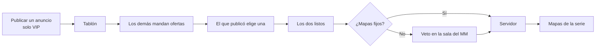

# Para Daniel: lo que se hizo el 2026-11-08 y lo que te toca

Hola Daniel. Esto es el resumen de lo que trabajamos Kyan y Claude el 2026-11-08 en `kyan/pruebas`, y de lo que falta para pasarlo a la web real. Como ahora hacés también lo de Esteban, junté las dos listas: el backend y el frontend.

El detalle completo está en [`DOCUMENTACION.md`](DOCUMENTACION.md) y [`GUIA_IMPLEMENTACION.md`](GUIA_IMPLEMENTACION.md). Este archivo es para que no tengas que leer todo eso de entrada.

## Qué se hizo

**Commits en `kyan/pruebas`, todos subidos:**

| Commit | Qué trae |
|---|---|
| `2f90b9d` | Merge de `main` (amigos con solicitudes, visitas, Quiénes somos, nivel con anillo y clips) |
| `c20f675` | Prototipo de la página de PCW, replanteo 88 (las PCW no dan ELO), chat del grupo, menú al tocar un nombre y lista de amigos con barra en Jugar |
| `fc22c63` | La sala de la PCW es la sala del matchmaking, ofertas como en pracc.com y la partida encontrada en cualquier pantalla |
| `1779fdd` | Tablón y Mis PCW como listas, la próxima PCW en grande, mapas fijos sin veto, avisos en la campana de la web, y elegir equipo o mix al publicar |
| `a405065` | Publicar una PCW es solo para VIP, y este archivo |

**No se tocó:**
- El plugin ni los servidores: no hay nada que subir a #1, #2 ni #3.
- La base de producción: el replanteo 88 está escrito y probado en local, pero **sin aplicar**.

### La página de PCW (`/demo/pcw`)

Para verla: en `web/frontend`, `pnpm dev`, y abrir `/demo/pcw`. La barra "Demo" de arriba muestra cada estado.

**Tablón:**
- Es una lista compacta con estas columnas: Equipo, Ranking (el puesto en el ranking de equipos), Mapa, Hora, Parejo y Oferta.
- La columna Mapa muestra el nombre del mapa si el anuncio lo trae fijo, o "BO3 · Ban" si hay veto.

**Publicar y ofertar:**
- **Publicar es solo para VIP.** Mandar una oferta a un anuncio del tablón es para todos.
- Al publicar o al mandar una oferta se elige con quién se juega:
  - **Tu equipo:** no se arma un roster. Entra cualquiera del plantel.
  - **Mix de amigos:** se le pone nombre y se elige el roster.
- **Ofertas:** como en pracc.com, el que publicó recibe ofertas y elige una. Las demás quedan rechazadas.

**Mis PCW:**
- La próxima PCW se muestra en grande, con la cuenta regresiva.
- Las siguientes van en una lista.
- Las últimas jugadas van plegadas.

**Sala:** es exactamente la del matchmaking (`MatchRoom`), con el escudo de cada equipo y los picks en el veto. Si el anuncio trae tantos mapas como el formato (por ejemplo BO1 en dust2), no hay veto.

**Reglas que muestra la página** (las mismas del plugin y de la base):
- Entrada: al menos 4 por lado, al menos 3 del roster y hasta 2 suplentes.
- Espera: 15 minutos para el primer mapa y 5 para cada uno de los siguientes.
- Abandono: sanción de 3 días, o de 7 si se repite en 30 días.
- Ranking: ganar una PCW da 5 puntos en el ranking de equipos y ningún ELO.

**Avisos:** llegan a la campana de notificaciones de la web, la de arriba, con los tipos `pcw_offer`, `pcw_offer_chosen`, `pcw_offer_rejected`, `pcw_soon` y `pcw_expired`.

### Jugar (`/play` y `/demo/matchmaking`)

Funcionan ya con la API real, sin backend nuevo:
- **Menú al tocar un nombre**, en cualquier lugar de Jugar y de la sala: Ver perfil, Agregar de amigo, Bloquear y Denunciar.
- **Lista de amigos:** muestra 3 y el resto con barra.
- **Partida encontrada en cualquier pantalla:** el aviso para aceptar salta en cualquier página, no solo en `/play`.
  - Mientras buscás, arriba aparece una píldora "Buscando m:ss" con una X para cancelar.
  - El título de la pestaña también avisa.

Solo funciona en la demo:
- **Chat del grupo:** una ventana abajo a la derecha que no achica la tarjeta. Sin chat global, porque Kyan no quiere cargar el socket.

### Las PCW no dan ELO (replanteo 88)

El archivo es `supabase/replanteo/88_pcw_sin_elo.sql`.

**Qué hace:**
- `elo_apply_match` saltea los mapas de una PCW.
- Un trigger recalcula el ELO si un mapa entra o sale de una PCW después de jugado.
- Al aplicarlo, recalcula el ELO de todos sin las PCW ya jugadas.

**Pruebas y vuelta atrás:**
- Pruebas: `pruebas/probar_88.sh docker`. Los 7 bloques dan ok.
- Inversa: `docs/bitacora/2026-10-14-replanteo-modelo-datos/reversas/88_pcw_sin_elo.sql`.

## Lo que te toca

Ordenado por lo que más destraba.

### Backend

1. **Aplicar el replanteo 88 en producción.**
   - Hacelo cuando ningún mix esté terminando, porque el recálculo bloquea `player_elo`.
   - Avisá antes en el Discord, porque cambia el ELO de quienes jugaron PCW.
   - Se aplica por el túnel al VPS con `psql`.
   - Decidí si también va a `feat/frontend-fase-1` y a `feat/mm-claim-en-sala`. No es del matchmaking.
2. **Publicar solo con VIP:** en `create_pcw_post`, rechazar con `is_vip(auth.uid())` y un código propio (por ejemplo `vip_required`), para que la web muestre "Hacete VIP". Ofertar no pide VIP. Ya está escrito en `/terminos`.
3. **Ofertas (`pcw_offers`)**, que reemplazan a aceptar el primero:
   - Una oferta tiene: el anuncio, el bando, la hora propuesta y el estado (abierta, elegida, rechazada o retirada).
   - `POST /pcw/posts/{id}/offers` para mandar una y `DELETE` para retirarla.
   - `POST /pcw/offers/{id}/choose` solo para el que publicó: crea la partida y rechaza las demás.
   - Las reglas de hoy (4 con cuenta, sanción y plantel) pasan a la oferta.
4. **Equipo sin roster:** como equipo, el anuncio y la oferta no llevan roster. Solo se valida que el plantel tenga 4 jugadores con cuenta, y el bando de la partida es el plantel entero; el plugin ya cuenta a los del plantel que entran. Como mix, se manda `p_name` y el roster.
5. **Mapas fijos sin veto:** si `pcw_posts.map_pool` tiene tantos mapas como el formato, la reserva saltea el veto y la partida guarda esos mapas en orden.
6. **El veto tiene que decir si el turno es ban o pick** (`veto_act` con picks), para la sala.
7. **Avisos de PCW en `notify()`** (categoría `pcw`):
   - `pcw_offer` y `pcw_offer_chosen` van también por Discord.
   - `pcw_offer_rejected` va solo en la web.
   - `pcw_soon` ya existe; falta que también vaya por Discord.
8. **Ranking en el tablón:** `GET /pcw/posts` tiene que traer el puesto del equipo, sacado de `team_ranking`.
9. **Chat del grupo en Jugar:**
   - Una tabla de mensajes por grupo, que se borran cuando el grupo se deshace.
   - `GET` y `POST /mm/party/chat`.
   - El aviso `party.chat` por el socket, solo a los del grupo.
   - El mismo filtro de palabras que el chat de la sala y un máximo de 300 caracteres.
10. **Denunciar fuera de la sala:** `POST /mm/players/{id}/report`, con el mensaje del chat como prueba, y que Administración › Matchmaking › Reportes muestre las denuncias sin sala. Mientras no exista, la web solo deja denunciar desde la sala.
11. **Las ideas g a m de la guía.** No son urgentes:
    - aviso en Discord al publicar;
    - desafío directo;
    - proponer otra hora;
    - avisos a medida;
    - confiabilidad del equipo;
    - suplentes;
    - recordatorio con el link de Conectar.

### Frontend (lo que era de Esteban)

1. **Pasar `features/pcw` a la página real `/pcw`.**
   - `PcwPage.tsx` hoy recibe el estado de la demo (`usePcwDemo`). Hay que cambiarlo por consultas en `api/queries.ts` contra los endpoints de arriba.
   - Los tipos de `types/index.ts` se reemplazan por los `Schemas[...]`.
   - La campana de la demo (`DemoNotifications`) no va: en la web real los avisos llegan solos a la campana de arriba. `NotificationsMenu` ya tiene los tipos nuevos en `lib/model.ts`.
2. **La sala:** `PcwRoom` con `pcwToLobby`, armado desde `match_booking` y el veto real, en lugar de `tickSeries`.
3. **Publicar solo con VIP:** usar `vip` de `/auth/me` (o lo que exponga la API) en lugar del interruptor "No soy VIP", y el código `vip_required` para el aviso.
4. **El menú:** sacarle `soon: true` al ítem `pcw` en `features/shell/lib/nav.ts`, devolverle `badge: "pcw"` y ajustar `nav.test.ts`.
5. **Administración › PCW:**
   - Las casillas BO1, BO3 y BO5 (`PUT /admin/pcw/formats`).
   - Cargar el resultado de una PCW a mano (`POST /admin/pcw/matches/{id}/result`).
   - Los dos endpoints ya existen y ninguna pantalla los usa.
6. **Jugar:** el chat del grupo aparece solo en cuanto `apiSource` implemente `partyChat` y `sendPartyChat`. Lo demás (menú del nombre, amigos y aviso global) ya va con la API.

### Despliegue

- Lo de Jugar que ya anda con la API va a `/play` cuando se despliegue la web: el menú del nombre, la lista de amigos y la partida encontrada en cualquier pantalla.
- La página de PCW sigue siendo una demo hasta que esté el backend de arriba.
- No hay nada para los servidores.

## Dónde está cada cosa

| Qué | Dónde |
|---|---|
| Página de PCW | `web/frontend/src/features/pcw/` (`pages/PcwPage.tsx`, `pages/PcwRoom.tsx`, `components/`, `lib/series.ts`, `lib/room.ts`) |
| Estado de la demo | `web/frontend/src/features/pcw/demo.ts` |
| Jugar | `web/frontend/src/features/matchmaking/` (`ChatDock.tsx`, `PlayerMenu.tsx`, `MatchAlerts.tsx`) |
| Notificaciones | `web/frontend/src/features/shell/notifications/` (`api/source.ts`, `lib/model.ts`) |
| Replanteo 88 | `supabase/replanteo/88_pcw_sin_elo.sql` y su inversa en `reversas/` |
| Pendientes | `docs/PENDIENTES.md`, punto 1.74 |
| Changelog para el Discord | `CHANGELOG_DISCORD.txt`, en esta carpeta |
