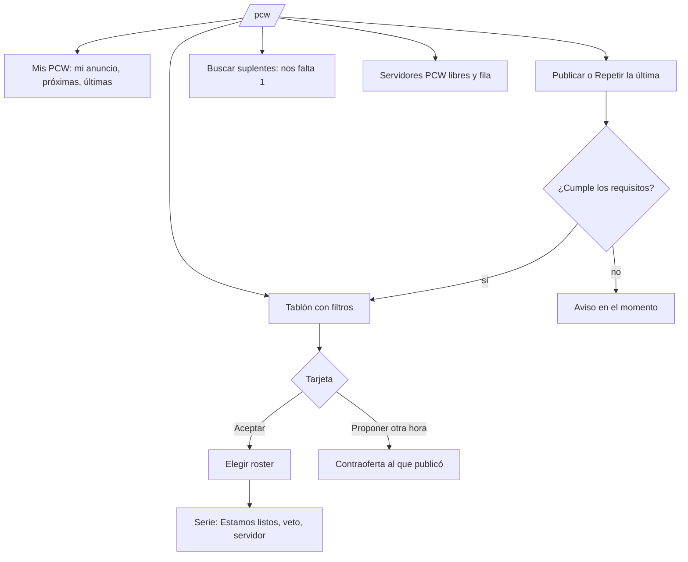

# Plan: Página de PCW (prototipo en `/demo/pcw`)

> Planeación original. Estado: **propuesta**, prototipo de Kyan para pasarle a Esteban (frontend) y a Daniel (lo que necesita backend).

El backend de las PCW está completo desde el 2026-10-15 ([`2026-10-15-api-partidas-torneos-pcw`](../2026-10-15-api-partidas-torneos-pcw/)), con formatos ([`2026-10-15-formatos-pcw`](../2026-10-15-formatos-pcw/)), pool de mapas ([`2026-10-25-pool-mapas-torneos-pcw`](../2026-10-25-pool-mapas-torneos-pcw/)) y la reserva del servidor con "Estamos listos" ([`2026-11-02-iniciar-torneo-pcw`](../2026-11-02-iniciar-torneo-pcw/)). En el frontend ya están la página de la serie, el veto, el panel del servidor, las sanciones de PCW y las PCW en Partidas y en el ranking. Falta la página `/pcw`: hoy es un "Próximamente" y el menú la muestra gris con "Pronto" ([`2026-11-02-ocultar-palmares-pcw`](../2026-11-02-ocultar-palmares-pcw/)).

Kyan pidió el prototipo (2026-11-08) con todas las sugerencias y QOL propuestas, menos las medallas de PCW.

## Decisiones tomadas

| Tema | Decisión | Por qué |
|---|---|---|
| Dónde se ve | `/demo/pcw` del frontend de `repo` (rama `kyan/pruebas`), solo en `pnpm dev`, con datos en memoria y sin API | Es el patrón de las demos (`demo.widget.tsx`, `demo.matchmaking.tsx`); Kyan hace prototipos y Esteban la página real |
| Estilo | El de la web: tarjetas `rounded-xl border bg-card`, `MapBackdrop`, `TeamCrest`, `PlayerAvatar`, `LevelBadge`, `Segmented`, `FilterChips`, `Sheet` | Kyan no quiere un lenguaje visual propio ni una página vacía o triste |
| Reuso | `MapPoolPicker` para los mapas del veto, `mapLabel` y `demoArt` del matchmaking para nombres y fotos de ejemplo, `levelOf` para el nivel de un promedio de ELO | No duplicar lo que existe |
| Datos de ejemplo | Los campos de `PcwPost`, `PcwSide` y `GET /me/pcw/*` de la API, más lo nuevo de cada idea con backend, en un tipo aparte y comentado | Que Esteban vea qué viene de la API y qué hay que pedirle a Daniel |
| Barra "Demo" | Arriba, para simular: con o sin anuncio propio, tablón vacío, equipo sancionado, servidores ocupados, "falta un jugador con cuenta" | Ver cada estado sin datos reales |
| Medallas de PCW | **No** | Lo decidió Kyan |
| Racha | Como dato de la confiabilidad del equipo ("8 seguidas sin cancelar"), sin medalla | Sale de lo mismo que la confiabilidad |

## 1. El flujo

## 2. La página

1. **Mis PCW** (arriba): mi anuncio abierto (hace cuánto, vence, borrar, copiar link), mis prácticas próximas con cuenta regresiva y "Estamos listos", y las últimas jugadas con su resultado.
2. **Tablón**: una tarjeta por anuncio con la foto del primer mapa de fondo, el bando o el equipo, el roster con su ELO promedio y nivel, formato, hora ("en 2 h", "hoy 22:00", "a convenir"), mapas en miniatura, nota y "Aceptar".
3. **Filtros**: formato, horario (ahora, hoy, más adelante), "de mi nivel" y "como equipo" o mix.
4. **Publicar** en un panel lateral: roster desde amigos y equipo más invitados, formato (solo los habilitados), hora, nombre, nota y `MapPoolPicker`. Avisa en el momento si falta un jugador con cuenta o si el equipo tiene una sanción de PCW.
5. **Nunca vacía**: sin anuncios, muestra las últimas PCW jugadas, los equipos más activos en PCW y los servidores libres.

## 3. QOL

| | Idea | Necesita backend |
|---|---|---|
| a | **Repetir la última**: abre el formulario con el roster, el formato y los mapas de la PCW anterior | No |
| b | **Servidores PCW libres ahora** y la fila de espera (`GET /servers/free?kind=pcw`) | No |
| c | **Copiar el link** de la PCW | No |
| d | **Agregar al calendario** (`.ics`) cuando tiene hora | No |
| e | **Historial entre los dos equipos** en la tarjeta ("2-1 en las últimas 3") | No (filtro de `GET /matches`) |
| f | **Nivel parejo**: compara el ELO medio de los dos rosters ("parejo", "ellos +120") | No |
| g | **Aviso en Discord** al publicar, como el de la cola del matchmaking | Sí: webhook y opción al publicar |
| h | **Desafío directo** a un equipo (PCW privada) | Sí: `invited_team_id` en el anuncio |
| i | **Proponer otra hora** al aceptar | Sí: contraoferta y respuesta |
| j | **Avisos a medida** ("avisame si aparece una BO3 de mi nivel") | Sí: suscripciones y notificación |
| k | **Confiabilidad del equipo**: PCW jugadas, canceladas y abandonadas, y la racha sin cancelar | Sí: agregado por equipo |
| l | **Buscar suplentes**: "nos falta 1" y un jugador suelto se anota | Sí: anuncio de suplente y postulación |
| m | **Recordatorio 15 minutos antes** con el link para conectarse (CMLeague Conectar) | Sí: tipo de notificación nuevo en `notify_due()` |

## 4. Archivos

- `web/frontend/src/features/pcw/lib.ts`: funciones puras (hora relativa, nivel parejo, filtros, requisitos para publicar, `.ics`, historial), con pruebas en `lib.test.ts`.
- `web/frontend/src/features/pcw/demo.ts`: datos de ejemplo y el estado de la demo.
- `web/frontend/src/features/pcw/components/`: las piezas de la página.
- `web/frontend/src/routes/demo.pcw.tsx`: la ruta, solo en `pnpm dev`.

No toca la API, la base, el plugin ni los servidores.

## 5. Requisitos antes de empezar

Ninguno: es un prototipo con datos en memoria.

## 6. Orden de implementación

1. `lib.ts` con sus pruebas.
2. `demo.ts` con anuncios, rosters, equipos, historial y servidores.
3. Las piezas: Mis PCW, tarjeta, filtros, publicar, servidores, suplentes, estado vacío.
4. La ruta con la barra "Demo".
5. Typecheck, lint, pruebas y revisión en el navegador (claro, oscuro y 375 px).
6. `DOCUMENTACION.md`, `GUIA_IMPLEMENTACION.md` con lo que hay que pedirle a Daniel y a Esteban, la fila en el índice y el punto en `docs/PENDIENTES.md`.
