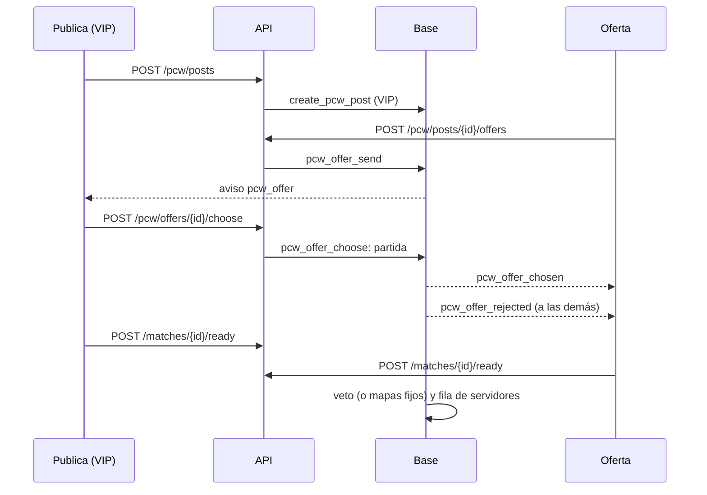
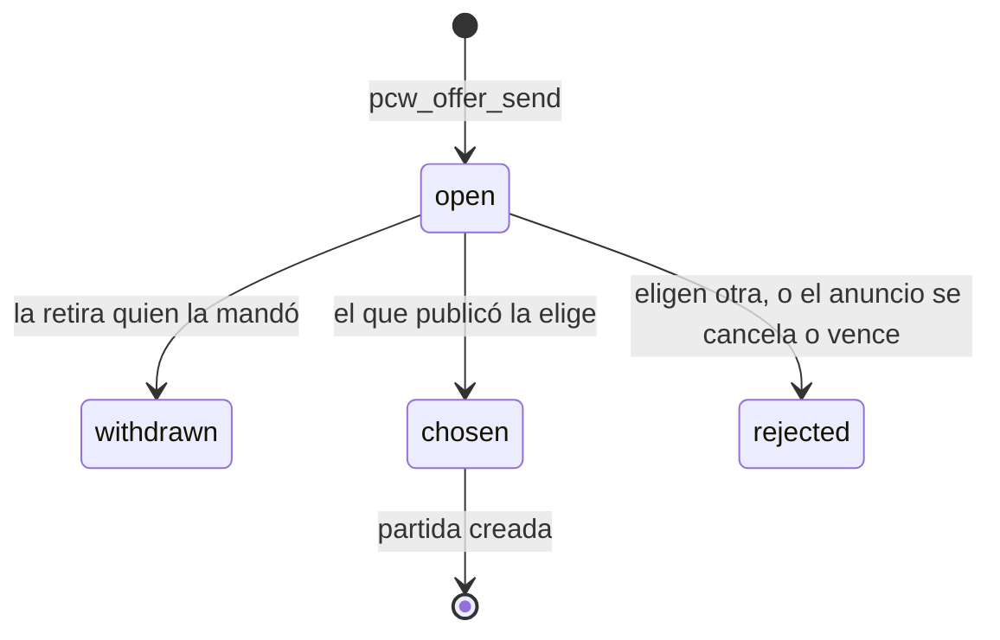

# La página de PCW de verdad, con ofertas, y lo nuevo de Jugar: documentación

## Qué hace

PCW deja de ser "Pronto". La página `/pcw` es la que diseñó Kyan en su prototipo ([`2026-11-08-pcw-demo`](../2026-11-08-pcw-demo/)), ahora contra la API real:

- **El tablón:** una lista con las PCW publicadas, con el puesto del equipo en el ranking, el mapa (o "BO3 · Ban"), la hora y si el nivel es parejo.
- **Las ofertas:** quien quiere jugar manda una oferta (y puede proponer otra hora) y el que publicó elige una. Ya no se queda la PCW el primero que la acepta.
- **Mis PCW:** la próxima en grande y las siguientes en una lista.
- **La sala:** la misma del matchmaking, alimentada por la reserva de la serie (replanteo `56`).

Publicar es para VIP; ofertar es para todos.

En Jugar entra lo que Kyan dejó listo:

- el menú al tocar un nombre;
- la lista de amigos con barra;
- la partida encontrada en cualquier página, con "Buscando" arriba y el aviso en el título de la pestaña.

Además, el chat del grupo y la denuncia desde ese chat, que ahora tienen backend.

## Ofertas

| Regla | Dónde |
|---|---|
| No se le manda una oferta al propio anuncio, ni dos al mismo anuncio | `pcw_offer_send` |
| Hasta 20 ofertas por día por cuenta | `pcw_offer_send` |
| Nadie puede estar en los dos rosters, ni el mismo invitado en los dos | `pcw_offer_send` (las de `accept_pcw`) |
| Una sanción de PCW del bando o de quien oferta impide ofertar | `pcw_ban_check` |
| Solo el que publicó (o un admin) elige. La partida toma la hora de la oferta si propuso otra | `pcw_offer_choose` |
| Al elegir, cancelar o vencer el anuncio, las ofertas abiertas quedan rechazadas y se avisa | `tg_pcw_posts_close_offers` (al actualizar y antes de borrar) |
| Los bandos de las ofertas abiertas no los borra la limpieza; los de las cerradas, sí (y la oferta se va con ellos) | `pcw_cleanup` |

`accept_pcw` y `POST /pcw/posts/{id}/accept` se borraron: con ofertas, nadie se queda con un anuncio sin que lo elijan.

## Publicar es para VIP

`create_pcw_post` rechaza a quien no es VIP ni admin con el código `V8901`. La API lo devuelve como `403 VIP_REQUIRED`. En la web, sin VIP, el botón muestra una corona y abre "Cómo ser VIP" (`VipDialog`).

## Como equipo o como mix

Al publicar y al ofertar se elige con quién se juega:

- **Como equipo:** la web manda solo el `team_id`. La API arma el bando con el plantel del equipo: hasta 7, primero el capitán y después los que tienen cuenta (`plantel()` en `pcw-play.ts`). La base sigue validando que sea capitán o dueño y que haya 4 con cuenta. En el servidor entra cualquiera del plantel.
- **Como mix:** el nombre y el roster, como antes.

Sin equipo (no soy capitán ni dueño de uno oficial), la web solo ofrece el mix.

## Mapas fijos

Si el anuncio trae tantos mapas como el formato (o menos), no hay veto y se juegan en el orden elegido:

- `veto_sequence(bo, n)` devuelve vacío cuando `n <= bo`. Antes, una BO3 con 3 mapas baneaba 2 y dejaba uno solo.
- `match_map_pool` ordena por el orden del anuncio en ese caso.
- `match_series_maps` devuelve todo el pool.
- En la API, `vetoSequence` y `vetoState` hacen lo mismo (`maps_to_play` con todos, sin decisivo).

Al marcarse listos, la reserva pasa directo a la fila de servidores.

## Lo mío para la página

`GET /me/pcw/context` (`pcw_my_context()`) devuelve:

- si soy VIP;
- mi ficha con su ELO;
- el equipo oficial con el que puedo jugar (capitán o dueño), con su plantel, su puesto y su sanción de PCW;
- mis amigos.

Va en la base porque `mm_friends` no se lee con la sesión del usuario.

## La API

| Ruta | Qué hace |
|---|---|
| `GET /pcw/posts` | Con sesión opcional. Cada bando trae `rank` y el `elo` de cada jugador; con sesión, `my_offer` |
| `GET /me/pcw/post` | Mi anuncio con `offers` (las abiertas) |
| `POST /pcw/posts` | Publicar (VIP). Con `team_id` y sin roster, el plantel |
| `POST /pcw/posts/{id}/offers` | Mandar una oferta (`starts_at` opcional) |
| `DELETE /pcw/offers/{id}` | Retirarla |
| `POST /pcw/offers/{id}/choose` | Elegirla: crea la partida |
| `GET /me/pcw/matches` | Mis PCW con `my_side`, la reserva (`booking`: estado y listos de cada lado) y `pcw_sides` (los dos bandos completos) |
| `GET /me/pcw/context` | Lo mío para la página |
| `GET /servers/free?kind=pcw` | Ahora para cualquiera con sesión (antes, solo organizadores y moderadores) |
| `GET` y `POST /mm/party/chat`, `POST /mm/party/chat/{id}/report` | Chat del grupo y denuncia (ver abajo) |

## La web

La página es la de Kyan (`features/pcw/`). Lo que cambió para que sirva con la API:

| Pieza | Qué es |
|---|---|
| `model.ts` (`PcwModel`) | Lo que necesita la página: datos, acciones, la sala y qué ideas mostrar (`features`). Lo arman `usePcwApi` (la API) y `/demo/pcw` (la demo) |
| `api/queries.ts` y `api/usePcwApi.tsx` | Consultas y mutaciones. El tablón y Mis PCW se refrescan cada 20 s (cada 10 con una reserva abierta) |
| `lib/adapt.ts` | De la API a los tipos de la página, y de la serie (`GET /matches/{id}` y su reserva) a la sala |
| `pages/PcwLiveRoom.tsx` | La sala real: `PcwRoom` con el veto, el chat general y "Ya no estamos listos" de la API. Se refresca cada 5 s |
| `pages/PcwRoom.tsx` | La sala de Kyan, ahora con la fuente, mi ficha y las fotos de los mapas por props. "Simular" solo en la demo |
| `PublishSheet`, `AcceptSheet`, `SidePicker` | Sin equipo solo ofrecen el mix; el desafío directo y el aviso en Discord se apagan con `features` |
| `routes/_app/pcw.tsx` | La página real, con `?sala=<id>` para la sala |
| `features/shell/lib/nav.ts` | PCW sin "Pronto" y con el badge de los anuncios abiertos |

Las ideas que todavía no tienen backend siguen solo en `/demo/pcw`:

- suplentes;
- avisos a medida;
- desafío directo;
- aviso en Discord al publicar;
- contrapropuesta de hora en una práctica ya armada;
- confiabilidad del equipo.

### La sala real

En la sala, el equipo 1 es "us" y el 2 "them", como en la base: el veto lo empieza el equipo 1 y se alterna, igual que el orden de la página (`vetoOrder`).

- **Quién veta:** veta quien la base dice que puede ahora (`can_veto`): el capitán de su lado, en su turno. La sala lo marca como capitán.
- **El chat:** el chat de la sala es el de la partida, uno solo (el general).
- **Denunciar:** desde la sala de una PCW no se denuncia. La web pide escribirle a un moderador por Discord.

## Chat del grupo y denuncias (replanteo `93`)

- **`mm_party_chat`:** guarda los mensajes del grupo. Los lee solo el grupo (RLS con `mm_party_of`) y se borran en cascada cuando el grupo se deshace.
- **`mm_party_chat_send`:**
  - acepta mensajes de 1 a 300 caracteres;
  - pide un grupo de 2 o más;
  - deja mandar hasta 10 mensajes cada 10 s;
  - avisa con `party.chat` por el socket a los del grupo.
- **`mm_party_chat_list`:** devuelve los últimos 50, con la ficha del autor.
- **Denunciar desde el chat (`mm_report_from_chat`):**
  - denuncia al autor de un mensaje del chat de mi grupo;
  - guarda el mensaje como prueba;
  - permite una denuncia por cuenta denunciada cada 24 h;
  - `mm_reports.lobby_id` ahora admite null.
- **Administración › Matchmaking › Reportes:** las muestra como "chat del grupo", con el mensaje.

En la web, `apiMmSource` implementa `partyChat`, `sendPartyChat` y `reportMessage`. Con eso Jugar muestra el chat. El menú del nombre muestra **Denunciar** solo en la sala y en el chat del grupo.

## Qué cambia para cada rol

| Rol | Qué cambia | Página del manual |
|---|---|---|
| Jugador | El chat del grupo, el menú al tocar un nombre, la partida encontrada en cualquier página y "Buscando" arriba. Puede jugar PCW como mix de amigos y mandar ofertas | [`jugador/buscar-partida.md`](../../manual/jugador/buscar-partida.md) |
| Capitán | Publicar (con VIP) y ofertar como equipo, elegir una oferta, Mis PCW y la sala | [`capitan/publicar-y-ofertar-pcw.md`](../../manual/capitan/publicar-y-ofertar-pcw.md) (nueva), [`capitan/jugar-pcw.md`](../../manual/capitan/jugar-pcw.md) y [`capitan/sanciones-pcw.md`](../../manual/capitan/sanciones-pcw.md) (ya no ocultas) |
| Moderador | Las sanciones de PCW se ven en el manual | [`moderador/sanciones-pcw.md`](../../manual/moderador/sanciones-pcw.md) (ya no oculta) |
| Admin | Los reportes del chat del grupo en Administración › Matchmaking › Reportes | Sin página nueva |
| Organizador, streamer, dueño de un servidor externo | Nada | — |

## Términos y privacidad

- **`/terminos`** (`TermsPage.tsx` y `terms/terminos.html`): la frase de las PCW deja de estar "En preparación". Ya decía que publicar es para VIP y ofertar para todos.
- **`/privacidad`** (`PrivacyPage.tsx` y `terms/privacidad.html`) suma:
  - en lo que escribes: los mensajes del chat del grupo (y la copia de un mensaje denunciado), y las PCW y ofertas;
  - en los plazos: el chat del grupo hasta que el grupo se deshace, el mensaje denunciado sin plazo (con la denuncia) y las ofertas que no se eligieron hasta la limpieza siguiente.
- **Fecha de actualización:** 8 de noviembre de 2026.

## Dónde está cada cosa

| Qué | Dónde |
|---|---|
| Base | `supabase/replanteo/88_pcw_sin_elo.sql` (de Kyan), `92_pcw_ofertas.sql` y `93_mm_chat_del_grupo.sql`; inversas en `docs/bitacora/2026-10-14-replanteo-modelo-datos/reversas/`; pruebas en `pruebas/` de esta carpeta y en la de `2026-11-08-pcw-demo` |
| API | `web/backend/src/routes/pcw-play.ts`, `schemas/pcw.ts`, `routes/mm.ts`, `lib/errors.ts` (`VIP_REQUIRED`), `services/matches.ts` (veto) y `db/types.ts` |
| Pruebas de la API | `test/integration/tournaments.test.ts` (PCW), `test/integration/pcw.test.ts`, `test/unit/mm-party-chat.test.ts`, `test/unit/tournament-services.test.ts` |
| Web | `web/frontend/src/features/pcw/` (`model.ts`, `api/`, `lib/adapt.ts`, `pages/PcwLiveRoom.tsx`), `routes/_app/pcw.tsx`, `routes/demo.pcw.tsx`, `features/matchmaking/` (`source.ts`, `PlayerMenu.tsx`, `ChatDock.tsx`, `admin/ReportsPanel.tsx`) |
| Manual | `docs/manual/capitan/publicar-y-ofertar-pcw.md`, `jugar-pcw.md`, `sanciones-pcw.md`, `moderador/sanciones-pcw.md`, `jugador/buscar-partida.md` |
