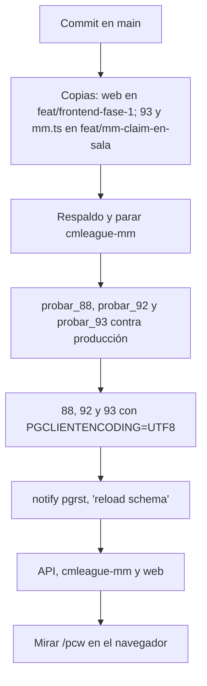

# La página de PCW de verdad, con ofertas, y lo nuevo de Jugar: guía de implementación

## Estado

Implementado y probado en local el 2026-11-08, en la copia de `main` (worktree `v34frag-mainwt`), **sin commit y sin desplegar**. La `88`, la `92` y la `93` quedaron aplicadas en la base local.

- **Lo del matchmaking va también en las otras dos ramas.** Son la `93` (chat del grupo y denuncias), las rutas de `mm.ts` y los cambios de `features/matchmaking/` de la web:
  - la base y la API, también en `feat/mm-claim-en-sala`;
  - la web, en `feat/frontend-fase-1`.
- **No toca el plugin ni los servidores.** No hay nada que subir a #1, #2 (flow) ni #3.

## Cómo se trajo el código de Kyan

Se aplicaron sin commit los commits de PCW y Jugar de `kyan/pruebas`: `c20f6757`, `fc22c639`, `1779fddf` y `a4050658`.

- Los conflictos fueron solo en `docs/PENDIENTES.md`, `docs/bitacora/README.md` y `routeTree.gen.ts`. Quedaron los de `main`; el árbol de rutas se regeneró.
- El widget para streamers (`d9c02ee0`) no entró: depende de archivos que solo están en `kyan/pruebas`.
- `vipToast` (de `features/vip/upsell`, solo de Kyan) se reemplazó por el `VipDialog` de `main`.
- La prueba `1` de `prueba_88.sql` elegía un mix de 2 jugadores de la base local que no movía el ELO al recalcular. Ahora elige uno de 8 o más.

## Archivos

| Archivo | Cambio |
|---|---|
| `supabase/replanteo/88_pcw_sin_elo.sql` (de Kyan), `92_pcw_ofertas.sql`, `93_mm_chat_del_grupo.sql` | Base |
| `docs/bitacora/2026-10-14-replanteo-modelo-datos/reversas/88…`, `89…`, `90…` | Inversas |
| `docs/bitacora/2026-11-08-pcw-real/pruebas/` | `probar_92.sh` y `probar_93.sh` con sus pruebas |
| `supabase/replanteo/README.md` | Filas de la `92` y la `93` (la de la `88` vino de Kyan) |
| `web/backend/src/routes/pcw-play.ts`, `schemas/pcw.ts` | Ofertas, contexto, ELO y puesto en los bandos, Mis PCW con la reserva, plantel como equipo; sin `accept` |
| `web/backend/src/routes/mm.ts` | Chat del grupo y denuncia |
| `web/backend/src/routes/bookings.ts` | Descripción de `servers/free` |
| `web/backend/src/lib/errors.ts` | `VIP_REQUIRED` (`V8901`) |
| `web/backend/src/services/matches.ts` | Veto con mapas fijos |
| `web/backend/src/db/types.ts` | Regenerado (también trae la `85`, la `86` y la `87`, que faltaban) |
| `web/backend/test/…` | `tournaments.test.ts`, `pcw.test.ts`, `mm-party-chat.test.ts` (nueva), `tournament-services.test.ts` |
| `web/frontend/src/api/schema.d.ts` | Regenerado |
| `web/frontend/src/features/pcw/` | De Kyan, más `model.ts`, `api/`, `lib/adapt.ts` (+ prueba), `pages/PcwLiveRoom.tsx` y `demoRoom.ts` |
| `web/frontend/src/features/matchmaking/` | De Kyan (`ChatDock`, `PlayerMenu`, `MatchAlerts`, la sala), más el chat del grupo y la denuncia por mensaje en `source.ts`, y los reportes sin sala en `admin/ReportsPanel.tsx` |
| `web/frontend/src/features/shell/` | De Kyan (campana con avisos de PCW, "Buscando" arriba); el menú con PCW activo |
| `web/frontend/src/routes/_app/pcw.tsx`, `demo.pcw.tsx`, `_app.tsx` | La página real, la demo con el modelo, el aviso de partida en todo el layout (de Kyan) |
| `docs/manual/…` | `capitan/publicar-y-ofertar-pcw.md` (nueva), `capitan/jugar-pcw.md`, `capitan/sanciones-pcw.md`, `moderador/sanciones-pcw.md` (ya no ocultas), `jugador/buscar-partida.md` |
| `web/frontend/src/features/legal/`, `terms/` | Términos y privacidad, fecha 8 de noviembre de 2026 |

## Despliegue (falta)

1. **Commit cuando Daniel lo pida.** Conventional Commits, en `main`, con las copias a las otras ramas que dice el estado.
2. **Respaldo** (`sudo -n /usr/local/bin/cmleague-respaldar`) y `systemctl stop cmleague-mm`. Antes, confirmar que no hay salas ni nadie en la cola.
3. **La `88` recalcula el ELO de todos sin las PCW ya jugadas.**
   - Bloquea `player_elo` un rato: hacerla con ningún mix terminando.
   - Avisar antes en el Discord, porque cambia el ELO de quienes jugaron PCW (Kyan lo pidió así en su `PARA_DANIEL.md`).
4. **Las pruebas contra producción, por el túnel:** `probar_88.sh "<conexión>"`, `probar_92.sh "<conexión>"` y `probar_93.sh "<conexión>"`. Las tres corren en una transacción que se deshace; tienen que terminar en verde y con la inversa igual a antes.
5. **Aplicar** la `88`, la `92` y la `93`, en ese orden, desde los archivos commiteados, con `PGCLIENTENCODING=UTF8`. Después, `notify pgrst, 'reload schema'`.
6. **Desplegar** la API, prender `cmleague-mm` de nuevo y desplegar la web.
7. **Mirarlo en el navegador:**
   - con una cuenta VIP: publicar;
   - con otra: mandar una oferta;
   - elegirla, marcar listos los dos y entrar a la sala;
   - en Jugar, el chat del grupo con dos cuentas.
8. **Publicar el changelog:** `CHANGELOG_DISCORD.txt` (2.9.27). El de `2026-11-08-pcw-demo` también dice 2.9.27, pero es el del prototipo de Kyan: no se publica.

## Pruebas

- **Base** (Supabase local con Docker, dentro de una transacción que se deshace):
  - `probar_88.sh docker`: los 7 bloques de Kyan en verde.
  - `probar_92.sh docker`: 12 bloques (sin VIP no se publica, ofertas, rosters, retirar, limpieza, elegir, mapas fijos, RLS, cancelar, `pcw_my_context` y servidores libres para PCW).
  - `probar_93.sh docker`: 6 bloques (sin grupo, escribir y leer, RLS, escribir muy rápido, denunciar y el chat que se va con el grupo).
  - Las tres terminan con la inversa igual a antes y las funciones como estaban.
- **API:**
  - `typecheck` y las 569 pruebas unitarias en verde.
  - En integración, contra la base local, pasan `tournaments.test.ts` (PCW con VIP, ofertas, plantel, contexto, mapas fijos), `pcw.test.ts`, `notifications.test.ts`, `vip.test.ts` y `llave-serie.test.ts`.
  - La suite completa da 10 fallas en `claim`, `equipo-torneos` (logos y banner), `hud`, `ips`, `live`, `medals` y `notify-due`. Son las mismas 10 sobre `main` limpio contra la misma base local, así que no vienen de este cambio.
- **Web:** `typecheck`, `lint`, las 698 pruebas y el build en verde.
- **En el navegador**, con la API y la web locales contra la base local, se recorrió todo el flujo con dos cuentas:
  - publicar con VIP y mandar una oferta como equipo;
  - "Tu anuncio" con la oferta y elegirla;
  - Mis PCW con la próxima en grande;
  - los dos listos y la sala con el veto: bans de los dos lados y el turno de pick en BO3;
  - el chat general.

- **Escenarios (2026-11-08, pedidos por Daniel)**, con la API y la web locales:
  - `pruebas/escenarios_api.mjs`: 40 escenarios contra la API, todos en verde. Cubren publicar (VIP, admin, como equipo, mix, pool corto, un anuncio por cuenta), el tablón con y sin sesión, ofertas (propia, repetida, cruce de rosters, hora pasada, retirar, ajena), elegir y sus avisos, aceptar directo (404), listos y "ya no estamos listos", turnos del veto (ban, ban, pick, pick), cancelar, mapas fijos (BO1 y BO3) y BO1 con 2 mapas, borrar un anuncio con ofertas, sanción de PCW, contexto, servidores libres, sin sesión, chat del grupo (permisos, largo, denuncias, borrado con el grupo, 10 cada 10 s) y el vencimiento a los 7 días.
  - `pruebas/escenarios_web.mjs`: 13 escenarios en el navegador. Cubren el panel de publicar sin desafío ni Discord, sin VIP abre "Cómo ser VIP", oferta con otra hora, sin equipo solo mix, la campana, elegir, la sanción, el rival listo, la sala, "ya no estamos listos", el celular sin scroll horizontal y el menú.
  - Las salas con mapas fijos (BO1 y BO3) se probaron aparte: sin veto y con los mapas en orden. De ahí salió un arreglo: con mapas fijos, el último mapa ya no dice "decisivo".

## En qué se apartó del plan

- **Los replanteos se renumeraron el 2026-11-09:** la `89` y la `90` del plan pasaron a ser la `92` (`92_pcw_ofertas.sql`) y la `93` (`93_mm_chat_del_grupo.sql`), con sus inversas y pruebas (`probar_92.sh`, `probar_93.sh`). Kyan ya había subido a `kyan/pruebas` su `89` (autoaceptar), `90` (verificados) y `91` (comentarios). En producción va **88 → 89 → 90 → 91 → 92 → 93 → 94**. Las dos se volvieron a probar encima de las de Kyan: 12 y 6 bloques en verde.
- Se agregó `GET /me/pcw/context` (`pcw_my_context()` en la `92`). La página necesitaba saber si soy VIP, mi equipo con su plantel y mis amigos, y `mm_friends` no se lee con la sesión del usuario.
- `GET /me/pcw/matches` trae también los dos bandos completos (`pcw_sides`), para los rosters con ELO de Mis PCW y de la sala.
- `servers_free('pcw')` lo puede pedir cualquiera con sesión: el panel "Servidores" de la página lo usa y antes daba 403 a los jugadores.
- La denuncia fuera de la sala va por mensaje del chat del grupo (`reportMessage`), no por jugador. Así queda el mensaje como prueba y solo se denuncia a alguien que escribió en tu grupo. En la lista de amigos y en las tarjetas del grupo, el menú del nombre ya no ofrece Denunciar.
- La sala de una PCW no deja denunciar (no hay sala del matchmaking): pide escribirle a un moderador.
- La tarjeta grande de Mis PCW ahora dice si el rival ya marcó Listos (`them_ready`).

## Pendiente

- Los avisos de PCW por mensaje directo de Discord (no existe el envío de mensajes directos).
- Las ideas g a m de Kyan siguen solo en la demo:
  - aviso en Discord al publicar;
  - desafío directo;
  - otra hora en una práctica ya armada;
  - avisos a medida;
  - confiabilidad;
  - suplentes;
  - recordatorio con Conectar.
- Que la sala escuche la reserva por el socket. Hoy se pide cada 5 s, como la página de la serie.
- El historial "contra ustedes" del tablón no aparece en la página real: los resultados traen el bando de la PCW, no el equipo oficial.
