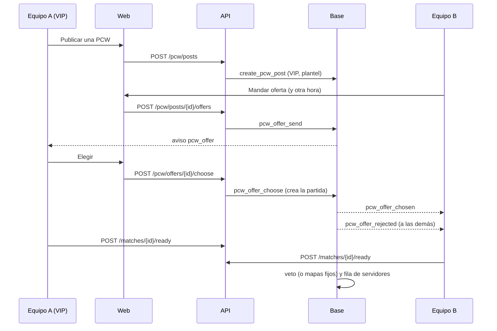

# Plan: la página de PCW de verdad, con ofertas, y lo nuevo de Jugar

> Planeación original. Estado: **aprobado por Daniel el 2026-11-08** ("empezá a implementar el frontend y el backend en main con los diseños que me diste en el artifact").

Pedido de Daniel (2026-11-08): pasar a la web real el prototipo de Kyan (`kyan/pruebas`, bitácora [`2026-11-08-pcw-demo`](../2026-11-08-pcw-demo/)) con los diseños del artifact https://claude.ai/artifact/TyjvGnDfauLS9L4AiZxLaL, haciendo también el backend que ese prototipo dejó pendiente (`PARA_DANIEL.md`). Se trabaja en `main` (worktree `v34frag-mainwt`).

## Decisiones tomadas

| Tema | Decisión | Por qué |
|---|---|---|
| Código de Kyan | Se traen a `main` sus commits de PCW y Jugar (`c20f6757`, `fc22c639`, `1779fddf`, `a4050658`) con `cherry-pick -n`, sin el widget (`d9c02ee0`, depende de cosas que no están en `main`) ni sus cambios a `PENDIENTES.md` | El diseño ya está hecho y probado en la demo. Entran limpios salvo docs y `routeTree.gen.ts` |
| La página | `PcwPage` deja de recibir el estado de la demo y recibe un modelo (`PcwModel`): datos, acciones y qué ideas mostrar. La demo (`/demo/pcw`) y la página real (`/pcw`) lo arman cada una a su manera | Una sola página para las dos; la demo sigue sirviendo para mostrar las ideas sin backend |
| Ideas sin backend (g a m) | En `/pcw` no se muestran: aviso en Discord al publicar, desafío directo, contrapropuesta de hora en una práctica ya armada, avisos a medida, suplentes y confiabilidad. Siguen en la demo | No son urgentes (Kyan) y cada una es un requerimiento aparte |
| Ofertas | Tabla nueva `pcw_offers`. Mandar una oferta crea el bando (como hoy al aceptar) y queda abierta; el que publicó elige una y se crea la partida; las demás quedan rechazadas. Una oferta puede proponer otra hora: si la eligen, la partida toma esa hora | Es el modelo de pracc.com que eligió Kyan |
| Aceptar directo | `POST /pcw/posts/{id}/accept` y `accept_pcw` se quitan: con ofertas, nadie se queda con un anuncio sin que el que publicó lo elija | Si quedaran, cualquiera se saltearía la elección |
| Publicar es VIP | `create_pcw_post` rechaza sin VIP (los admins pueden). La API lo devuelve como `403 VIP_REQUIRED` y la web abre "Cómo ser VIP" (`VipDialog`, el de `main`). Ofertar es para todos | Kyan, 2026-11-08; ya está en `/terminos` |
| Equipo sin roster | Como equipo no se elige roster: la API completa el bando con el plantel del equipo (hasta 7, primero el capitán). La base sigue validando 4 con cuenta | Sin tocar `pcw_make_side`; el plugin ya cuenta a los del plantel que entran |
| Mapas fijos | Si el pool tiene tantos mapas como el formato (o menos), no hay veto: `veto_sequence` devuelve vacío, los mapas se juegan en el orden elegido (`match_map_pool` y `match_series_maps`) y la API hace lo mismo (`vetoSequence`, `vetoState`) | Hoy una BO3 con 3 mapas banea 2 y queda uno solo |
| Ban o pick | Ya existe: `veto.next.action` en `GET /matches/{id}`. La sala lo usa | Nada que hacer en la base |
| Sala | La de Kyan (`PcwRoom` sobre `MatchRoom`), alimentada por `GET /matches/{id}` y `GET /matches/{id}/booking` (los de la página de la serie). Veto, listos y "ya no estamos listos" con las mutaciones de `features/series`. Chat general con el chat de la partida que ya existe; sin chat de equipo | Reutiliza la reserva de la `56`, que ya funciona |
| Avisos | `pcw_offer` (al que publicó), `pcw_offer_chosen` y `pcw_offer_rejected` (al que ofertó), categoría `pcw`. Solo en la web | Discord por mensaje directo no existe todavía: queda pendiente |
| Ranking y ELO en el tablón | `GET /pcw/posts` y las ofertas traen el puesto del equipo (`team_ranking`) y el ELO de cada jugador del roster | Las columnas Ranking y Parejo del diseño |
| PCW sin ELO | Se aplica el replanteo `88` de Kyan tal cual | Ya está escrito y probado |
| Jugar | Lo que ya anda con la API entra como está: menú al tocar un nombre, amigos con barra, partida encontrada en cualquier página y "Buscando" arriba. Se hace el backend del chat del grupo (`mm_party_chat`, aviso `party.chat` por el socket) y de denunciar desde el chat del grupo | Están en el diseño y Kyan los dejó listos en la web |
| Rama | Todo en `main`. Lo del matchmaking (chat del grupo y denuncias) se copia después a `feat/frontend-fase-1` y `feat/mm-claim-en-sala`, como en los últimos despliegues | Pedido de Daniel |

## 1. El flujo completo

## 2. Base de datos

- `88_pcw_sin_elo.sql` (de Kyan, sin cambios).
- `89_pcw_ofertas.sql`, con su inversa y pruebas SQL:
  - `pcw_offers` (`post_id`, `team_id` del bando, `by_user`, `starts_at` propuesta, `status` `open`/`chosen`/`rejected`/`withdrawn`, `created_at`), una abierta por cuenta y anuncio, RLS de solo lectura para el que publicó y el que ofertó.
  - `pcw_offer_send`, `pcw_offer_withdraw` y `pcw_offer_choose`, con las reglas de hoy de `accept_pcw` (no el propio anuncio, nadie en los dos rosters, sanción de PCW).
  - Al cerrarse un anuncio (elegido, cancelado o vencido), sus ofertas abiertas quedan rechazadas.
  - `create_pcw_post` exige VIP (o admin). Se borra `accept_pcw`.
  - Mapas fijos: `veto_sequence`, `match_map_pool` y `match_series_maps`.
  - Avisos `pcw_offer`, `pcw_offer_chosen`, `pcw_offer_rejected` en `notification_category`.
- `90_mm_chat_del_grupo.sql`: `mm_party_chat` (se borra al deshacerse el grupo), `mm_party_chat_send` (300 caracteres, el filtro de palabras del chat de la sala, emite `party.chat` a los del grupo), `mm_party_chat_list`, y `mm_report_from_chat` (denuncia sin sala con el mensaje como prueba; `mm_reports.lobby_id` pasa a admitir null y guarda `message`).

## 3. API (`web/backend`)

- `GET /pcw/posts`: puesto del equipo, ELO de cada jugador y, con sesión, `my_offer`.
- `GET /me/pcw/post`: las ofertas que llegaron.
- `POST /pcw/posts`: con `team_id` y sin jugadores, el plantel; `VIP_REQUIRED`.
- `POST /pcw/posts/{id}/offers`, `DELETE /pcw/offers/{id}`, `POST /pcw/offers/{id}/choose`. Se quita `POST /pcw/posts/{id}/accept`.
- `GET /me/pcw/matches`: cada práctica con su reserva (listos de cada lado y estado) y mi lado.
- `vetoSequence` y `vetoState` con mapas fijos.
- `GET` y `POST /mm/party/chat`, `POST /mm/party/chat/{id}/report`.
- Pruebas de cada ruta nueva y regenerar `schema.d.ts` de la web.

## 4. Web (`web/frontend`)

- `features/pcw/api/` (consultas y mutaciones) y `lib/adapt.ts` (de la API a los tipos de la página).
- `PcwPage` con `PcwModel`; `/pcw` real; `/demo/pcw` sigue igual.
- Sala real en `/pcw?sala=<id>` con `PcwRoom`.
- Menú: `pcw` sin `soon`.
- Jugar: `partyChat`, `sendPartyChat` y `reportPlayer` en `apiSource`.
- Pruebas de los adaptadores y de las páginas.

## 5. Manual, términos y changelog

- Manual: páginas de PCW del jugador y del capitán (publicar es VIP, ofertas, la sala) y la del chat del grupo.
- `/terminos` y `terms/terminos.html`: la sección de PCW deja de estar "En preparación" en lo que queda hecho. `/privacidad`: los mensajes del chat del grupo (se guardan hasta que el grupo se deshace).
- `CHANGELOG_DISCORD.txt`.

## 6. Requisitos antes de empezar

- Supabase local con Docker para probar la `88`, la `89` y la `90` (Docker Desktop está apagado en la PC: hay que prenderlo).
- Nada de servidores ni plugin.

## 7. Orden de implementación

1. Traer el código de Kyan (hecho al planear) y este plan.
2. Base: `89` y `90`, inversas y pruebas.
3. API y sus pruebas; regenerar el esquema de la web.
4. Web: modelo, adaptadores, `/pcw`, sala, Jugar; pruebas, `typecheck` y `lint`.
5. Manual, términos, privacidad, changelog, `DOCUMENTACION.md`, `GUIA_IMPLEMENTACION.md`, `PENDIENTES.md` y la fila del README.
6. Sin commit ni despliegue hasta que Daniel lo pida.
