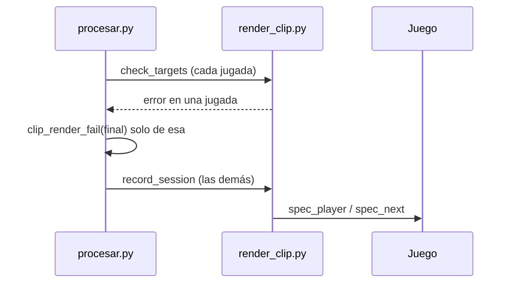

# Clips con el jugador como único vivo: documentación

## Qué hace

El render pone la cámara en el jugador de cada tramo con `spec_player "<nombre>"`. Los comandos se escriben con el teclado en la consola, así que un nombre con caracteres fuera del ASCII (el `™` del tag "New™") no se puede escribir. En ese caso se elige un "ancla": un jugador vivo con nombre escribible, y desde él se avanza con `spec_next` hasta el del clip.

Al final de un clutch, el del clip suele ser el único vivo (por ejemplo, mientras desactiva la bomba). No había ancla, `spec_target` lanzaba un error dentro de la sesión del juego y `procesar.py` marcaba como fallidas todas las jugadas de la partida. Ahora pasan dos cosas:

1. Si el del clip es el único vivo, la cámara llega con un solo `spec_next`.
2. Antes de abrir el juego se revisa la cámara de cada jugada (`check_targets`). La que no tiene forma de llegar a su jugador falla sola, con el error `Cámara: …` y sin reintentos, y las demás se graban.

## Casos que se vieron

| Partida | Clips | Antes | Ahora |
|---|---|---|---|
| mirage_rc1 del #1, `srv1-20261107T215859-3025` (2026-11-08 01:47 UTC) | 10 | Los 10 fallaron por el clutch 1v1 de "New™ LescoSSJ" en la ronda 26 (solo vivo, desactivando) | Los 10 pasan la revisión; el de Lesco va con `spec_next` (grabado y revisado en la PC) |
| mirage_rc1 de flow, `flow-20261107T002859-44a2` (2026-11-07 03:56 UTC) | 5 | Los 5 fallaron por el 3k de "New™ DnG" (ronda 16, solo vivo) | 4 pasan; el 3k de "New™ Malapraxis" (ronda 17) falla solo |

**Límite que queda:** si hay varios vivos y ninguno tiene nombre escribible (en la ronda 17 de flow, los cuatro de New™ y "EXTRADITABLES# zgalact1ck" con un carácter raro al final), la jugada no se puede grabar.

## Qué cambia para cada rol

Nada para los usuarios: salen los videos de clips que antes fallaban.

## Términos y privacidad

Sin cambios.

## Dónde está cada cosa

- `render/render_clip.py`: `spec_target` (caso del único vivo) y `check_targets`.
- `render/procesar.py`: la revisión en `process_match`.
- `pruebas/revisar_camara.py`: simula la cámara de cada clip de una partida con su demo, sin el juego.
- `pruebas/reprocesar.sql`: devuelve los clips a la cola.
