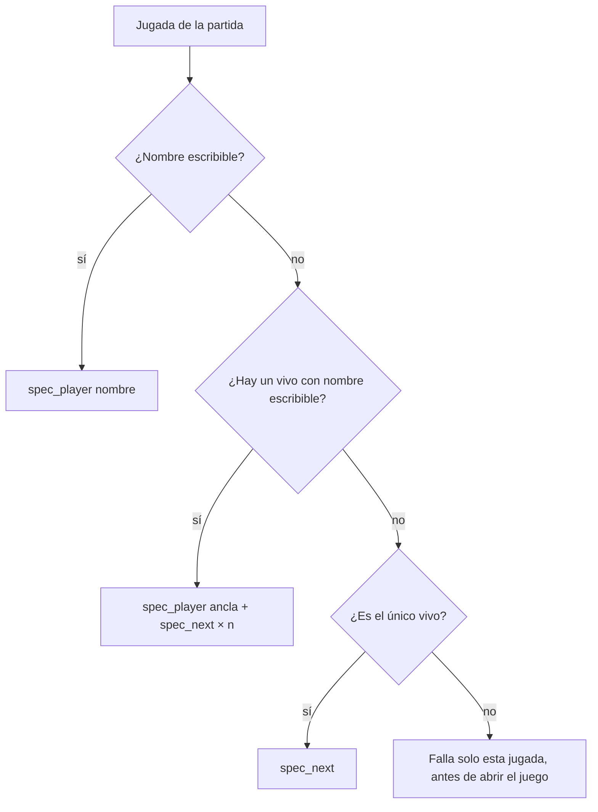

# Plan: clips que fallaban cuando el jugador es el único vivo y su nombre no se puede escribir

> Planeación original. Estado: **propuesta**, pedida por Daniel el 2026-11-08 ("todos los clips de mirage_rc1 de ayer fallaron").

## Decisiones tomadas

| Tema | Decisión |
|---|---|
| Causa | `spec_target` (`render/render_clip.py`) necesita un jugador vivo con nombre ASCII ("ancla") para llegar con `spec_next` a uno con `™` en el nombre. Al final de un clutch (desactivando la bomba) el del clip es el único vivo: no hay ancla y lanza un error |
| Arreglo 1 | Si el del clip es el único vivo, alcanza con `spec_next`: va al siguiente vivo desde cualquier jugador, y no hay otro |
| Arreglo 2 | El error salía dentro de `record_session` y `procesar.py` marcaba como fallidas **todas** las jugadas de la partida. La cámara de cada jugada se revisa antes de abrir el juego, y la que no tiene forma falla sola, sin reintentos (con la misma demo vuelve a pasar) |
| Lo que queda | Si hay varios vivos y ninguno tiene nombre escribible (el 3k de "New™ Malapraxis" en flow), la jugada sigue fallando, pero sola |

## 1. El flujo

## 2. Cambios

- `render/render_clip.py`: el caso del único vivo en `spec_target` y `check_targets(d, job, lead_ticks)`.
- `render/procesar.py`: `process_match` llama a `check_targets` por jugada antes de `record_session`.

## 3. Orden

1. Reproducir con las demos de los dos mixes, sin el juego.
2. Grabar el clutch de Lesco en la PC con `probar_jugada.py`.
3. Commit, `git pull` en el portátil y devolver los clips a la cola (`pruebas/reprocesar.sql`), con la confirmación de Daniel.
