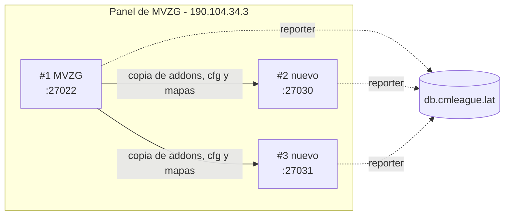

# Servidores nuevos #2 y #3: documentación

## Qué cambió

Desde el 2026-11-08 (Kyan):

| # | Servidor | ID del panel | Dirección | SourceTV | Tag |
|---|---|---|---|---|---|
| #1 | MVZG (sin cambios) | `157703b5` | `190.104.34.3:27022` | `27065` | `srv1` |
| #2 | Nuevo | `cd1be322` | `190.104.34.3:27030` | `27066` | `srv2` |
| #3 | Nuevo | `16c850ff` | `190.104.34.3:27031` | `27067` | `srv3` |

- **flow** (antes el #2) ya no existe. Su API key del panel da 401.
- **El de retake** (`aurav34`, ExtremeHost, antes el #3) se da de baja alrededor del 2026-11-10. Hasta entonces queda sin número.
- Los tres servidores son nuestros, están en el mismo panel (`panel-mvzg.com`) y en la misma máquina, y los tres van a tomar salas del matchmaking.
- El modelo de configuración pasa a ser el #1.

## Acceso

- **API del panel:** la misma key del #1 (`SFTP_CSS_API_KEY`) ve los tres servidores. Permisos de esa key:
  - Sí: ver el estado, prender y reiniciar, y cambiar las variables de arranque `SERVER_NAME`, `SRV_STARTMAP` y `Boot_Custom_Command`.
  - No: los archivos, las direcciones ni `TICKRATE`, que es de solo lectura.
- **SFTP:** el host, el puerto y la contraseña son los de `SFTP_CSS_*_MVZG`. El usuario es el mismo con el ID del servidor al final: `<usuario>.cd1be322` o `<usuario>.16c850ff`.

## Qué tiene cada servidor nuevo

Lo mismo que el #1:
- MetaMod, SourceMod 1.10 (plugins, extensiones, gamedata, traducciones y `configs`) y Stripper con sus filtros;
- `cfg/sourcemod/`, `cfg/csstv/`, `server.cfg`, `autoexec.cfg`, `mapcycle.txt`, `maplist.txt` y `motd.txt`;
- los 17 mapas que el #1 tenía y ellos no.

No se copiaron los logs, la cola ni los envíos del reporter, `sqlite`, los respaldos `.bak` ni las versiones viejas de `plugins/disabled/`.

Lo propio de cada uno:

| Archivo | Qué cambia respecto del #1 |
|---|---|
| `server.cfg` | `hostname CMLeague #N`, `tv_title "CMLeague SourceTV #N"` y `tv_port`. `sv_password` y `rcon_password` quedan comentados: valen los del panel |
| `csstv_reporter.cfg` | Tag `srvN`, sin token, `csstv_send "0"`, `csstv_mm "0"` y `csstv_claim "0"` hasta el alta en la base |
| `csstv_hud.cfg` | `csstv_hud "0"`, sin puerto ni clave |
| `csstv_calladmin.cfg` | El nombre y la dirección de cada uno |
| Variables de arranque | `SERVER_NAME "CMLeague #N"`, `Boot_Custom_Command "+tv_port <puerto>"`; mapa de inicio `de_dust2` |

Los archivos que se reemplazaron quedaron como respaldo en el servidor, con el sufijo `.bak_original`: `server.cfg`, `autoexec.cfg`, `mapcycle.txt`, `maplist.txt` y `motd.txt`.

## Lo que todavía no está igual al #1

- **`-nohltv`:** está en la línea de arranque de los dos nuevos y apaga SourceTV, así que no se graban demos. La línea no se puede editar.
- **Tickrate 64** en lugar de 100: `TICKRATE` es de solo lectura.
- **Sin token ni HUD:** el reporter no manda nada a la base y no toman salas.

## Qué cambia para cada rol

- **Jugador:** por ahora nada. Cuando se den de alta, el matchmaking tiene tres servidores para asignar salas.
- **Admin:** en Administración › Servidores aparecen #2 y #3 una vez dados de alta. Las páginas del manual no nombran servidores, así que no cambian.

## Términos y privacidad

Sin cambios. Los servidores son nuestros, no de terceros, y no cambia qué datos se guardan ni a quién se mandan.
