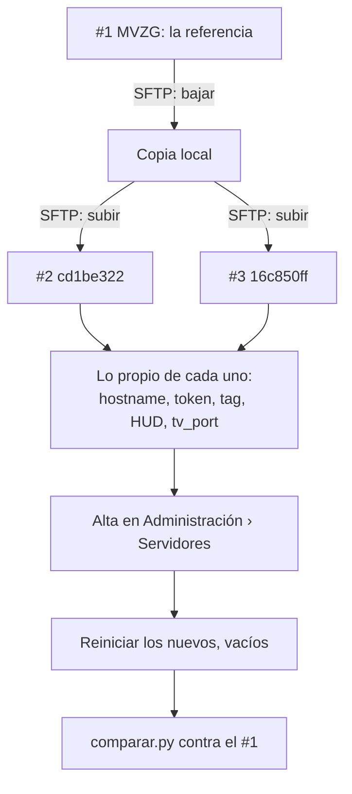

# Plan: servidores nuevos #2 y #3 en el panel de MVZG

> Planeación original. Estado: **propuesta**, pendiente de aprobación de Kyan.

## Decisiones tomadas

| Tema | Decisión | Por qué |
|---|---|---|
| flow | Ya no existe (Kyan, 2026-11-08). Sale de la lista de despliegue | Su servidor se dio de baja. Su key del panel (`SERVER2_PANEL_API_KEY`) da 401 |
| Servidor de retake (`aurav34`, ExtremeHost) | Se da de baja alrededor del 2026-11-10. Hasta entonces queda como "retake", sin número | Kyan, 2026-11-08 |
| Numeración | MVZG sigue como **#1** (`157703b5`). Los nuevos son **#2** (`cd1be322`, puerto 27030) y **#3** (`16c850ff`, puerto 27031) | Kyan, 2026-11-08. Los números viejos quedan como historia en la bitácora |
| Uso | Los tres toman salas del matchmaking. El retake y el 2v2 se quedan sin servidor | Kyan, 2026-11-08 |
| Referencia de configuración | El **#1** (MVZG), en lugar del de retake | Es el único servidor que va a quedar con la configuración completa del matchmaking |
| Plugin | `.smx` genérico en los tres, como en el #1 | Son nuestros: no llevan build licenciado |
| Acceso | La API key del panel (`SFTP_CSS_API_KEY`) ve los tres. El SFTP usa el mismo usuario base y contraseña que el #1 (`SFTP_CSS_*_MVZG`), con el sufijo de cada servidor | Comprobado el 2026-11-08 |

## 1. El flujo completo

## 2. Lo que se copia del #1

Los servidores nuevos son una instalación limpia: solo traen `bufferfix`. Del #1 se copia:

- `addons/metamod`, `metamod.vdf`, `addons/sourcemod` (plugins, extensiones, gamedata, traducciones y `configs`) y `addons/stripper`.
- `cfg/sourcemod/` (con `csstv_reporter.cfg`), `cfg/csstv/` (`warmup`, `live`, `end` y las cfg por tipo de partida), `mapcycle.txt` y `maplist.txt`.
- `server.cfg`, con lo propio de cada servidor cambiado.
- Los mapas que faltan, entre ellos `de_dust2_ob`, `de_mirage_rc1`, `de_cache`, `de_inferno_classic`, `de_season`, `de_tuscan`, `de_villa` y `$2000$`, con sus `.nav` y `.txt`.
- No se copian `logs/`, `csstv_demos/`, los `data/csstv/queue/` ni los respaldos `.bak`.

## 3. Lo propio de cada servidor

| | #2 (`cd1be322`) | #3 (`16c850ff`) |
|---|---|---|
| Dirección | `190.104.34.3:27030` | `190.104.34.3:27031` |
| `hostname` y `tv_title` | `CMLeague #2` | `CMLeague #3` |
| Tag | `srv2` | `srv3` |
| Token, `csstv_hud_port` y `csstv_hud_key` | De Administración › Servidores | De Administración › Servidores |
| `tv_port` | `27066` en `server.cfg` y en `game_servers.tv_port` | `27067`, igual |

**Por la API del panel** (variables de arranque): `SERVER_NAME`, `TICKRATE` de 64 a 100 (igual que el #1), `SRV_STARTMAP` a `de_dust2_ob`, y `Boot_Custom_Command` con `+tv_port` como el #1.

## 4. Lo que no se puede hacer desde acá

- **`-nohltv`:** la línea de arranque de los nuevos lo trae fijo. Sin SourceTV no se graban demos. La API no deja editar la línea, así que hay que pedirle a MVZG que lo saque.
- **Alta en la base de producción:** se hace en Administración › Servidores (Daniel o Kyan): dar de alta #2 y #3 con su token, su tag y su HUD, y marcarlos para el matchmaking. Además:
  - pasar la fila de flow (`cedf12a8-…`) a "flow (histórico)", fuera del matchmaking;
  - pasar el de retake a histórico cuando se dé de baja.
- **Worker de demos:** agregar `PTERO_KEY_cd1be322` y `PTERO_KEY_16c850ff` (con la misma key) y borrar `PTERO_KEY_f337a7d9` (flow).

## 5. Documentos

- `CLAUDE.md`:
  - La tabla de servidores pasa a #1, #2 y #3 en el panel de MVZG, más el de retake hasta su baja.
  - Despliegue: a los tres, sin builds licenciados por ahora.
  - La referencia de configuración pasa a ser el #1.
  - Desaparecen las reglas propias de flow, y las de ExtremeHost quedan hasta la baja del retake.
- `docs/PENDIENTES.md`: un punto nuevo para esto.
- `docs/bitacora/README.md`: una fila nueva.
- La bitácora vieja no se reescribe.

## 6. Requisitos antes de empezar

- El OK de Kyan para subir archivos a los servidores nuevos y reiniciarlos. Están vacíos, sin nadie jugando.
- El #1 no se toca: solo se leen sus archivos.

## 7. Orden de implementación

1. Bajar del #1 lo de la sección 2 a una carpeta fuera del repo, sin logs ni demos.
2. Subirlo a #2 y #3 y ajustar lo propio de cada uno (sección 3).
3. Cambiar las variables de arranque por la API del panel.
4. Reiniciar #2 y #3 (vacíos) y mirar la consola: que carguen MetaMod, SourceMod y los plugins sin errores.
5. Comparar con `comparar.py` contra el #1.
6. Dejar en la guía lo que hacen Daniel o Kyan: el alta en la base, el Worker y pedirle a MVZG que saque `-nohltv`.
7. Actualizar `CLAUDE.md`, `PENDIENTES.md`, la bitácora y el manual, si cambia algo para los jugadores.
