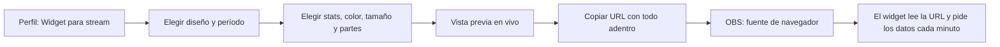

# Plan: Widget para streamers con stats completas y personalizable

> Planeación original. Estado: **propuesta**, prototipo de Kyan para pasarle a Daniel (backend) y a Esteban (frontend).

Parte del widget para OBS que ya existe ([`2026-10-29-widget-streamers`](../2026-10-29-widget-streamers/)), con sus diseños Mini, Compacto y Completo. Kyan pasó como referencia una tarjeta de stats con:

- El nivel y el ELO.
- ADR, promedio, K/D y KR.
- El puesto en el ranking y una frase.
- Aces, 4K, 3K, kills con sniper y con cuchillo.
- HS %, el puesto por región y por país, y los últimos resultados.

Pidió que el widget tenga ese tipo de diseño, que haya más diseños y que cada streamer lo pueda personalizar.

## Decisiones tomadas

| Tema | Decisión | Por qué |
|---|---|---|
| Dónde se ve | `/demo/widget` del frontend de `repo` (rama `kyan/pruebas`), solo en `pnpm dev` | Desde el 2026-11-02 todo va en `kyan/pruebas`, y ahí está el demo del widget |
| Diseños nuevos | **Stats**, una tarjeta como la referencia con el estilo de la web, sin copiar la de la imagen. **Barra**, una tira horizontal para abajo de la pantalla. **Vertical**, una columna angosta para el costado de la cámara | Más formas de ubicarlo en el stream; los tres de antes siguen igual |
| Nivel | El anillo de 10 barras elegido el 2026-11-01 (`public/niveles/nivel_01.svg` a `nivel_10.svg`) | Es el diseño de niveles de la plataforma |
| Datos | Solo lo que ya manda el reporter 2.9.3: ADR (daño / rondas), rating, K/D, KR, HS %, 3K, 4K, aces (`k3` a `k5`), sniper (`weapon_kills` de `awp` y `scout`), cuchillo (`weapon_kills.knife`), clutches, entradas, pistolas, puesto en el ranking y en tu país | Desde el reporter 2.7.0 todos esos datos están en el JSON de cada partida |
| Región | En lugar de "SEA" y "CN" va el **puesto en el ranking general** y el **puesto en tu país** | Es lo que tiene sentido en CM League |
| Período | Hoy, últimas 24 h, temporada o histórico | Lo que el streamer quiera mostrar |
| Personalizable | Diseño, período, qué stats se ven y en qué orden, color de acento, opacidad del fondo, tamaño, qué partes se muestran (nick, tag, nivel, barra al próximo nivel, últimos resultados, bandera, frase) y una frase propia | Lo pidió Kyan |
| Dónde se guarda la personalización | En la URL del widget, como hoy (`/widget?id=…&d=…`) | OBS solo guarda la URL; no hace falta cuenta ni tabla nueva |
| Frase | Si el streamer no escribe una, sale sola según cómo viene: primero del ranking, racha de victorias, mejor día de la semana… Hasta 40 caracteres | La referencia tiene una frase; automática no hay que mantenerla |
| VIP | No | El widget para OBS es gratis hoy; no se cambia sin que Kyan lo pida |

## 1. El flujo

## 2. Lo que tendría que hacer cada uno

- **Daniel:** que `widget_player()` (o una ruta nueva) devuelva, para el período pedido:
  - ADR, rating, KR y HS %.
  - `k3`, `k4` y `k5` sumados.
  - Kills con AWP más Scout, y con cuchillo.
  - Clutches ganados, entradas y pistolas.
  - El puesto en el ranking y en el país del jugador, y el país.
- **Esteban:** el generador en el perfil y la página `/widget` que lee la URL.

## 3. Orden de implementación

1. `features/widget/options.ts`: tipos, valores por defecto, stats disponibles, y leer y escribir la URL (con tests).
2. Los diseños nuevos en `StreamWidget.tsx`, con el anillo de nivel.
3. Los datos de ejemplo con las stats nuevas.
4. `routes/demo.widget.tsx`: los seis diseños y un personalizador con vista previa y la URL.
