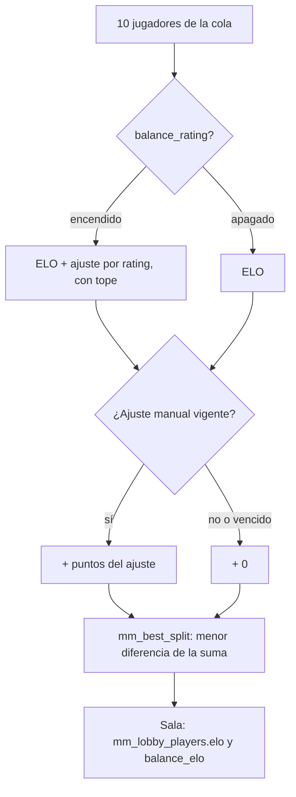

# Ajuste manual del armado del matchmaking: documentación

## Qué hace

El matchmaking reparte a los 10 jugadores de una sala con el **ELO de armado**. Desde este cambio, ese número puede llevar también un **ajuste manual** por jugador: puntos que se suman o se restan para que alguien pese más o menos en el reparto, sin tocar nada de lo que se ve (ELO, rating, nivel).

Sirve para los casos que el ELO y el rating todavía no reflejan: la cuenta nueva de alguien conocido, un smurf o un jugador que vuelve después de mucho tiempo.

Por defecto nadie tiene ajuste. Se pone **solo desde la base**: no hay pantalla en la web ni ruta en la API.



## La cuenta

```
ELO de armado = ELO
              + ajuste por rating (si balance_rating: 400 × (rating corregido − 1), entre −200 y +200)
              + ajuste manual vigente (entre −300 y +300; 0 si no hay o venció)
```

- El ajuste manual va **después** del tope del rating: un jugador con +200 por rating y +150 manual queda en ELO + 350.
- Se aplica aunque `balance_rating` esté apagado. Con el interruptor apagado y nadie de la sala con ajuste, `mm_balance_elos` devuelve null y todo queda como antes (`balance_elo` null).
- **Qué no cambia:** el ELO, el rating, el nivel, quién entra a la sala (ventana de la cola), el capitán, quién banea primero, la probabilidad de ganar y el ELO que se gana o se pierde.

## Cómo se usa (psql en la base de producción)

```sql
-- Buscar la ficha
select id, nick, steam_id from players where nick ilike '%nick%';

-- Poner o cambiar (30 días por defecto; de 1 a 180)
select * from mm_balance_override_set('<id de la ficha>', 150, 'cuenta nueva de X, juega como 1200', 'Daniel');
select * from mm_balance_override_set('<id de la ficha>', -100, 'motivo', 'Daniel', 60);

-- Sacar
select mm_balance_override_clear('<id de la ficha>', 'ya subió de ELO', 'Daniel');

-- Ver los vigentes y el historial
select * from mm_balance_overrides_active;
select * from mm_balance_override_log where player_id = '<id de la ficha>' order by at;
```

Para renovar, se vuelve a llamar `mm_balance_override_set`: reemplaza los puntos, el motivo y el vencimiento.

## Datos

| Objeto | Qué es |
|---|---|
| `mm_balance_overrides` | Un ajuste por ficha: `points` (−300 a 300, no 0), `reason`, `set_by`, `expires_at`, `created_at`, `updated_at`. Sin fila: sin ajuste. Uno vencido se ignora (no hace falta borrarlo) |
| `mm_balance_override_log` | Historial: `action` (`set`, `update`, `clear`), puntos y vencimiento antes y después, `reason`, `set_by`, `db_user` y `at`. Lo llena el trigger `mm_balance_override_log`, también si se edita la tabla a mano (en ese caso, una baja queda sin motivo ni autor, pero con `db_user`) |
| `mm_balance_override_set(ficha, puntos, motivo, autor, días = 30)` | Pone o reemplaza el ajuste. Falla con 0 puntos, fuera de ±300, sin motivo, con días fuera de 1 a 180 o con una ficha que no existe |
| `mm_balance_override_clear(ficha, motivo, autor)` | Lo saca. Devuelve si había. El motivo y el autor van al historial |
| `mm_balance_overrides_active` | Los vigentes, con nick, SteamID y ELO |
| `mm_balance_elos` | El ELO de armado: suma el ajuste manual vigente |
| `mm_tick` | Borra el historial de más de un año, como hace con `mm_queue_log` |

Todo es solo para `postgres` y `service_role`: RLS sin políticas y `revoke` a `anon` y `authenticated`.

## Qué cambia para cada rol

| Rol | Qué cambia | Página del manual |
|---|---|---|
| Jugador | Nada que vea. Los equipos se pueden repartir con un ajuste interno que no cambia su ELO, su rating ni lo que gana o pierde | [`jugador/buscar-partida.md`](../../manual/jugador/buscar-partida.md) |
| Admin | Sabe que el ajuste existe y que se pide a Daniel: no está en Administración › Matchmaking | [`admin/matchmaking.md`](../../manual/admin/matchmaking.md) |

## Términos y privacidad

- **Términos** (sección del ELO y el matchmaking, `/terminos` y `terms/terminos.html`): la liga puede aplicar ajustes internos y temporales a cuánto pesa un jugador al repartir los equipos, sin cambiar su ELO, su rating ni lo que gana o pierde, y sin publicarlos.
- **Privacidad** (`/privacidad` y `terms/privacidad.html`): en lo que se guarda con la cuenta, el ajuste (puntos, motivo, quién lo puso y hasta cuándo vale), que no se publica. En los plazos: hasta que vence (30 días por defecto, 180 como máximo) y su historial, un año.
- La fecha (`LEGAL_UPDATED`, 9 de noviembre de 2026) ya era la de hoy: no cambió.

## Dónde está cada cosa

| Qué | Archivo |
|---|---|
| Replanteo | `supabase/replanteo/96_mm_ajuste_manual_armado.sql` |
| Inversa | `docs/bitacora/2026-10-14-replanteo-modelo-datos/reversas/96_mm_ajuste_manual_armado.sql` (copia en `pruebas/96_inversa.sql`) |
| Pruebas | `pruebas/probar_96.sh` y `pruebas/prueba_96.sql` |
| Términos | `web/frontend/src/features/legal/pages/TermsPage.tsx`, `terms/terminos.html` |
| Privacidad | `web/frontend/src/features/legal/pages/PrivacyPage.tsx`, `terms/privacidad.html` |
| Manual | `docs/manual/jugador/buscar-partida.md`, `docs/manual/admin/matchmaking.md` |
