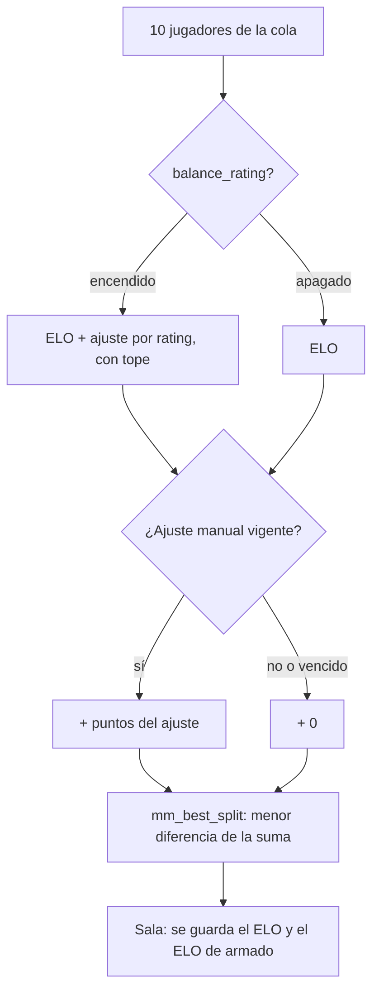
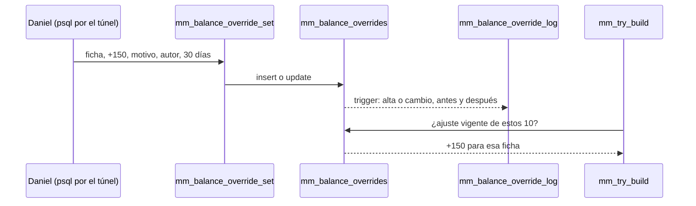

# Plan: ajuste manual del armado del matchmaking

> Planeación original. Estado: **propuesta**, pendiente de aprobación. Pedido por Daniel el 2026-11-09.

## Qué pasa hoy

El matchmaking reparte a los 10 jugadores de una sala con el **ELO de armado** (`mm_balance_elos`, replanteos `73` y `83`):

```
ELO de armado = ELO + ajuste por rating        (400 × (rating corregido − 1), entre −200 y +200)
```

En producción, `balance_rating` está encendido con 400, 200, 3 mapas y 60 días (comprobado el 2026-11-09).

Pasa que hay jugadores que el ELO y el rating todavía no reflejan bien: un smurf, la cuenta nueva de alguien conocido o un jugador que vuelve después de mucho tiempo. Daniel quiere poder correr el **peso** de un jugador en el reparto sin tocar lo que se ve: ni el ELO ni el rating.

Antes de esto se probaron (2026-11-09, con los 131 mixes de producción) dos formas automáticas: sumar la μ de TrueSkill y darle al rating un peso según la σ. Ninguna mejoró el armado actual (log loss 0,612 en los tres casos). Por eso se elige un ajuste **manual**.

## Decisiones tomadas

| Tema | Decisión | Por qué |
|---|---|---|
| Qué es | Un **ajuste manual** en puntos por jugador (positivo o negativo) que se suma al ELO de armado | Es el número que ya usa el reparto. El jugador no lo ve |
| Por defecto | **0 para todos**: sin fila, sin ajuste. El replanteo no carga ningún ajuste | Daniel: "por defecto prefiero que todos los jugadores sigan como están" |
| Dónde se pone | **Solo desde la base** (funciones SQL). Nada en la API ni en Administración | Daniel: "por ahora no se puede poner desde la web" |
| Tope | Entre **−300 y +300** puntos (`check` de la tabla) | Que nadie quede inflado o hundido sin límite. El ajuste por rating llega a ±200 |
| Dónde se suma | Después del tope del rating: `ELO + ajuste por rating (con su tope) + ajuste manual` | Si se sumara antes, el tope del rating lo recortaría |
| Con `balance_rating` apagado | El ajuste manual **se aplica igual** | Es independiente del rating. Sin ningún ajuste en la sala y con el interruptor apagado, todo queda como hoy (`balance_elo` null) |
| Vencimiento | **30 días por defecto**, configurable en cada alta. Se renueva volviendo a ponerlo | Un smurf que juega mucho sube de ELO solo y el ajuste sobra. Vencido, se ignora: no hace falta borrarlo |
| Motivo y autor | Obligatorios en cada alta, cambio o baja | Saber quién tocó a quién y por qué |
| Historial | Tabla aparte con cada alta, cambio y baja, llenada por un trigger (también si alguien edita la tabla a mano) | Que nada quede sin registro, aunque no se usen las funciones |
| Qué ve el jugador | Nada en su perfil ni en la sala. Los términos dicen que la liga puede hacer ajustes internos al armar los equipos | Daniel aprobó las dos cosas (opción 3 del 2026-11-09) |
| Qué no cambia | El ELO, el rating, el nivel, la ventana de la cola, el capitán, quién banea primero, la probabilidad de ganar y el ELO que se gana o pierde | Mismo criterio que el ajuste por rating (`73`) |
| Changelog | **Ninguno** | Es una herramienta interna. Lo público son los términos |

## 1. El flujo





## 2. Base de datos: replanteo `96_mm_ajuste_manual_armado.sql`

(El número es el siguiente libre en `main` el 2026-11-09. Si otro requerimiento lo toma antes, se usa el siguiente.)

### Tablas

`mm_balance_overrides`: un ajuste vigente o vencido por ficha.

| Columna | Tipo | Qué es |
|---|---|---|
| `player_id` | `uuid` PK, FK a `players` (`on delete cascade`) | La ficha |
| `points` | `integer not null`, `check (points between -300 and 300 and points <> 0)` | Puntos que suma o resta |
| `reason` | `text not null`, `check (length(trim(reason)) >= 3)` | Motivo |
| `set_by` | `text not null` | Quién lo decidió (por ejemplo `Daniel`) |
| `expires_at` | `timestamptz not null` | Hasta cuándo vale |
| `created_at`, `updated_at` | `timestamptz not null default now()` | |

`mm_balance_override_log`: el historial.

| Columna | Tipo | Qué es |
|---|---|---|
| `id` | `bigint` identidad | |
| `player_id` | `uuid` | La ficha (sin FK, para que el historial sobreviva) |
| `action` | `text`: `set`, `update`, `clear` | Alta, cambio o baja |
| `points_before`, `points_after` | `integer` | Null cuando no aplica |
| `expires_before`, `expires_after` | `timestamptz` | |
| `reason`, `set_by` | `text` | Los de la fila nueva (o los de la baja) |
| `db_user` | `text default current_user` | El usuario de Postgres que hizo el cambio |
| `at` | `timestamptz default now()` | |

- Las dos con RLS y sin políticas; `revoke all` a `anon` y `authenticated`. Solo `postgres` y `service_role`.
- Trigger `after insert or update or delete` en `mm_balance_overrides` que escribe en el historial.

### Funciones (solo `postgres` y `service_role`)

- `mm_balance_override_set(p_player uuid, p_points int, p_reason text, p_by text, p_days int default 30)`: crea o reemplaza el ajuste con `expires_at = now() + p_days días` (1 a 180). `p_points = 0` es error: para sacarlo, la de abajo.
- `mm_balance_override_clear(p_player uuid, p_reason text, p_by text)`: lo borra. El motivo de la baja queda en el historial (el trigger lo lee de una variable de sesión que pone la función).
- Vista `mm_balance_overrides_active`: los vigentes con nick, SteamID, ELO, ajuste, vencimiento, motivo y autor. Para revisar de un vistazo.

### `mm_balance_elos(p_players uuid[], p_elos int[])`

Misma firma. Cambia por dentro:

```
para cada ficha:
  base   = ELO + (ajuste por rating si balance_rating, si no 0)
  manual = points si hay fila con expires_at > now(), si no 0
  ELO de armado = base + manual
devuelve null solo si balance_rating está apagado y ninguno de los 10 tiene ajuste vigente
```

`mm_try_build` no cambia: ya hace `coalesce(v_bal, v_elos)` y guarda `balance_elo`.

### Costo

Una búsqueda por clave primaria de 10 fichas por intento de armado. Despreciable al lado de `player_recent_rating`.

## 3. API y web

- **API:** sin cambios.
- **Web:** solo los textos legales (punto 4).

## 4. Términos, privacidad y manual

- **Términos** (sección 8, `TermsPage.tsx` y `terms/terminos.html`): a "arma los equipos según el ELO (y, si la liga lo enciende, también según el rating…)" se le suma que la liga también puede aplicar **ajustes internos y temporales a cómo pesa un jugador en el reparto**, sin cambiar su ELO, su rating ni lo que gana o pierde. Fecha nueva en `LEGAL_UPDATED`.
- **Privacidad** (`PrivacyPage.tsx` y `terms/privacidad.html`): en lo que se guarda, "ajustes internos del armado de equipos del matchmaking (puntos, motivo y vencimiento), que no se publican". Plazo: el ajuste vale hasta su vencimiento y el historial se guarda **un año** (borrado por la limpieza periódica que ya exista; se confirma al implementar y, si no hay, se suma una).
- **Manual:**
  - `jugador/buscar-partida.md`: una línea en el párrafo del reparto: la liga puede hacer ajustes internos y temporales, sin tocar tu ELO ni tu rating.
  - `admin/matchmaking.md`: una nota de que el ajuste existe, que se pone solo desde la base y a quién pedírselo.

## 5. Pruebas (`pruebas/probar_96.sh`, con `rollback`)

1. Sin ajustes: `mm_balance_elos` devuelve lo mismo que antes del replanteo, encendido y apagado.
2. `+150` a una ficha: su ELO de armado sube 150 y las demás no cambian.
3. El ajuste se suma después del tope: una ficha con +200 por rating y +150 manual queda en ELO + 350.
4. Con `balance_rating` apagado y un ajuste en la sala: se aplica. Sin ajuste en la sala: devuelve null.
5. Vencido (`expires_at` en el pasado): se ignora.
6. `points` 0, 301 o −301, motivo vacío y `p_days` fuera de rango: error.
7. Historial: alta, cambio, baja y un `update` a mano quedan registrados.
8. `anon` y `authenticated` no pueden leer las tablas ni llamar las funciones.
9. Una sala real en la base local con `mm_try_build_now`: el ajuste cambia el reparto y queda en `balance_elo`.
10. La inversa deja la base como con la `95`.

## 6. Requisitos antes de empezar

- Aprobación de Daniel de este plan: el tope de ±300, el máximo de 180 días, el historial de un año y que no haya changelog.
- La base local con la copia de producción al día.

## 7. Orden de implementación

1. Replanteo `96`, su inversa (`docs/bitacora/2026-10-14-replanteo-modelo-datos/reversas/`) y `probar_96.sh`, en la base local.
2. Términos, privacidad (web y `terms/`) y manual.
3. `DOCUMENTACION.md`, `GUIA_IMPLEMENTACION.md`, fila en `docs/bitacora/README.md` y en `supabase/replanteo/README.md`, y `docs/PENDIENTES.md`.
4. Commit en `main`. Copias: todo en `feat/frontend-fase-1` y la base en `feat/mm-claim-en-sala` (es del matchmaking).
5. Desplegar cuando Daniel lo pida: respaldo, `probar_96.sh` contra producción y la `96` **sin un mix en curso**, y la web (por los textos legales). Como queda sin ajustes cargados, el reparto no cambia hasta que se ponga el primero.
