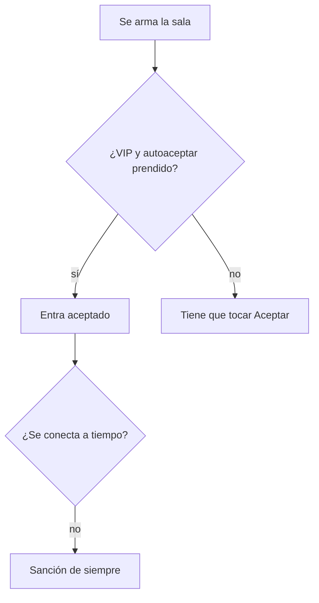

# Autoaceptar partida para VIP: documentación

## Qué es

En Jugar › **Configuración**, los VIP prenden **Autoaceptar partida**. Cuando se arma una sala, la base los marca como aceptados en el mismo momento. Igual suena el aviso, y la ventana "Partida encontrada" dice "la aceptamos por ti (autoaceptar)" con el botón **Aceptada sola**.

## Base: replanteo `89_mm_autoaceptar_vip.sql`

| Objeto | Para qué |
|---|---|
| `user_preferences.preferences.mm_auto_accept` | El interruptor |
| `mm_auto_accept_on(p_user)` | Lo lee, sin mirar el VIP |
| `mm_set_auto_accept(p_on)` | Prenderlo pide VIP (`42501`); apagarlo, no |
| Trigger `mm_lobby_players_auto_accept` (`before insert`) | Si `accepted_at` viene vacío, la sala está en `accepting`, la cuenta tiene el interruptor y es VIP, pone `accepted_at = now()`. No toca los reemplazos (que ya entran aceptados) |
| `mm_my_profile()` | Suma `auto_accept: { enabled, allowed }` (`allowed` = VIP), con `pg_temp.reemplazar` |

Si los diez tienen autoaceptar, `mm_tick` ve a todos aceptados y pasa al veto en su próxima vuelta, como cuando aceptan a mano.

## API

`PUT /api/v1/mm/auto-accept` `{ enabled }`: devuelve el estado completo (`mm_my_state`). Prenderlo sin VIP da `403` con el mensaje de la base.

## Web

| Archivo | Qué tiene |
|---|---|
| `features/matchmaking/types.ts` | `MmState.auto_accept` |
| `features/matchmaking/source.ts` | `setAutoAccept` |
| `features/matchmaking/demo.ts` | El interruptor en la demo; con "Sin VIP" no se puede prender y no se aplica |
| `features/matchmaking/SoundSettings.tsx` | La ventana se llama "Configuración"; `AutoAcceptSetting` arriba y el sonido abajo |
| `features/matchmaking/AcceptDialog.tsx` | `auto`: "la aceptamos por ti" y "Aceptada sola" |
| `PlayPage.tsx`, `MatchAlerts.tsx` | Le pasan `auto` a la ventana |

## Qué cambia para cada rol

- **Jugador VIP:** puede prenderlo. Manual: [`jugador/buscar-partida.md`](../../manual/jugador/buscar-partida.md), sección "Autoaceptar (VIP)".
- **Jugador sin VIP:** ve el interruptor con candado.
- **Los demás roles:** nada nuevo.

## Términos y privacidad

- **Términos, sección 12 (VIP):** suma "autoaceptar las partidas del matchmaking" a las ventajas, y aclara que la sanción por no conectarse es la misma.
- **Privacidad:** "Tus preferencias del matchmaking, como el autoaceptar partida (VIP)" en lo que guardamos.
