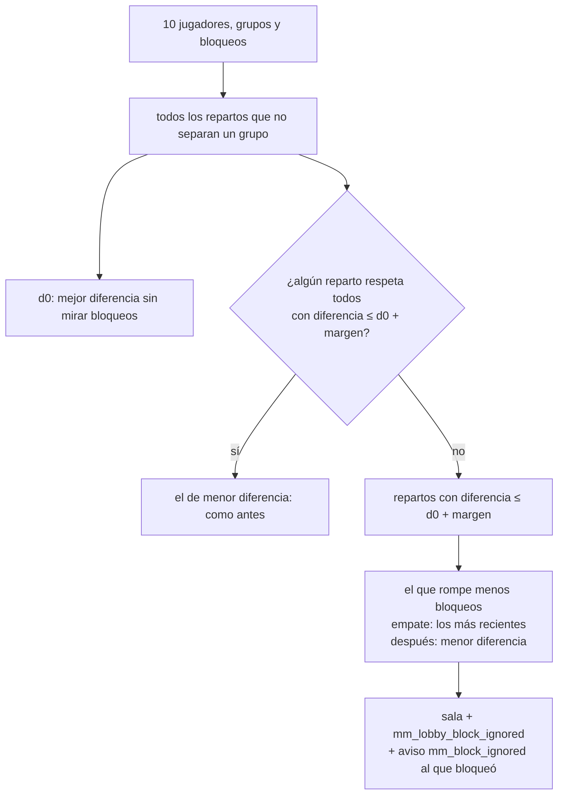

# El bloqueo de los VIP no puede desarmar una partida: documentación

## Qué hace

Un VIP puede bloquear a un jugador para que no le toque en su equipo en el matchmaking. Desde el replanteo `104`, ese bloqueo es una **preferencia**: si respetarlo deja los equipos demasiado desparejos, el armado lo ignora en esa partida y le avisa solo al que bloqueó. Además, cada cuenta puede bloquear a alguien nuevo como mucho 5 veces en 7 días.

Lo plantearon Daniel y Kyan el 2026-11-09 después del mix de mirage (sala `cb04b97c`, #2): con el dúo de kyan y romanxz y tres bloqueos, el único reparto permitido juntaba a los tres jugadores más fuertes (190 de diferencia de ELO de armado contra 20 sin bloqueos).

## El reparto (`mm_best_split_ex`)

1. Recorre todos los repartos posibles (512 con 10 jugadores; el primero siempre en el equipo 1) y descarta los que separan un grupo.
2. Para cada uno guarda la diferencia (suma del ELO de armado, con el ajuste por rating y el ajuste manual de la `96`) y qué bloqueos rompe: los dos jugadores en el mismo equipo.
3. `d0` es la menor diferencia de todos.
4. Entre los que tienen diferencia ≤ `d0 + block_margin` (100), elige el que rompe **menos** bloqueos; si empatan, el que rompe los **más recientes** (cada bloqueo pesa el doble que el siguiente más nuevo); si siguen empatados, el de **menor diferencia**.
5. Devuelve los lados, los pares ignorados (cuenta que bloqueó y cuenta bloqueada), la diferencia y `d0`.

`mm_best_split` devuelve solo los lados, como antes. Tarda lo mismo que la versión anterior (2,4 ms por sala de 10 contra 2,9 ms).

**En la sala del mirage** habría ignorado solo el bloqueo de kyan a kobassj: diferencia 40 (LESCO, Nmz1-, daniloev, shevchenko y slave contra kobassj, kyan, nokushima, romanxz y tam).

## El límite semanal

- `mm_block` deja bloquear a alguien nuevo `block_changes_week` (5) veces en los últimos 7 días (ventana móvil). Volver a bloquear al mismo que ya tenías no gasta un cambio; desbloquear no cuenta.
- Al pasarse: error `V8904` ("Ya cambiaste tu bloqueo 5 veces en los últimos 7 días") con `next_change_at` en el detail. La API lo devuelve como `409 CONFLICT` con `details.next_change_at`.
- `mm_block_changes(user)` devuelve `changes_week`, `changes_left` (null sin límite) y `next_change_at`; `mm_my_profile` lo trae en `blocks.changes`.

## Datos

| Objeto | Qué es |
|---|---|
| `mm_config.block_margin` | Margen en ELO de armado (total), 0 a 2000. 100 por defecto |
| `mm_config.block_changes_week` | Bloqueos nuevos en 7 días, 0 a 50 (0: sin límite). 5 por defecto |
| `mm_block_log` | Bloqueos y desbloqueos (cuenta, ficha, `block`/`unblock`, fecha). `mm_tick` borra lo de más de 90 días. Al aplicar la `104` entran los bloqueos vigentes con su fecha |
| `mm_lobby_block_ignored` | Por sala, quién bloqueó y a qué ficha no se respetó. Se borra con la sala |
| Aviso `mm_block_ignored` | Categoría `elo` ("Mixes y ELO"; la API no conoce la categoría `mm`), con `player` (`id`, `alias`) y `lobby`. Lleva a Jugar |

Ninguna de las dos tablas tiene políticas: solo las leen y escriben las funciones.

## Web

- Jugar › **Bloqueo**: el texto explica la preferencia; "Te quedan N cambios esta semana" o, sin cambios, desde cuándo se libera el próximo (y no se puede agregar).
- **Notificaciones**: "No pudimos respetar tu bloqueo. Para que los equipos quedaran parejos, en esta partida te tocó con *nick*."
- Mi perfil › Notificaciones: la descripción de **Mixes y ELO** suma este aviso.
- Administración › Matchmaking › General, en **Bloqueo de compañeros**: **Margen de ELO de armado** y **Cambios por semana**.

## Qué cambia para cada rol

| Rol | Qué cambia | Página del manual |
|---|---|---|
| Jugador (VIP) | El bloqueo es una preferencia, con aviso cuando no se respeta y 5 cambios por semana | `jugador/amigos.md` (Bloquear), `jugador/notificaciones.md` |
| Admin | Los dos campos nuevos de Bloqueo de compañeros | `admin/matchmaking.md` |
| Capitán, organizador, moderador, streamer, dueño de un servidor externo | Nada | — |

## Términos y privacidad

- **Términos** (`/terminos` y `terms/terminos.html`): en "Mixes, matchmaking y ELO", el bloqueo como preferencia, sin garantía, con el aviso solo al que bloquea, 5 cambios por semana y los grupos que no se separan; en la sección VIP, el bloqueo entre las ventajas de comodidad.
- **Privacidad** (`/privacidad` y `terms/privacidad.html`): el historial de bloqueos (90 días) y los bloqueos que no se respetaron (lo que exista la partida) en los plazos; "a quién bloqueaste en el matchmaking" entre lo que ven solo tú y el staff.

## Dónde está cada cosa

| Qué | Dónde |
|---|---|
| Migración | `supabase/replanteo/104_mm_bloqueo_blando.sql` |
| Inversa | `docs/bitacora/2026-10-14-replanteo-modelo-datos/reversas/104_mm_bloqueo_blando.sql` |
| Pruebas de la base | `pruebas/probar_104.sh` y `pruebas/probar_104.sql` |
| API | `web/backend/src/lib/errors.ts` (`V8904`), `src/lib/manual.ts` (`mm.bloqueo_margen`, `mm.bloqueo_cambios`), `test/unit/errors.test.ts` |
| Web | `features/matchmaking/BlockPanel.tsx`, `types.ts`, `demo.ts`, `admin/GeneralForm.tsx`, `features/shell/notifications/lib/model.ts` (y su prueba), `features/profile/components/NotificationPrefsCard.tsx`, `features/legal/pages/` |
| Manual | `docs/manual/jugador/amigos.md`, `jugador/notificaciones.md`, `admin/matchmaking.md` |
| Legales | `terms/terminos.html`, `terms/privacidad.html` |
| Changelog | `CHANGELOG_DISCORD.txt` (2.9.33) |
