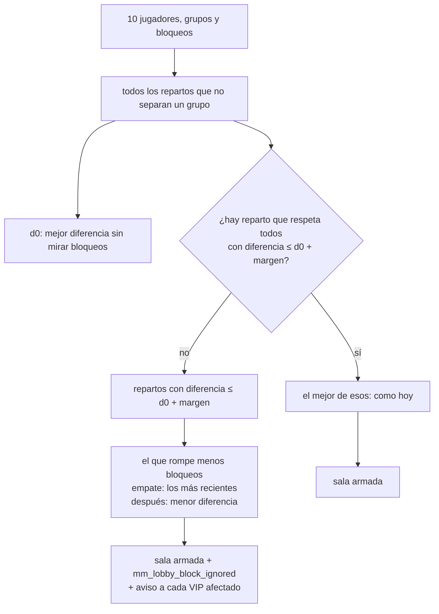

# Plan: el bloqueo de los VIP no puede desarmar una partida

> Planeación original. Estado: **aprobada** por Daniel el 2026-11-09 (margen de 100 e historial de 90 días).

Planteado por Daniel y Kyan el 2026-11-09. Decisiones de Daniel del mismo día: bloqueo "blando" con un margen, ignorar los menos bloqueos posibles, avisar solo al VIP y un límite de 5 cambios por semana.

## El problema

En el mix de mirage del 2026-11-09 (sala `cb04b97c`, #2) jugaron juntos los tres más fuertes (kyan, romanxz y daniloev). No fue un error del armado: con el dúo de kyan y romanxz y los bloqueos (dos VIP bloqueaban a kobassj y uno a shevchenko), **el único reparto permitido era ese**. Con el ELO de armado de esa sala:

| | Mejor reparto | Diferencia (suma del ELO de armado) |
|---|---|---|
| Sin bloqueos | kobassj, kyan, romanxz, shevchenko, tam contra LESCO, Nmz1-, daniloev, nokushima, slave | 20 |
| Con los bloqueos | el que se jugó | 190 |

Hoy el bloqueo (`mm_blocks`, solo VIP, `max_blocks` = 1) es una regla dura de `mm_best_split`: el que bloquea y el bloqueado nunca van en el mismo equipo, cueste lo que cueste. Se puede cambiar sin límite y no queda registro (cuando se revisó el caso, kyan ya tenía otro bloqueado).

Un umbral de probabilidad (por ejemplo 65 %) no habría saltado: para el armado, 190 de diferencia es un 55 % (todos arrancan la temporada en 1000). Por eso se mide **lo que cuesta el bloqueo** y no el porcentaje.

## Decisiones tomadas

| Tema | Decisión | Por qué |
|---|---|---|
| Cuándo se ignora un bloqueo | Si el mejor reparto que respeta todos los bloqueos tiene una diferencia mayor que la del mejor reparto sin bloqueos **más un margen** (`mm_config.block_margin`, **100** de ELO de armado en total) | Mide el daño real del bloqueo. En la sala del mirage: 190 > 20 + 100, se habría ignorado |
| Cuáles se ignoran | **Los menos posibles**: de los repartos dentro del margen, el que rompe menos bloqueos; si empatan, rompe los **más recientes**; si siguen empatados, el de menor diferencia | Daniel, 2026-11-09. El más reciente es el que menos tiempo lleva puesto |
| Grupos | **Un dúo (o grupo) nunca se separa**, como hoy | Daniel, 2026-11-09 |
| Ajuste manual del armado (`96`) | Sigue sumando al ELO de armado, con el que se miden las dos diferencias | Sin cambios |
| Aviso | Solo al VIP cuyo bloqueo no se respetó, al armarse la sala: "Para que los equipos quedaran parejos, en esta partida no pudimos separarte de *nick*". Nada para el bloqueado ni para el resto | Daniel, 2026-11-09 |
| Registro | `mm_lobby_block_ignored` (sala, quién bloqueó, a quién) para revisar casos como el del mirage | Hoy no hay cómo saber qué bloqueos había en una partida |
| Límite de cambios | **5 bloqueos nuevos en los últimos 7 días** por cuenta (`mm_config.block_changes_week`). Desbloquear no cuenta; volver a bloquear (al mismo o a otro) sí | Daniel, 2026-11-09. Ventana móvil: no se "recarga" un día fijo |
| Historial | `mm_block_log` (cuenta, jugador, `block`/`unblock`, fecha), que también sirve para el límite. Se borra a los 90 días (`mm_tick`) | El límite lo necesita, y ayuda a revisar casos |
| Rendimiento | Una sola pasada por los repartos posibles (512 con 10 jugadores), guardando por cada uno la diferencia y qué bloqueos rompe | Sin probar todas las combinaciones de bloqueos |

## 1. El armado

Si ningún reparto queda dentro del margen (no debería pasar: el de `d0` siempre está), se usa el de `d0`.

## 2. Base (replanteo `104_mm_bloqueo_blando.sql`)

- `mm_config.block_margin` (100; 0 a 2000) y `block_changes_week` (5; 0 a 50; 0 = sin límite).
- `mm_best_split` con la regla nueva. Devuelve los lados como hoy; los bloqueos ignorados salen por una función nueva (`mm_best_split_ex`, que devuelve lados y pares ignorados) que usa `mm_try_build`.
- `mm_try_build`: guarda `mm_lobby_block_ignored` y manda el aviso (`mm_block_ignored`, categoría del matchmaking).
- `mm_block`: el límite de 5 en 7 días (error claro con cuándo se libera el próximo) y la fila en `mm_block_log`; `mm_unblock`: la fila en el log.
- `mm_my_profile`: `blocks_left_week` y `blocks_next_at` para la web.
- `mm_tick`: borra `mm_block_log` de más de 90 días.
- `mm_set_config` y `manual_valores()` con los dos valores.
- Inversa con respaldo de las funciones.

## 3. API y web

- API: los dos valores en la configuración del matchmaking; el error del límite como `409` con `details.next_at`; `blocks_left_week` en el perfil.
- Web, panel **Bloqueo** de Jugar: "Te quedan N cambios esta semana" y el error con la fecha. El aviso nuevo en Notificaciones.
- Administración › Matchmaking: los dos campos. En el detalle de una sala, qué bloqueos se ignoraron (si el detalle de la sala ya existe; si no, queda para después).

## 4. Manual, legales y changelog

- `jugador/amigos.md` (sección Bloquear): el bloqueo es una preferencia; si deja los equipos muy desparejos no se respeta y te avisamos; 5 cambios por semana.
- `admin/matchmaking.md`: los dos campos nuevos.
- **Términos** (sección VIP y matchmaking): el bloqueo no es garantía; puede no respetarse para que los equipos queden parejos. Encaja con "el VIP nunca da ventaja dentro de la partida".
- **Privacidad**: el historial de bloqueos (`mm_block_log`) con su plazo de 90 días, y los bloqueos ignorados por sala.
- `CHANGELOG_DISCORD.txt`.

## 5. Pruebas (base local, con rollback)

1. La sala del mirage (sus 10 jugadores, ELO de armado, dúo y los tres bloqueos): se ignora solo el bloqueo de kyan a kobassj y la diferencia queda en 40 (LESCO, Nmz1-, daniloev, shevchenko, slave contra kobassj, kyan, nokushima, romanxz, tam). Calculado aparte el 2026-11-09: es el único reparto dentro del margen que rompe un solo bloqueo.
2. Bloqueos que cuestan menos que el margen: se respetan todos (como hoy).
3. Dos repartos que rompen la misma cantidad: se rompe el bloqueo más reciente.
4. Un dúo nunca se separa, aunque eso obligue a romper más bloqueos.
5. `mm_lobby_block_ignored` y el aviso solo para el VIP que bloqueó.
6. Límite: el 6.º bloqueo en 7 días falla con la fecha; desbloquear no cuenta; a los 7 días se libera.
7. La inversa deja las funciones como estaban.
8. API y web: pruebas, typecheck, lint y el panel en el navegador.

## 6. Orden

1. Aprobación de Daniel (el margen de 100 y los 90 días del historial).
2. Replanteo `104` y pruebas en la base local.
3. API y web en `main`.
4. Despliegue de base, API y web en la misma tanda, sin salas armándose en ese momento.
5. Documentación, manual, legales y commit: la base en `main`, `feat/frontend-fase-1` y `feat/mm-claim-en-sala`; la API y la web en `main`.
