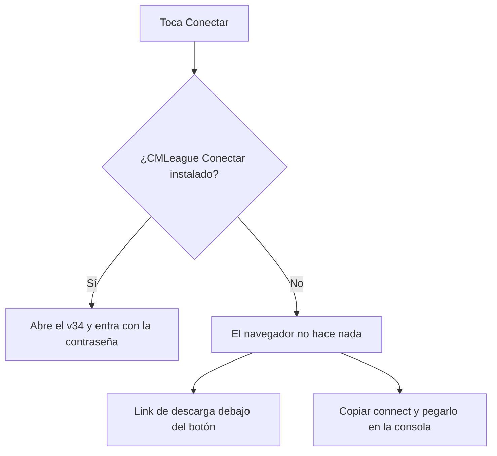

# El botón Conectar abre el v34: documentación

## Qué hace

Los botones que llevan a jugar (**Conectar** de la sala del matchmaking, **Volver a la partida**, **Entrar** de la PCW y **Conectar** de la barra de partida en curso) usan el link `cmleague://connect/<ip:puerto>/<contraseña>`. Lo atiende **CMLeague Conectar** (`hud/conectar/`), que el jugador instala una vez: con el juego abierto escribe `password …; connect …` en la consola, y con el juego cerrado abre el launcher de ClientMod y entra.

Antes usaban `steam://connect/...`, que abre el CS:S de Steam y no el v34, así que no servían. El arreglo se había hecho el 2026-11-03 (`8c0eec0`) y se perdió en un merge; esto lo vuelve a poner y lo suma a la PCW y a la barra.

## Reglas

- La contraseña va codificada en el link. Sin contraseña (barra de partida en curso), el link es `cmleague://connect/<ip:puerto>` y el programa solo conecta.
- CMLeague Conectar solo acepta una IPv4 con puerto y una contraseña `[A-Za-z0-9_-]` de hasta 32 caracteres, así que un link de otra página no puede meter comandos. Una dirección con nombre de host no entra.
- Debajo del botón, "¿No se abre el juego? Instala CMLeague Conectar…" baja `/descargas/cmleague-conectar.zip` (el `.zip` tiene los mismos `conectar.ps1` y `conectar.bat` del repo, comprobado el 2026-11-09).
- No cambian: el SourceTV de los mixes (`tvUrl`, sigue con `steam://`) ni el panel de series (el link lo arma el backend).

## Qué cambia para cada rol

| Rol | Qué cambia | Página del manual |
|---|---|---|
| Jugador | **Conectar** abre el v34 si tiene CMLeague Conectar; link para instalarlo en la sala | [`jugador/buscar-partida.md`](../../manual/jugador/buscar-partida.md) |
| Capitán | **Entrar** de la PCW abre el v34, con el mismo link de descarga | [`capitan/jugar-pcw.md`](../../manual/capitan/jugar-pcw.md) |

## Términos y privacidad

Sin cambios: CMLeague Conectar corre en la PC del jugador, no manda nada a ningún lado y la web no guarda datos nuevos.

## Dónde está cada cosa

| Qué | Archivo |
|---|---|
| Link y descarga | `web/frontend/src/features/matchmaking/labels.ts` |
| Texto de ayuda | `web/frontend/src/features/matchmaking/ConectarHint.tsx` |
| Botones | `matchmaking/room/RoomOverview.tsx`, `matchmaking/ReconnectBanner.tsx`, `pcw/components/SeriesPanel.tsx`, `shell/components/NowBar.tsx` |
| Programa | `hud/conectar/conectar.ps1`, `hud/conectar/conectar.bat` |
| Descarga | `web/frontend/public/descargas/cmleague-conectar.zip` |
