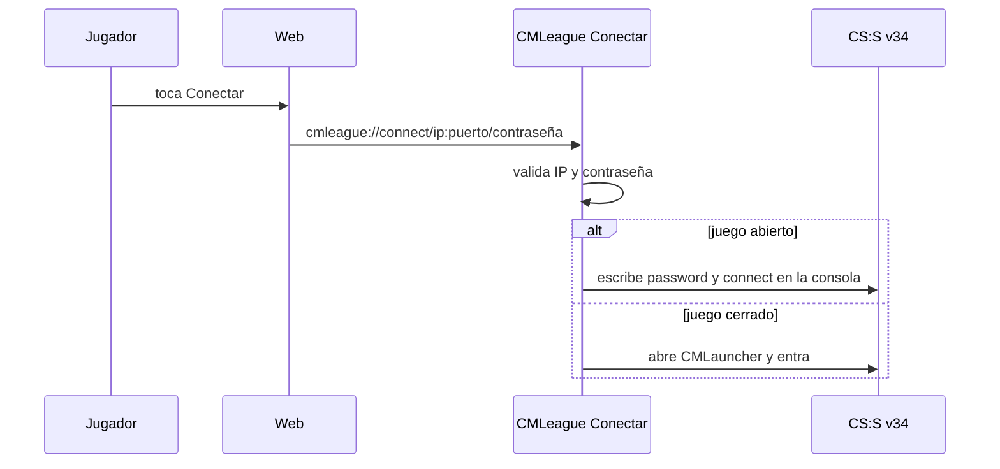

# Plan: el botón Conectar abre el v34

> Planeación original, aprobada por Kyan el 2026-11-09 ("Sí, ponelo").

## Decisiones tomadas

| Tema | Decisión | Por qué |
|---|---|---|
| Link | `cmleague://connect/<ip:puerto>/<contraseña>` en vez de `steam://connect/...` | `steam://` abre el CS:S de Steam, no el v34 de ClientMod que usan los jugadores |
| Programa | CMLeague Conectar (`hud/conectar/`, hecho el 2026-11-03 en `8c0eec0`), sin cambios | Ya existía y se descarga desde `web/frontend/public/descargas/cmleague-conectar.zip`; la web lo dejó de usar en un merge |
| Botones | Sala del matchmaking, "Volver a la partida", "Entrar" de la PCW y "Conectar" de la barra de partida en curso | Son los que conectan a jugar. El SourceTV (mixes) y el panel de series (link que arma el backend) quedan como están |
| Sin el programa | Texto debajo del botón con la descarga, y el botón de copiar `connect …; password …` a la vista | Sin el programa, el navegador no sabe abrir `cmleague://` |
| Rama | `kyan/pruebas`; Daniel lo pasa a `feat/frontend-fase-1` | La web del matchmaking va en su rama y no se toca sin permiso |

## 1. El flujo

## 2. Web

- `labels.ts`: `cmleagueConnectUrl(address, password?)` y `CONECTAR_DESCARGA`, en lugar de `steamConnectUrl`.
- `ConectarHint`: texto con el link de descarga, en la sala y en la PCW.
- Pruebas de `labels` y de la sala.

## 3. Orden

1. Web y pruebas. 2. Probar en `/demo/matchmaking`. 3. Manual del jugador y del capitán. 4. Bitácora.
