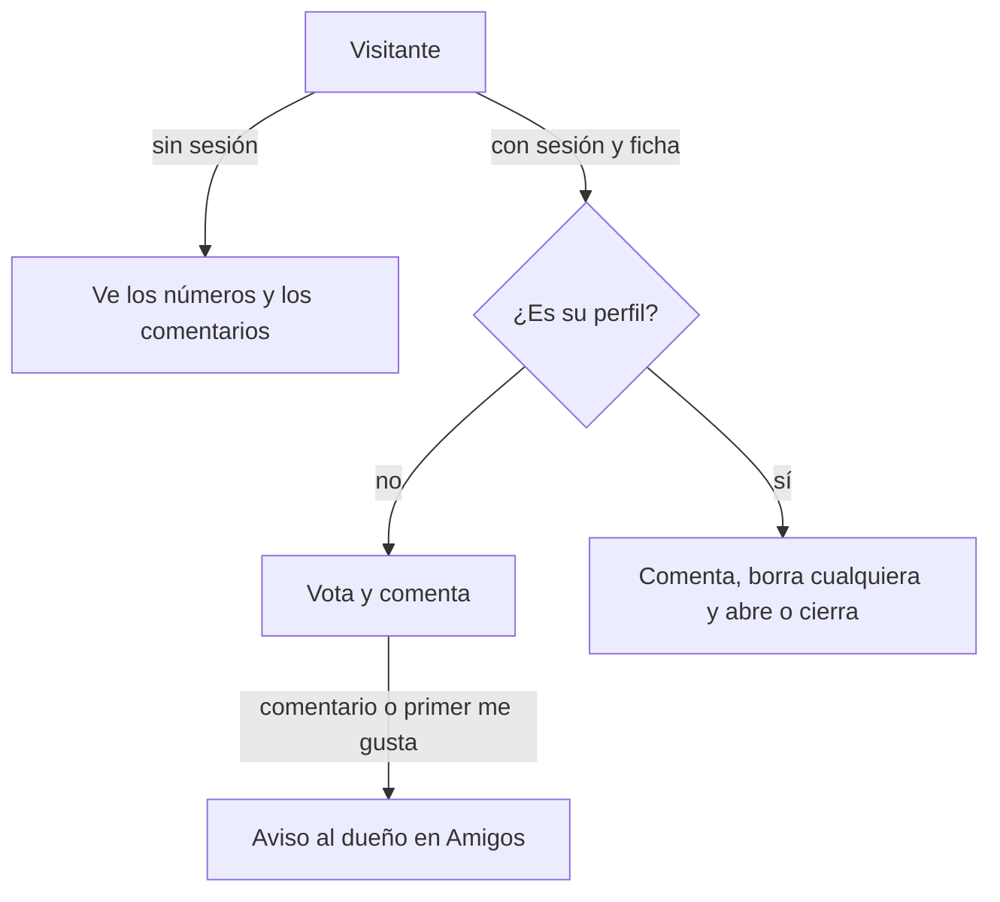

# Comentarios y me gusta en los perfiles: documentación

## Qué es

En cada perfil público hay:

- **Votos:** 👍 y 👎, cada uno con su número, arriba a la derecha del encabezado.
- **Pestaña Comentarios:** al lado de "Bio y torneos", con el total de comentarios.

## Reglas (las aplica la base)

| Regla | Valor |
|---|---|
| Votos | Uno por cuenta y perfil. `1`, `-1` o `0` (sacarlo). No el perfil propio |
| Largo del comentario | 1 a 280 caracteres (se recortan los espacios de los bordes) |
| Tope | 30 segundos entre comentarios y 30 por día (hora de Bogotá) por cuenta, contando los borrados |
| Quién borra | El autor, el dueño del perfil, moderadores y admins. Borrado lógico |
| Cerrados | `user_preferences.preferences.profile_comments = false`: no se ven ni se dejan; los votos siguen |
| Fichas sin cuenta | Sin muro: no se vota ni se comenta |
| Página | 20 comentarios, los más nuevos primero; "Ver más" pide los anteriores con `before` |

## Base: replanteo `91_comentarios_y_votos_perfil.sql`

| Objeto | Para qué |
|---|---|
| `profile_votes (player_id, voter, value, voted_at)` | Un voto por cuenta y perfil |
| `profile_comments (id, player_id, author, body, created_at, deleted_at, deleted_by)` | Los comentarios; índice parcial de los visibles |
| `profile_comments_open(p_player)` | Si el dueño los deja abiertos (por defecto, sí) |
| `profile_wall(p_player, p_before)` | `likes`, `dislikes`, `my_vote`, `can_vote`, `is_owner`, `comments_open`, `can_comment`, `total` e `items`. También para `anon` |
| `profile_vote(p_player, p_value)` | Vota, cambia o saca. Avisa el primer me gusta de cada cuenta |
| `profile_comment_add(p_player, p_body)` | Comenta y avisa al dueño |
| `profile_comment_delete(p_id)` | Borra |
| `profile_comments_set(p_open)` | Abre o cierra los del perfil propio |

Cada comentario trae al autor con `nick`, `photo_url`, `level` y `verified` (la insignia de la 90), más `mine` y `can_delete`.

**Errores:** los de reglas van con `P0001` (la API devuelve `400` con el mensaje de la base) y los de permiso con `42501` (`403`).

### Notificaciones

| Tipo | A quién | `data` | `ref` |
|---|---|---|---|
| `profile_comment` | El dueño, si comentó otro | `player`, `profile`, `comment` (100 caracteres) | `profile_comment:{id}` |
| `profile_like` | El dueño, la primera vez que cada cuenta da me gusta | `player`, `profile` | `profile_like:{perfil}:{cuenta}` |

Las dos van en la categoría `friends`: se apagan con "Amigos" en las preferencias. Volver a dar me gusta no avisa de nuevo, porque el `ref` ya existe. El no me gusta no avisa.

## API (`web/backend/src/routes/community.ts`)

| Método y ruta | Sesión | Respuesta |
|---|---|---|
| `GET /api/v1/players/{id}/wall?before=` | Opcional | `ProfileWall` |
| `PUT /api/v1/players/{id}/vote` `{ value }` | Sí | `ProfileWall` |
| `POST /api/v1/players/{id}/comments` `{ body }` | Sí | `ProfileWall` |
| `DELETE /api/v1/profile-comments/{id}` | Sí | `204` |
| `PUT /api/v1/me/profile-comments` `{ open }` | Sí | `204` |

`{id}` es el id de la ficha (no el nick).

## Web

| Archivo | Qué tiene |
|---|---|
| `features/player/components/ProfileWall.tsx` | `WallVotes` y `WallComments` (reciben datos y acciones), `ProfileVotes` y `ProfileWall` (con la API), `wallOptions` y `useWallActions` |
| `features/player/pages/PlayerProfile.tsx` | Los votos en el encabezado |
| `features/player/components/PlayerTabs.tsx`, `lib/search.ts` | La pestaña `comentarios` (`?tab=comentarios`) con el total |
| `features/shell/notifications/lib/model.ts` | Los dos avisos; el del comentario lleva a la pestaña Comentarios propia |
| `features/profile/components/NotificationPrefsCard.tsx` | La descripción de "Amigos" los nombra |
| `routes/demo.perfil-social.tsx` | Demo sin API: votos, comentarios, dueño, sin sesión, moderador e insignia |

## Qué cambia para cada rol

- **Jugador:** vota y comenta perfiles ajenos; en el suyo, comenta, borra cualquier comentario y los abre o cierra. Recibe los avisos en Amigos. Manual: [`jugador/comentarios-en-el-perfil.md`](../../manual/jugador/comentarios-en-el-perfil.md).
- **Moderador y admin:** borran cualquier comentario. Manual: [`moderador/borrar-comentarios.md`](../../manual/moderador/borrar-comentarios.md).
- **Sin sesión:** ve los números y los comentarios.
- Organizador, capitán, streamer y dueño de un servidor externo: como un jugador.

## Términos y privacidad

- **Términos, sección 10 (Lo que subes y publicas):** los comentarios son públicos y siguen las reglas de conducta; quién los borra; los votos se ven como números.
- **Privacidad:**
  - Qué guardamos: los comentarios y los votos.
  - Quién ve qué: los comentarios los ve cualquiera, y nadie ve cómo votó otro.
  - Los borrados se guardan con quién los borró.
  - Plazo: mientras exista la cuenta.

Va en la web (`TermsPage`, `PrivacyPage`) y en `terms/terminos.html` y `privacidad.html`, sin la marca de "En preparación": queda listo al aplicar la 91.
